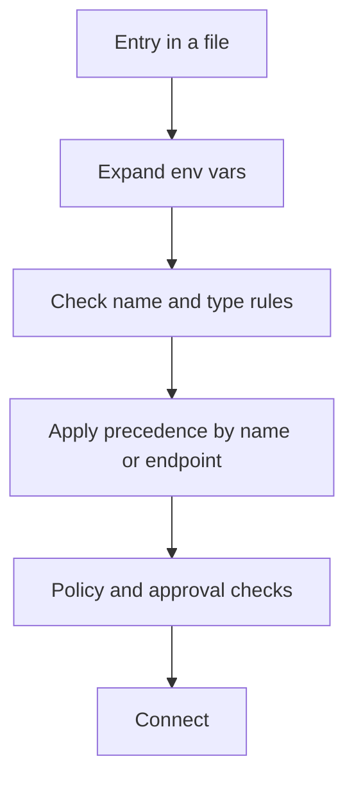

# Server Configuration


An MCP server is a program that gives Claude new tools.
You write its config in `.mcp.json` or in `~/.claude.json`.
Each transport takes its own options, and values can use `${VAR}` expansion.
For example, `{ "mcpServers": { "files": { "command": "bunx", "args": ["server"] } } }` starts a local server.

Edit the file, or use `claude mcp add` and `add-json`. To turn a server off, remove the entry or use `/mcp`. See [MCP Settings and Policy](https://xsyetopz.github.io/claude-code-docs/extend/mcp/settings.md). Servers live in `.mcp.json`, `~/.claude.json`, a plugin `.mcp.json`, or `mcpServers` in `plugin.json`.

## File Shape

`.mcp.json` holds one object, `mcpServers`, that maps a server name to an entry.
`~/.claude.json` uses the same entry shape under `mcpServers` (user scope) and under `projects["<path>"].mcpServers` (local scope).
A plugin can use the same shape in its `.mcp.json` or inline in `plugin.json`.

```json title=".mcp.json"
{
  "mcpServers": {
    "name": { "type": "http", "url": "https://example.com/mcp" }
  }
}
```

## Server Options

Source: [Connect Claude Code to Tools via MCP](https://code.claude.com/docs/en/mcp) for rows marked [Documented]. For the others, the program (its server schema).

| Option | Status | What It Does | How It Works | Used By |
| --- | --- | --- | --- | --- |
| `type` | [Documented] | Picks the transport. | `stdio`, `sse`, `http`, `ws`. `streamable-http` is an alias of `http`. No `type` means `stdio`, so a `url` without `type` is an error and Claude Code skips the entry. | All |
| `command` | [Documented] | The program to run. | Required, at least one character. `${VAR}` is expanded. | `stdio` |
| `args` | [Documented] | Arguments for the program. | Array of strings. Default `[]`. `${VAR}` is expanded. | `stdio` |
| `env` | [Documented] | Env vars for the process. | Map of strings. `${VAR}` is expanded. | `stdio` |
| `url` | [Documented] | The endpoint. | `${VAR}` is expanded. An empty `url` shows as `not configured` and does not connect. | `http`, `sse`, `ws` |
| `headers` | [Documented] | Static request headers. | Map of strings. `${VAR}` is expanded. Credential variables read as empty here. | `http`, `sse`, `ws` |
| `headersHelper` | [Documented] | A command that prints headers. | Runs in a shell on each connect. The output is a JSON object. See [MCP Authentication](https://xsyetopz.github.io/claude-code-docs/extend/mcp/auth.md#headershelper). | `http`, `sse`, `ws` |
| `oauth` | [Documented] | OAuth client settings. | Object with `clientId`, `callbackPort`, `authServerMetadataUrl`, `scopes`. See [MCP Authentication](https://xsyetopz.github.io/claude-code-docs/extend/mcp/auth.md#oauth-options). | `http`, `sse` |
| `timeout` | [Documented] | Wall-clock limit of one tool call, in ms. | A positive integer. A value below 1000 is ignored. It overrides `MCP_TOOL_TIMEOUT` for this server. It is a floor for the idle timeout. | All |
| `alwaysLoad` | [Documented] | Skips tool search deferral. | `true` loads all tools upfront and makes startup wait for the server (5 s cap). `false` defers all tools, even those the author marked (`2.1.287` and later). In cloud sessions, a new conversation's first turn does not wait for local (stdio) servers of plugins synced from claude.ai unless the server sets `alwaysLoad: true` (since 2.1.304). | All |
| `role` | [Documented] | Sets the coordinator-mode role. | Only `"comms"`. It marks the server the coordinator uses to talk to the user. | `stdio`, `sse`, `http`, `ws`, IDE types |
| `tools` | [Documented] | A per-tool policy list. | Array of `{ name, permission_policy }`. The policy is `always_allow`, `always_ask`, or `always_deny`. A host sets it with `mcp_set_servers`. | `sse`, `http`, `sdk` |
| `name` | [Documented] | Names the in-process server. | A string. | `sdk` |
| `id`, `displayName`, `iconUrl`, `stateless`, `enterpriseManaged` | [Documented] | Describe a connector row in `/mcp`. | `id` must match `[A-Za-z0-9_-]+`. | `claudeai-proxy` |
| `bareElicitationCapability` | [Undocumented] | Declares a bare `elicitation` capability. | When `true`, Claude Code sends `elicitation: {}` instead of the form and url capability. | `stdio`, `sse`, `http`, `ws` |
| `discoveryCache` | [Undocumented] | Per-server switch of the discovery cache. | Boolean. Claude Code removes it from the shown config. | `sse`, `http` |
| `request_timeout_ms` | [Undocumented] | A wire hint for a per-request timeout. | Folded into `timeout` at parse time when `timeout` is missing. Capped at 300000. | `sse`, `http` |
| `toolPermissions` | [Undocumented] | A per-tool policy map. | Tool name to `allow`, `ask`, or `blocked`. `ask` prompts on each call. `blocked` hides the tool. | `sse`, `http`, `claudeai-proxy` |
| `disableAutoBackground` | [Undocumented] | Never moves calls to the background. | `true` keeps the call in the foreground. Read when the server is first registered. | `sdk` |
| `ideName`, `ideRunningInWindows`, `authToken` | [Undocumented] | Data of an IDE server. | `authToken` exists only on `ws-ide`. | `sse-ide`, `ws-ide` |
| `cachedInitResponse`, `cachedDiscoverResponse`, `discoverSupport`, `eligible`, `ineligibleReason` | [Undocumented] | Cached connector data. | `discoverSupport` is `supported`, `legacy`, or `unknown`. Claude Code removes these from the shown config. | `claudeai-proxy` |

## Env Var Expansion

Values in `command`, `args`, `env`, `url`, and `headers` can read env vars.

| Form | Status | What It Does | How It Works |
| --- | --- | --- | --- |
| `${VAR}` | [Documented] | Inserts the value of an env var. | If `VAR` is not set and has no default, the text `${VAR}` stays and `claude mcp list` and `/mcp` show a warning. |
| `${VAR:-default}` | [Documented] | Inserts the value, or the default. | Uses `default` when `VAR` is not set. |
| Credential names read as empty | [Documented] | Protects your credentials. | In a remote `url` and `headers`, names such as `ANTHROPIC_API_KEY`, `ANTHROPIC_AUTH_TOKEN`, `AWS_BEARER_TOKEN_BEDROCK`, `HTTPS_PROXY`, and `NPM_TOKEN` read as empty. A default is ignored. |
| `${CLAUDE_PROJECT_DIR}` | [Documented] | The project root. | In `.mcp.json` and `~/.claude.json`, write `${CLAUDE_PROJECT_DIR:-.}`. A plugin config substitutes it directly. Works in `command` and `args`. |
| `${CLAUDE_PLUGIN_ROOT}`, `${CLAUDE_PLUGIN_DATA}` | [Documented] | Plugin paths. | Replaced in `command`, `args`, `env` (stdio) and `url`, `headers`, `headersHelper` (remote). Plugin servers only. |
| `${user_config.KEY}` | [Documented] | A plugin option value. | Allowed in `env` and `headers`. Not allowed in `headersHelper`, because it is a shell command. |
| Hidden whitespace warning | [Documented] | Finds pasted newlines. | Checks `command`, `url`, each `args` entry, and the values and key names of `env` and `headers`. Values stay unchanged. |

## Names

| Rule | Status | What It Does | How It Works |
| --- | --- | --- | --- |
| Server name characters | [Documented] | Limits the name. | Letters, numbers, hyphens, and underscores. |
| Blocked names | [Undocumented] | Rejects unsafe keys. | The program also rejects `constructor`, `prototype`, `__proto__`, `__defineGetter__`, `__defineSetter__`, `__lookupGetter__`, `__lookupSetter__`. |
| Reserved names | [Documented] | Protects built-in servers. | `workspace`, `claude-in-chrome`, `computer-use`, `Claude Preview`, `Claude Browser`. Claude Code skips such a server and warns. |
| `anthropic-skills` | [Documented] | A reserved prompt source. | Prompts of a server with this name are not listed. Its tools still work. |

## Precedence

- Claude Code uses the highest source for a name. It does not merge fields.
- The order, highest first, is managed, local, project, user, plugin, claude.ai connector.
- Scopes match by name. Plugins and connectors match by endpoint.
- Two URLs are the same endpoint when they differ only in scheme or host case, a default port, or a trailing slash.
- The same name with different endpoints in two scopes gives a warning. OAuth sign-ins are stored for each endpoint.
- Since `2.1.305`, a server passed by a cloud session or by the SDK's `setMcpServers` is no longer replaced later in the session by a same-named server from your own settings ([v2.1.305 release](https://github.com/anthropics/claude-code/releases/tag/v2.1.305)).

## Example

```json title=".mcp.json"
{
  "mcpServers": {
    "github": {
      "type": "http",
      "url": "https://api.example.com/mcp",
      "headers": { "X-Team": "${TEAM_ID:-platform}" },
      "timeout": 120000
    },
    "files": {
      "command": "bunx",
      "args": ["@example/files-server", "${CLAUDE_PROJECT_DIR:-.}"],
      "env": { "LOG_LEVEL": "info" },
      "alwaysLoad": true
    }
  }
}
```

## How It Works



## Related Pages

- [MCP](https://xsyetopz.github.io/claude-code-docs/extend/mcp.md)
- [MCP Commands](https://xsyetopz.github.io/claude-code-docs/extend/mcp/cli.md) for `claude mcp add` and `add-json`
- [MCP Settings and Policy](https://xsyetopz.github.io/claude-code-docs/extend/mcp/settings.md)
- [Plugin Manifest](https://xsyetopz.github.io/claude-code-docs/extend/plugins/manifest.md) for `mcpServers` in a plugin
