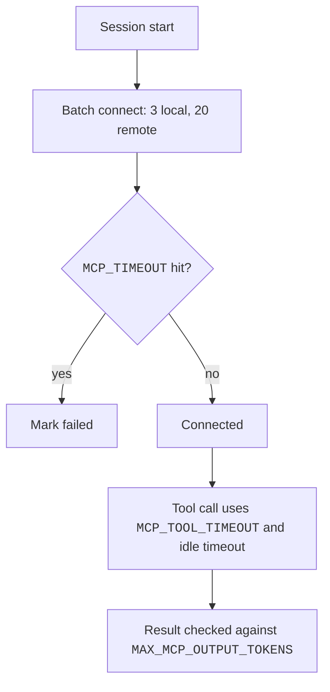

# MCP Env Vars


These env vars change how Claude Code starts, times out, and limits MCP servers.
Set them in the shell or in the `env` key of a settings file.
For example, `MCP_TIMEOUT=30000` gives a server 30 seconds to start.

Export the variable, or add it to `env` in a settings file. Some are switches, such as `ENABLE_CLAUDEAI_MCP_SERVERS` and `MCP_CONNECTION_NONBLOCKING`.

## Documented Variables

Each name links to its row on the env var pages, which hold the status, the values, the defaults, and the notes.
Source: [Connect Claude Code to Tools via MCP](https://code.claude.com/docs/en/mcp), [Environment Variables](https://code.claude.com/docs/en/env-vars), and [Settings Reference](https://code.claude.com/docs/en/settings-reference).
All env vars of Claude Code are listed on [Plugin and MCP Env Vars](https://xsyetopz.github.io/claude-code-docs/configure/env-vars/plugins-and-mcp.md) and the other env var pages.

- [`MCP_TIMEOUT`](https://xsyetopz.github.io/claude-code-docs/configure/env-vars/plugins-and-mcp.md#variables): Startup timeout of one server.
- [`MCP_TOOL_TIMEOUT`](https://xsyetopz.github.io/claude-code-docs/configure/env-vars/plugins-and-mcp.md#variables): Timeout of one tool call.
- [`CLAUDE_CODE_MCP_TOOL_IDLE_TIMEOUT`](https://xsyetopz.github.io/claude-code-docs/configure/env-vars/plugins-and-mcp.md#variables): Idle timeout of a call.
- [`MCP_CONNECT_TIMEOUT_MS`](https://xsyetopz.github.io/claude-code-docs/configure/env-vars/plugins-and-mcp.md#variables): Wait during blocking startup.
- [`MCP_CONNECTION_NONBLOCKING`](https://xsyetopz.github.io/claude-code-docs/configure/env-vars/plugins-and-mcp.md#variables): Sets whether startup waits for servers.
- [`MCP_SERVER_CONNECTION_BATCH_SIZE`](https://xsyetopz.github.io/claude-code-docs/configure/env-vars/plugins-and-mcp.md#variables): Sets how many local servers connect at once.
- [`MCP_REMOTE_SERVER_CONNECTION_BATCH_SIZE`](https://xsyetopz.github.io/claude-code-docs/configure/env-vars/plugins-and-mcp.md#variables): Sets how many remote servers connect at once.
- [`CLAUDE_CODE_MCP_STARTUP_WAIT_MS`](https://xsyetopz.github.io/claude-code-docs/configure/env-vars/plugins-and-mcp.md#variables): Sets the first-turn wait in non-interactive mode.
- [`MAX_MCP_OUTPUT_TOKENS`](https://xsyetopz.github.io/claude-code-docs/configure/env-vars/context-and-compaction.md#variables): Token limit of a result.
- [`CLAUDE_CODE_MAX_MCP_DESCRIPTION_LENGTH`](https://xsyetopz.github.io/claude-code-docs/configure/env-vars/plugins-and-mcp.md#variables): Length limit of descriptions and instructions.
- [`CLAUDE_CODE_MCP_AUTO_BACKGROUND_MS`](https://xsyetopz.github.io/claude-code-docs/configure/env-vars/plugins-and-mcp.md#variables): Delay before a call moves to the background.
- [`CLAUDE_CODE_DISABLE_BACKGROUND_TASKS`](https://xsyetopz.github.io/claude-code-docs/configure/env-vars/agents-and-teams.md#variables): Turns off all background tasks.
- [`CLAUDE_AUTO_BACKGROUND_TASKS`](https://xsyetopz.github.io/claude-code-docs/configure/env-vars/agents-and-teams.md#variables): Allows auto background in `-p`.
- [`CLAUDE_CODE_MCP_ALLOWLIST_ENV`](https://xsyetopz.github.io/claude-code-docs/configure/env-vars/plugins-and-mcp.md#variables): Gives stdio servers a minimal env.
- [`ENABLE_TOOL_SEARCH`](https://xsyetopz.github.io/claude-code-docs/configure/env-vars/tools-and-bash.md#variables): Sets the tool search mode. See [MCP Runtime](https://xsyetopz.github.io/claude-code-docs/extend/mcp/runtime.md#timing-and-recovery).
- [`CLAUDE_CODE_DISABLE_EXPERIMENTAL_BETAS`](https://xsyetopz.github.io/claude-code-docs/configure/env-vars/models-and-effort.md#variables): Strips beta fields.
- [`ENABLE_CLAUDEAI_MCP_SERVERS`](https://xsyetopz.github.io/claude-code-docs/configure/env-vars/plugins-and-mcp.md#variables): Controls the fetch of connectors.
- [`MCP_DISCOVERY_CACHE`](https://xsyetopz.github.io/claude-code-docs/configure/env-vars/plugins-and-mcp.md#variables): Turns the discovery cache on or off.
- [`MCP_DISCOVERY_CACHE_TTL_S`](https://xsyetopz.github.io/claude-code-docs/configure/env-vars/plugins-and-mcp.md#variables): Sets entry age without a refresh.
- [`MCP_DISCOVERY_CACHE_MAX_STALE_S`](https://xsyetopz.github.io/claude-code-docs/configure/env-vars/plugins-and-mcp.md#variables): Sets the maximum entry age.
- [`MCP_DISCOVERY_CACHE_STRIKES`](https://xsyetopz.github.io/claude-code-docs/configure/env-vars/plugins-and-mcp.md#variables): Sets failed refreshes before an entry is discarded.
- [`MCP_SDK_GENERATION`](https://xsyetopz.github.io/claude-code-docs/configure/env-vars/plugins-and-mcp.md#variables): Pins the client runtime.
- [`MCP_PROTOCOL_NEGOTIATION`](https://xsyetopz.github.io/claude-code-docs/configure/env-vars/plugins-and-mcp.md#variables): Probes for revision 2026-07-28.
- [`MCP_CLIENT_SECRET`](https://xsyetopz.github.io/claude-code-docs/configure/env-vars/auth-and-accounts.md#variables): Gives the OAuth client secret.
- [`MCP_OAUTH_CALLBACK_PORT`](https://xsyetopz.github.io/claude-code-docs/configure/env-vars/auth-and-accounts.md#variables): Fixes the OAuth callback port.
- [`CLAUDE_AGENT_SDK_MCP_NO_PREFIX`](https://xsyetopz.github.io/claude-code-docs/configure/env-vars/plugins-and-mcp.md#variables): Drops the name prefix.
- [`CLAUDE_CODE_REMOTE_MCP_CONFIG`](https://xsyetopz.github.io/claude-code-docs/configure/env-vars/remote-and-cloud-sessions.md#variables): Gives the path of the delivered server file.

## Variables Claude Code Sets for Servers

Claude Code puts these in the env of a stdio server or a `headersHelper`.

- [`CLAUDE_PROJECT_DIR`](https://xsyetopz.github.io/claude-code-docs/configure/env-vars/plugins-and-mcp.md#variables): Gives the project root.
- [`CLAUDE_CODE_SESSION_ID`](https://xsyetopz.github.io/claude-code-docs/configure/env-vars/sessions-and-storage.md#variables), [`CLAUDECODE`](https://xsyetopz.github.io/claude-code-docs/configure/env-vars/tools-and-bash.md#variables): Mark the session.
- [`CLAUDE_CODE_SUBPROCESS_ENV_SCRUB`](https://xsyetopz.github.io/claude-code-docs/configure/env-vars/tools-and-bash.md#variables): Strips credentials.
- [`CLAUDE_CODE_MCP_SERVER_NAME`](https://xsyetopz.github.io/claude-code-docs/configure/env-vars/plugins-and-mcp.md#variables), [`CLAUDE_CODE_MCP_SERVER_URL`](https://xsyetopz.github.io/claude-code-docs/configure/env-vars/plugins-and-mcp.md#variables): Tell a `headersHelper` the server.

## Undocumented Variables

Only the program shows these. They can change without notice.

- [`ENABLE_MCP_LARGE_OUTPUT_FILES`](https://xsyetopz.github.io/claude-code-docs/configure/env-vars/plugins-and-mcp.md#variables): Switch for result files.
- [`CLAUDE_CODE_MCP_APPS_HOST`](https://xsyetopz.github.io/claude-code-docs/configure/env-vars/plugins-and-mcp.md#variables): Declares MCP Apps support.
- [`CLAUDE_CODE_SKIP_PLUGIN_LOCAL_MCP_SERVERS`](https://xsyetopz.github.io/claude-code-docs/configure/env-vars/plugins-and-mcp.md#variables): Skips local plugin servers.
- [`CLAUDE_CODE_SKIP_PLUGIN_MCP_BUNDLES`](https://xsyetopz.github.io/claude-code-docs/configure/env-vars/plugins-and-mcp.md#variables): Skips MCPB sources of plugins.
- [`CLAUDE_CODE_SKIP_PLUGIN_MCP_SERVERS`](https://xsyetopz.github.io/claude-code-docs/configure/env-vars/plugins-and-mcp.md#variables): Skips plugin servers.
- [`CLAUDE_CODE_SKIP_PLUGIN_MCP_SERVERS_EXCEPT`](https://xsyetopz.github.io/claude-code-docs/configure/env-vars/plugins-and-mcp.md#variables): Exempts plugin servers from the skip.
- [`CLAUDE_CODE_ENABLE_REFRESH_MCP_TOOLS`](https://xsyetopz.github.io/claude-code-docs/configure/env-vars/plugins-and-mcp.md#variables): Adds a refresh tool.
- [`MCP_TRUNCATION_PROMPT_OVERRIDE`](https://xsyetopz.github.io/claude-code-docs/configure/env-vars/plugins-and-mcp.md#variables): Picks the truncation prompt.
- [`MCP_OAUTH_CLIENT_METADATA_URL`](https://xsyetopz.github.io/claude-code-docs/configure/env-vars/auth-and-accounts.md#variables): Overrides the CIMD URL.
- [`CLAUDE_CODE_SYNC_PLUGINS_MCP_TIMEOUT_MS`](https://xsyetopz.github.io/claude-code-docs/configure/env-vars/plugins-and-mcp.md#variables): Timeout of the plugin MCP sync.
- [`CLAUDE_CODE_MCP_CONNECTOR_PREWAIT_MS`](https://xsyetopz.github.io/claude-code-docs/configure/env-vars/plugins-and-mcp.md#variables): First-turn wait for connectors.
- [`CLAUDE_CODE_MCP_PREWAIT_SERVERS`](https://xsyetopz.github.io/claude-code-docs/configure/env-vars/plugins-and-mcp.md#variables), [`CLAUDE_CODE_MCP_PREWAIT_SERVERS_MS`](https://xsyetopz.github.io/claude-code-docs/configure/env-vars/plugins-and-mcp.md#variables): Name servers to wait for.
- [`CLAUDE_CODE_MCP_MEMORY_CGROUP`](https://xsyetopz.github.io/claude-code-docs/configure/env-vars/plugins-and-mcp.md#variables): Sets the memory cap class of MCP processes.
- [`CLAUDE_CODE_TERMINAL_MCP_TOOLS`](https://xsyetopz.github.io/claude-code-docs/configure/env-vars/plugins-and-mcp.md#variables): Lists MCP tool names.
- [`CLAUDE_AGENT_SDK_DISABLE_MCP_MANIFESTS`](https://xsyetopz.github.io/claude-code-docs/configure/env-vars/plugins-and-mcp.md#variables): Stops SDK manifest capture.
- [`CLAUDE_CODE_BRIDGE_MCP_CARRIER`](https://xsyetopz.github.io/claude-code-docs/configure/env-vars/remote-and-cloud-sessions.md#variables): Marks a bridge MCP carrier.
- [`CLAUDE_CODE_ENABLE_XAA`](https://xsyetopz.github.io/claude-code-docs/configure/env-vars/auth-and-accounts.md#variables): Turns XAA on. See [MCP Authentication](https://xsyetopz.github.io/claude-code-docs/extend/mcp/auth.md#xaa).
- [`MCP_XAA_IDP_CLIENT_SECRET`](https://xsyetopz.github.io/claude-code-docs/configure/env-vars/auth-and-accounts.md#variables): Gives the IdP client secret for XAA.

## Example

```bash title="Slow server, big results, no connector fetch"
export MCP_TIMEOUT=60000
export MCP_TOOL_TIMEOUT=300000
export MAX_MCP_OUTPUT_TOKENS=50000
export ENABLE_CLAUDEAI_MCP_SERVERS=false
claude
```

```json title="The same in settings"
{ "env": { "MCP_TIMEOUT": "60000", "MAX_MCP_OUTPUT_TOKENS": "50000" } }
```

## How It Works



## Related Pages

- [MCP Runtime](https://xsyetopz.github.io/claude-code-docs/extend/mcp/runtime.md)
- [MCP Authentication](https://xsyetopz.github.io/claude-code-docs/extend/mcp/auth.md)
- [Plugin Loading](https://xsyetopz.github.io/claude-code-docs/extend/plugins/loading.md#env-vars) for plugin env vars
