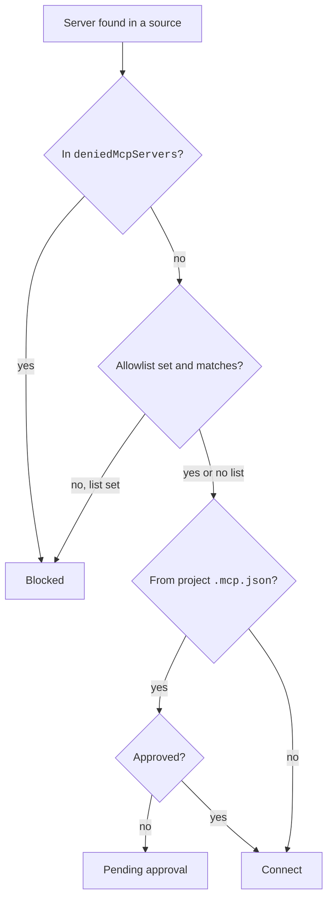

# MCP Settings and Policy


These settings decide which MCP servers may run and which ones a project may use.
Administrators use them for allow lists and deny lists.
For example, `{ "enableAllProjectMcpServers": true }` approves every server in a project `.mcp.json` file.

Most keys also work in your own settings. They live in settings files, `~/.claude.json`, `.mcp.json`, and `managed-mcp.json`. The switches are `disabledMcpjsonServers`, `enableAllProjectMcpServers`, `deniedMcpServers`, `--strict-mcp-config`, and `disableClaudeAiConnectors`.

## Settings Keys

Source: [Connect Claude Code to Tools via MCP](https://code.claude.com/docs/en/mcp), [Control MCP Server Access for Your Organization](https://code.claude.com/docs/en/managed-mcp), [Settings Reference](https://code.claude.com/docs/en/settings-reference), and [Channels Reference](https://code.claude.com/docs/en/channels-reference).

These keys sit in the settings files. Each key has one row, with its type, what it does, and where to set it, on [MCP and Channels Settings](https://xsyetopz.github.io/claude-code-docs/configure/settings/mcp-and-channels.md#keys).

- Approve or reject servers from a project `.mcp.json`: [`enableAllProjectMcpServers`](https://xsyetopz.github.io/claude-code-docs/configure/settings/mcp-and-channels.md#keys), [`enabledMcpjsonServers`](https://xsyetopz.github.io/claude-code-docs/configure/settings/mcp-and-channels.md#keys), and [`disabledMcpjsonServers`](https://xsyetopz.github.io/claude-code-docs/configure/settings/mcp-and-channels.md#keys).
- Allow or block servers for users: [`allowedMcpServers`](https://xsyetopz.github.io/claude-code-docs/configure/settings/mcp-and-channels.md#keys), [`deniedMcpServers`](https://xsyetopz.github.io/claude-code-docs/configure/settings/mcp-and-channels.md#keys), and [`allowManagedMcpServersOnly`](https://xsyetopz.github.io/claude-code-docs/configure/settings/mcp-and-channels.md#keys).
- Give servers to every user: [`managedMcpServers`](https://xsyetopz.github.io/claude-code-docs/configure/settings/mcp-and-channels.md#keys).
- Let connectors and Claude in Chrome run beside `managed-mcp.json`: [`allowAllClaudeAiMcps`](https://xsyetopz.github.io/claude-code-docs/configure/settings/mcp-and-channels.md#keys) and [`allowClaudeInChromeWithManagedMcp`](https://xsyetopz.github.io/claude-code-docs/configure/settings/mcp-and-channels.md#keys).
- Turn off the connectors Claude Code fetches: [`disableClaudeAiConnectors`](https://xsyetopz.github.io/claude-code-docs/configure/settings/mcp-and-channels.md#keys).
- Allow channels: [`channelsEnabled`](https://xsyetopz.github.io/claude-code-docs/configure/settings/mcp-and-channels.md#keys) and [`allowedChannelPlugins`](https://xsyetopz.github.io/claude-code-docs/configure/settings/mcp-and-channels.md#keys).
- Store the IdP connection for XAA: [`xaaIdp`](https://xsyetopz.github.io/claude-code-docs/configure/settings/auth.md#keys) [Undocumented]. `claude mcp xaa setup` writes it. See [MCP Authentication](https://xsyetopz.github.io/claude-code-docs/extend/mcp/auth.md#xaa).

## State Keys in `~/.claude.json`

These keys sit under `projects["<path>"]`.

| Key | Status | What It Does | How It Works |
| --- | --- | --- | --- |
| `disabledMcpServers` | [Documented] | A per-project opt-out list. | Covers user, plugin, managed, connector, and default-on built-in servers. A connector uses its display name, such as `claude.ai Slack`. |
| `enabledMcpServers` | [Documented] | A per-project opt-in list. | Only for built-in servers that default to off, such as `computer-use`. Other entries are ignored. |
| `hasTrustDialogAccepted` | [Documented] | The workspace trust flag. | `true` lets a `headersHelper` of a project or local server run without the dialog. |

## Files and Flags

| Item | Status | What It Does | How It Works |
| --- | --- | --- | --- |
| `.mcp.json` | [Documented] | Holds project servers. | At the project root. Interactive sessions ask for approval. `claude -p`, the SDK, and cloud sessions load it without a prompt. |
| `~/.claude.json` | [Documented] | Holds local and user servers. | Written by `claude mcp add`. |
| `managed-mcp.json` | [Documented] | A fixed server set from the organization. | Gives the organization exclusive control. Claude Code ignores other sources. In the probe, user and project servers were dropped with no warning, which matches the [official page](https://code.claude.com/docs/en/managed-mcp#disable-mcp-entirely) (see [Managed Folder Probe](https://xsyetopz.github.io/claude-code-docs/reference/probes.md#managed-folder-probe)). Claude in Chrome and connectors stay blocked unless the two `allow` keys above are set. |
| `--mcp-config <configs...>` | [Documented] | Loads servers from files or strings. | Space-separated. Scope `dynamic`. `headersHelper` runs in the primary working folder. |
| `--strict-mcp-config` | [Documented] | Uses only the `--mcp-config` servers. | Skips the approval prompt for project servers it does not load (`2.1.246` and later). |
| `--plugin-dir-no-mcp <path>` | [Undocumented] | Loads an inline plugin without its MCP servers. | Hidden flag. The SDK form is `skipMcpDiscovery`. |
| `--channels <servers...>` | [Documented] | Registers channel notifications of the listed servers. | Hidden flag. Space-separated names. See [MCP Runtime](https://xsyetopz.github.io/claude-code-docs/extend/mcp/runtime.md#elicitation-and-channels). |
| `--dangerously-load-development-channels <servers...>` | [Documented] [Caution] | Loads channel servers that are not on the allowlist. | Hidden flag for local channel development. Shows a confirmation dialog. |
| `--setting-sources` | [Documented] | Excludes project settings. | Keeps a project `.mcp.json` out. |

## Approval Rules

- `claude mcp list` and `claude mcp get` read approvals only from files outside the repository until you trust the folder.
- In an untrusted folder, these sources apply: `~/.claude/settings.json`, managed settings, and `--settings`.
- An untracked `.claude/settings.local.json` applies only in a trusted folder. Before `2.1.207` it always applied.
- In `bypassPermissions` mode, Claude Code skips the project prompt when `skipDangerousModePermissionPrompt` is set in user or managed settings.

## Example

```json title="Managed settings: lock down MCP"
{
  "allowManagedMcpServersOnly": true,
  "allowedMcpServers": [
    { "serverName": "github" },
    { "serverUrl": "https://*.example.com/*" }
  ],
  "deniedMcpServers": [{ "serverCommand": ["bunx", "untrusted-server"] }],
  "disableClaudeAiConnectors": true
}
```

## How It Works



## Related Pages

- [MCP](https://xsyetopz.github.io/claude-code-docs/extend/mcp.md)
- [Server Configuration](https://xsyetopz.github.io/claude-code-docs/extend/mcp/config.md)
- [MCP Commands](https://xsyetopz.github.io/claude-code-docs/extend/mcp/cli.md) for `claude mcp reset-project-choices`
- [MCP and Channels Settings](https://xsyetopz.github.io/claude-code-docs/configure/settings/mcp-and-channels.md)
