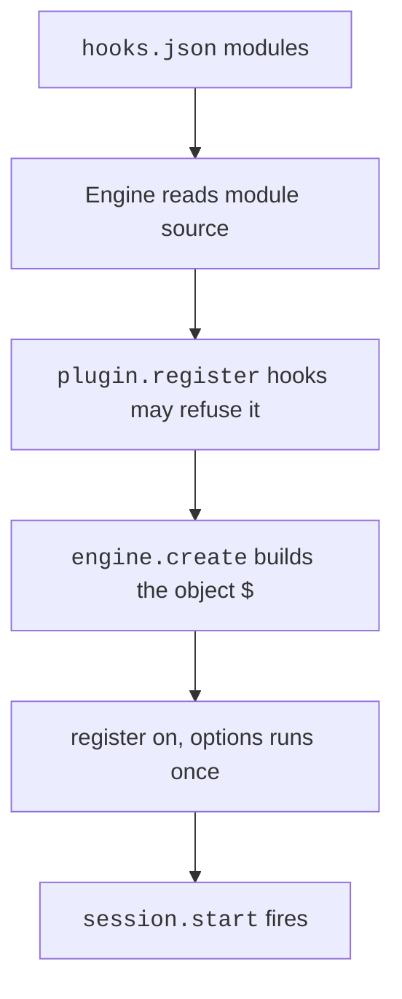

# Mod API Overview


A mod is a plugin whose code runs inside Claude Code.
Claude Code calls the code when an event happens, such as a tool call or a submitted prompt.
The code can watch the event, change it, or answer it.
The object `$` is the Mod API, and the type file that Claude Code publishes marks it as early access, so it may change between releases.

These pages cover `2.1.304`. Official pages: [Mods Overview](https://code.claude.com/docs/en/plugins/mods/overview), [Create a Mod](https://code.claude.com/docs/en/plugins/mods/create), [Use the Mods API](https://code.claude.com/docs/en/plugins/mods/api), [React to Events](https://code.claude.com/docs/en/plugins/mods/events), [Draw in the Interface](https://code.claude.com/docs/en/plugins/mods/interface), [Test a Mod](https://code.claude.com/docs/en/plugins/mods/test), [Troubleshoot a Mod](https://code.claude.com/docs/en/plugins/mods/troubleshoot), and [Mods Reference](https://code.claude.com/docs/en/plugins/mods/reference).

## At a Glance

| Question | Answer |
| --- | --- |
| Can you use it? | ✅ Yes. Put `modules` in `hooks/hooks.json` of a plugin and export `register` from the module. |
| Can you change it? | ✅ Yes. Edit the module. Claude Code reloads it when you save. |
| Can you turn it on or off? | `disableAllHooks` stops installed mods. `--safe-mode` and `--bare` load none. See [Files, Nouns, and Gates](https://xsyetopz.github.io/claude-code-docs/extend/mod-api/nouns-and-gates.md#gates-that-stop-mods). |
| Where does it live? | A plugin folder: `.claude-plugin/plugin.json`, `hooks/hooks.json`, and the hooks module. |
| Status | [Documented] [Differs: The docs add the re-entry value of next.error.kind, which the type file lacks.] [Differs: The type file says the VS Code extension attaches no surface yet. The docs say it draws from 2.1.299.] [Gated: Remote rollout switch for installed mods: the server flag tengu_plugin_hooks_modules] |

## Example

This mod writes each Bash command that Claude runs to the transcript.

```javascript title="hooks/register.js"
export const register = (on) => {
  on("tool.call", { tool: "Bash" }, async ($, e, next) => {
    $.ui.log(`Claude runs: ${e.command}`);
    return next(e);
  });
};
```

## A First Mod

A small mod has three files.

- `first-mod/`
  - `.claude-plugin/`
    - `plugin.json`
  - `hooks/`
    - `hooks.json`
    - `register.js`

- `plugin.json` is the manifest of the plugin. It has a `name`, a `version`, and a `description`.
- `hooks.json` holds `{ "modules": ["./register.js"] }`. That key makes the plugin a mod.
- `register.js` is the hooks module. It exports `register`, and `register` calls `on` once for each hook.

Load the folder for one session with the flag `--plugin-dir`.

```bash
claude --plugin-dir ./first-mod
```

The docs build the same mod step by step in [Create a Mod](https://code.claude.com/docs/en/plugins/mods/create). You can also describe the mod in a session and let Claude write it.

## How a Mod Loads



1. The plugin has `hooks/hooks.json` with `modules`. It holds one path, relative to that file. A second entry is refused.
2. The engine reads the source of the module before it loads it. It lists the events, the `$` calls, the env names, and the `$.state` values. `claude plugin validate <dir>` prints that list.
3. The `plugin.register` hooks of the modules admitted before it can refuse the module.
4. The `engine.create` fold builds `$` for the plugin. A step can add a noun.
5. The engine calls `register(on, options)` once. Then `session.start` fires for each loaded mod.
6. After an edit, `/reload-plugins` or the reload of `--plugin-dir` runs the cycle again.

Hooks run in five tiers, from outermost: `prepend`, `user`, `append`, `builtin`, `core`.
Managed plugins in `prependPlugins` and `appendPlugins` take the first and third tier.
The engine itself is `core`.

## Commands for Mod Authors

| Item | Status | What it does |
| --- | --- | --- |
| `claude --plugin-dir <dir>` | [Documented] | Loads a plugin folder for one session and reloads its module on save. |
| `claude plugin validate <dir>` | [Documented] | Reads the manifest and the module, then lists the events and `$` calls. `--strict` makes warnings errors and `--json` prints a report. |
| `claude plugin test [dir]` | [Documented] | Runs every `*.test.ts` and `*.test.tsx` file. Exits with 1 when a test fails. See [Testing](https://xsyetopz.github.io/claude-code-docs/extend/mod-api/testing.md). |
| `/plugin` | [Documented] | Shows a line such as `1 mod active · first-mod` when a mod loaded. |
| `/reload-plugins` | [Documented] | Reloads the plugins of the session. |
| `claude --debug-file <path>` | [Documented] | Writes a log with a line for each module that loads or fails. |

If a mod does nothing, run `claude plugin validate` first, then read the debug log.
The docs list the causes in [Troubleshoot a Mod](https://code.claude.com/docs/en/plugins/mods/troubleshoot).

## How to Read the Mod API Pages

- The Documented badge means a docs page names the item, or the item is in the published type file. The docs call that file "the complete reference".
- The Differs badge means the docs and the type file or the program disagree.
- The Gated badge means a flag or a gate controls the item.
- In a "Where it can be used" cell, "Run time" means in a hook, in a closure that a hook drew, or in a timer callback. It does not mean inside `register`.
- Most calls on `$` are also events with the same name, such as `fs.read`. A hook on that event can pass the call on, refuse it with `{ deny }`, or answer it with `{ value }`.
- Source for these pages: the program (`types-2.1.304.d.ts`) and the docs pages above.

## Pages of the Mod API

| Page | What is in it |
| --- | --- |
| [Hooks, `on`, and `next`](https://xsyetopz.github.io/claude-code-docs/extend/mod-api/hooks.md) | `register`, `on`, `next`, failure, and budgets. |
| [Event Table Types](https://xsyetopz.github.io/claude-code-docs/extend/mod-api/types/events.md) | How each event gets its input and result type. |
| [Files, Nouns, and Gates](https://xsyetopz.github.io/claude-code-docs/extend/mod-api/nouns-and-gates.md) | Manifest keys, the `$` nouns, switches, limits, and built-in mods. |
| [Plugin and Engine](https://xsyetopz.github.io/claude-code-docs/extend/mod-api/plugin.md) | `$.plugin`, `plugin.register`, `engine.create`, and their types. |
| [UI Methods](https://xsyetopz.github.io/claude-code-docs/extend/mod-api/ui.md) | `$.ui`: toasts, panes, scroll, focus, clipboard. |
| [UI Events](https://xsyetopz.github.io/claude-code-docs/extend/mod-api/ui-events.md) | `ui.render`, `ui.press`, and the other interface events. |
| [Surfaces, Elements, and Render Sites](https://xsyetopz.github.io/claude-code-docs/extend/mod-api/ui-elements.md) | What a mod may draw, where, and with which props. Also JSX and globals. |
| [Model, Audio, and MCP](https://xsyetopz.github.io/claude-code-docs/extend/mod-api/model-audio-mcp.md) | `$.model`, `$.audio`, `$.mcp`. |
| [Session](https://xsyetopz.github.io/claude-code-docs/extend/mod-api/session.md) | `$.session` and the `session.*` events. |
| [Turn and Prompt](https://xsyetopz.github.io/claude-code-docs/extend/mod-api/turn-prompt.md) | `$.turn`, `$.prompt`, `turn.*`, `prompt.*`, `skill.prompt`, `attribution.text`. |
| [Tool, Command, and Config](https://xsyetopz.github.io/claude-code-docs/extend/mod-api/tool-command-config.md) | `$.tool`, `$.command`, `$.config`. |
| [Agent](https://xsyetopz.github.io/claude-code-docs/extend/mod-api/agent.md) | `$.agent`, `agent.offer`, `agent.spawn`, and the agent types. |
| [Files, Store, and State](https://xsyetopz.github.io/claude-code-docs/extend/mod-api/fs-store-state.md) | `$.fs`, `$.store`, `$.state`, and the state helpers. |
| [Clock, HTTP, Process, Env, and Settings](https://xsyetopz.github.io/claude-code-docs/extend/mod-api/clock-http-process-env-settings.md) | `$.clock`, `$.http`, `$.process`, `$.env`, `$.settings`. |
| [Telemetry](https://xsyetopz.github.io/claude-code-docs/extend/mod-api/telemetry.md) | `$.telemetry`, `telemetry.log`, `telemetry.mark`. |
| [Classic Events](https://xsyetopz.github.io/claude-code-docs/extend/mod-api/classic-events.md) | The `classic.*` events of the settings hooks. |
| [The `claude-code/testing` Module](https://xsyetopz.github.io/claude-code-docs/extend/mod-api/testing.md) | `test`, `describe`, `expect`, `mock`, `tier`, `$.ui.mount`. |

The [type pages](https://xsyetopz.github.io/claude-code-docs/extend/mod-api/types.md) hold the detailed shapes of inputs and results: [Hook Machinery Types](https://xsyetopz.github.io/claude-code-docs/extend/mod-api/types/hooks.md), [UI Types](https://xsyetopz.github.io/claude-code-docs/extend/mod-api/types/ui.md), [Model, Audio, and MCP Types](https://xsyetopz.github.io/claude-code-docs/extend/mod-api/types/model.md), [Session Types](https://xsyetopz.github.io/claude-code-docs/extend/mod-api/types/session.md), [Turn and Prompt Types](https://xsyetopz.github.io/claude-code-docs/extend/mod-api/types/turn-prompt.md), [Tool, Command, and Config Types](https://xsyetopz.github.io/claude-code-docs/extend/mod-api/types/tool-command-config.md), [Files, State, Clock, HTTP, Process, and Settings Types](https://xsyetopz.github.io/claude-code-docs/extend/mod-api/types/infra.md), [Classic Event Types](https://xsyetopz.github.io/claude-code-docs/extend/mod-api/types/classic.md), [Testing Types](https://xsyetopz.github.io/claude-code-docs/extend/mod-api/types/testing.md), and [Event Table Types](https://xsyetopz.github.io/claude-code-docs/extend/mod-api/types/events.md).

## Known Gaps

- The 50 millisecond limit of a `prompt.edit` hook is set on the event in the program, not in the type file.
- The rollout flag for installed mods is the server flag `tengu_plugin_hooks_modules`. The program has no local switch for it.
- The value `re-entry` of `next.error.kind` is in the docs and in a program debug string, and not in the type file.
- Many doc comments in the type file name code items without backticks. The tables keep the wording of the type file where it matters.

## Related Pages

- [Plugins](https://xsyetopz.github.io/claude-code-docs/extend/plugins.md)
- [Hooks](https://xsyetopz.github.io/claude-code-docs/extend/hooks.md)
