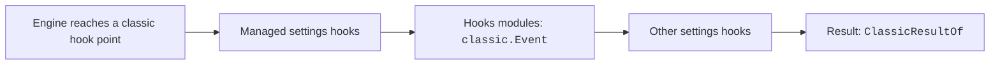

# Classic Event Types


These are the input and result types of the `classic.*` events.
Each input type matches the data that a settings hook of the same name receives on `stdin`.
The result types match the JSON that a settings hook prints.
Use them when you write a mod hook for an event such as `classic.Stop`.

## At a Glance

| Question | Answer |
| --- | --- |
| Can you use it? | ✅ Yes, as types. `import type { ClassicEventOf } from 'claude-code'`. The import is empty at run time. |
| Can you change it? | ❌ No. These are types only. They describe data, and they do not hold settings. |
| Can you turn it on or off? | ❌ No. A type has no switch. |
| Where does it live? | The published type file `types-2.1.303.d.ts` and `.claude-plugin/types/claude-code/index.d.ts`. |
| Status | [Documented] |

## Example

This hook on `classic.Stop` passes the event on without a change. Its `e` is the same data a `Stop` settings hook reads on `stdin`.

```ts
on("classic.Stop", ($, e, next) => next(e))
```

## How It Works

Every settings hook event has a twin event under `classic`. The twin fires wherever the engine runs the classic hook, even with no settings hook configured.
The chain runs managed settings hooks first, then hooks modules, then the other settings hooks. A managed block ends the chain above every module.



## Types without Fields

These types are aliases, unions, or plain shapes. Each row gives its use and its shape.

| Type | Status | What it is for | Shape and limits |
| --- | --- | --- | --- |
| `ClassicEventName` | [Documented] | The name of a classic hook event as a function-hooks event: the settings hook's own name under `classic` (`classic.Stop`, `classic.PreToolUse`). | Alias of `` `classic.${ClassicHookEvent}` ``. Each fires wherever the engine runs the classic hook, even with no settings hook configured. |
| `ClassicHookEvent` | [Documented] | The name of a classic hook event: `PreToolUse`, `Stop`, and the rest. | Alias of `HookInput['hook_event_name']`. |
| `ClassicHookInputs` | [Documented] | What a classic hook receives on stdin for each event, by event name: the Agent SDK's `<Event>HookInput`. | Alias of `{ [I in HookInput as I['hook_event_name']]: I, }`. |
| `ExitReason` | [Documented] | Not described in the type file. | Alias of `'clear' \| 'resume' \| 'logout' \| 'prompt_input_exit' \| 'other'`. |
| `HookInput` | [Documented] | Not described in the type file. | Alias of the union of every hook input type, such as `PreToolUseHookInput`, `PostToolUseHookInput`, `SessionStartHookInput`, and `StopHookInput`. |
| `PermissionBehavior` | [Documented] | Not described in the type file. | Alias of `'allow' \| 'deny' \| 'ask'`. |
| `PermissionMode` | [Documented] | How tool runs are handled: `default`, `acceptEdits`, `bypassPermissions`, `plan`, `dontAsk`, or `auto`. `bypassPermissions` needs `allowDangerouslySkipPermissions`. | Alias of `'default' \| 'acceptEdits' \| 'bypassPermissions' \| 'plan' \| 'dontAsk' \| 'auto'`. |
| `PermissionUpdateDestination` | [Documented] | Not described in the type file. | Alias of `'userSettings' \| 'projectSettings' \| 'localSettings' \| 'session' \| 'cliArg'`. |
| `PermissionUpdates` | [Documented] | The permission rules a PermissionRequest allow may add: the shape of the request's own `permission_suggestions` (the SDK's PermissionUpdate list). | Alias of `NonNullable<ClassicHookInputs['PermissionRequest']['permission_suggestions']>`. |
| `SDKAssistantMessageError` | [Documented] | Not described in the type file. | Alias of 13 error names, from `authentication_failed` and `billing_error` to `rate_limit`, `overloaded`, `model_not_found`, `server_error`, `max_output_tokens`, and `unknown`. |

## Types with Fields

Each type below has its own table of fields.

### `BackgroundTaskSummary`

| Field | Status | What it is for | Type and limits |
| --- | --- | --- | --- |
| `id` | [Documented] | Not described in the type file. | Type: `string`. |
| `type` | [Documented] | Friendly task-type label (e.g. 'shell', 'subagent', 'monitor', 'workflow'). Falls back to the raw discriminant for unknown types. | Type: `string`. |
| `status` | [Documented] | Not described in the type file. | Type: `string`. |
| `description` | [Documented] | Free-text description. Capped at 1000 chars, clipped values append an in-string "... [+N chars]" marker. | Type: `string`. |
| `command` | [Documented] | Shell command line. Only present for 'shell' tasks. Capped at 1000 chars with the same "... [+N chars]" marker. | Type: `string`. Optional. |
| `agent_type` | [Documented] | Subagent type name. Only present for 'subagent' tasks. | Type: `string`. Optional. |
| `server` | [Documented] | MCP server name. Only present for 'monitor' / 'MCP task' tasks. | Type: `string`. Optional. |
| `tool` | [Documented] | MCP tool name. Only present for 'monitor' / 'MCP task' tasks. | Type: `string`. Optional. |
| `name` | [Documented] | Workflow name. Only present for 'workflow' tasks. | Type: `string`. Optional. |

### `BaseHookInput`

| Field | Status | What it is for | Type and limits |
| --- | --- | --- | --- |
| `session_id` | [Documented] | Not described in the type file. | Type: `string`. |
| `transcript_path` | [Documented] | Not described in the type file. | Type: `string`. |
| `cwd` | [Documented] | Not described in the type file. | Type: `string`. |
| `prompt_id` | [Documented] | A UUID that ties a user prompt to all later events until the next prompt. It is also the `prompt.id` attribute on OpenTelemetry events. Absent until the first user input. | Type: `string`. Optional. |
| `permission_mode` | [Documented] | Not described in the type file. | Type: `string`. Optional. |
| `agent_id` | [Documented] | Subagent identifier. Present only when the hook fires inside a subagent. Absent on the main thread. Use it, not `agent_type`, to tell subagent calls apart. | Type: `string`. Optional. |
| `agent_type` | [Documented] | Agent type name, such as `general-purpose`. Present inside a subagent, or on the main thread of a session started with `--agent`. | Type: `string`. Optional. |
| `effort` | [Documented] | Reasoning effort of the current turn. Present for hooks in a tool-use context on a model that supports effort. Absent for session-lifecycle hooks. | Type: `object`. Optional. |

### `ClassicEventOf`

The classic (settings) hook events, one per classic event name: `e` is the hook's whole stdin input, base fields (`transcript_path`, `cwd`) included. Object. One key for each classic event. The chain is managed settings hooks, then hooks modules, then the other settings hooks. A managed block ends it above every module.

| Field | Status | What it is for | Type and limits |
| --- | --- | --- | --- |
| `` [E in ClassicHookEvent as `classic.${E}`] `` | [Documented] | Not described in the type file. | Type: `E extends 'PreToolUse' ? ToolCallEnvelope : ClassicHookInputs[E]`. |

### `ClassicResult`

Everything a classic hook event's answer can carry, named as the classic hook's JSON output names it, each event reads its subset (ClassicResultOf). The settings hooks fold into one of these. A field of the wrong shape fails the hook.

| Field | Status | What it is for | Type and limits |
| --- | --- | --- | --- |
| `block` | [Documented] | `decision: "block"` with this text as `reason` (a command hook's exit code 2): the event's block, veto or re-prompt. | Type: `string`. Optional. |
| `preventContinuation` | [Documented] | `continue: false`: the session stops after this event. | Type: `true`. Optional. |
| `stopReason` | [Documented] | Shown when `preventContinuation` stops the session (`stopReason`). | Type: `string`. Optional. |
| `additionalContext` | [Documented] | `hookSpecificOutput.additionalContext`, one entry per hook: text handed to the model with the event. | Type: `string[]`. Optional. |
| `sessionTitle` | [Documented] | `hookSpecificOutput.sessionTitle` (UserPromptSubmit, SessionStart). | Type: `string`. Optional. |
| `suppressOriginalPrompt` | [Documented] | `hookSpecificOutput.suppressOriginalPrompt` (UserPromptSubmit, UserPromptExpansion). | Type: `true`. Optional. |
| `initialUserMessage` | [Documented] | `hookSpecificOutput.initialUserMessage` (SessionStart). | Type: `string`. Optional. |
| `watchPaths` | [Documented] | `hookSpecificOutput.watchPaths` (SessionStart). | Type: `string[]`. Optional. |
| `reloadSkills` | [Documented] | `hookSpecificOutput.reloadSkills` (SessionStart). | Type: `true`. Optional. |
| `permissionDecision` | [Documented] | `hookSpecificOutput.permissionDecision` (PreModelSwitch). | Type: `'allow' \| 'deny' \| 'ask'`. Optional. |
| `permissionDecisionReason` | [Documented] | `hookSpecificOutput.permissionDecisionReason` (PreModelSwitch). | Type: `string`. Optional. |
| `decision` | [Documented] | `hookSpecificOutput.decision` (PermissionRequest). | Type: `PermissionRequestDecision`. Optional. |
| `updatedToolOutput` | [Documented] | `hookSpecificOutput.updatedToolOutput` (PostToolUse): replaces what the model sees of the tool's result. | Type: `unknown`. Optional. |
| `updatedMCPToolOutput` | [Documented] | `hookSpecificOutput.updatedMCPToolOutput` (PostToolUse, MCP tools only). | Type: `unknown`. Optional. |
| `retry` | [Documented] | `hookSpecificOutput.retry` (PermissionDenied). | Type: `true`. Optional. |
| `displayContent` | [Documented] | `hookSpecificOutput.displayContent` (MessageDisplay). | Type: `string`. Optional. |
| `worktreePath` | [Documented] | `hookSpecificOutput.worktreePath` (WorktreeCreate, a command hook prints it): the worktree the hook created, absolute or relative to its cwd. | Type: `string`. Optional. Left unset, the session creates its git worktree as it would unhooked. |

### `ClassicResultFields`

The event-specific fields of ClassicResult each classic event reads (its `hookSpecificOutput`), by event, an event absent here reads none of them. `block`, `preventContinuation` and `stopReason` are every event's.

| Field | Status | What it is for | Type and limits |
| --- | --- | --- | --- |
| `UserPromptSubmit` | [Documented] | Not described in the type file. | Type: `'additionalContext' \| 'sessionTitle' \| 'suppressOriginalPrompt'`. |
| `UserPromptExpansion` | [Documented] | Not described in the type file. | Type: `'additionalContext' \| 'suppressOriginalPrompt'`. |
| `SessionStart` | [Documented] | Not described in the type file. | Type: `'additionalContext' \| 'initialUserMessage' \| 'sessionTitle' \| 'watchPaths' \| 'reloadSkills'`. |
| `Setup` | [Documented] | Not described in the type file. | Type: `'additionalContext'`. |
| `PreModelSwitch` | [Documented] | Not described in the type file. | Type: `'permissionDecision' \| 'permissionDecisionReason'`. |
| `PostModelSwitch` | [Documented] | Not described in the type file. | Type: `'additionalContext'`. |
| `SubagentStart` | [Documented] | Not described in the type file. | Type: `'additionalContext'`. |
| `PostToolUse` | [Documented] | Not described in the type file. | Type: `'additionalContext' \| 'updatedToolOutput' \| 'updatedMCPToolOutput'`. |
| `PostToolUseFailure` | [Documented] | Not described in the type file. | Type: `'additionalContext'`. |
| `PostToolBatch` | [Documented] | Not described in the type file. | Type: `'additionalContext'`. |
| `Stop` | [Documented] | Not described in the type file. | Type: `'additionalContext'`. |
| `SubagentStop` | [Documented] | Not described in the type file. | Type: `'additionalContext'`. |
| `PermissionDenied` | [Documented] | Not described in the type file. | Type: `'retry'`. |
| `PermissionRequest` | [Documented] | Not described in the type file. | Type: `'decision'`. |
| `MessageDisplay` | [Documented] | Not described in the type file. | Type: `'displayContent'`. |
| `WorktreeCreate` | [Documented] | Not described in the type file. | Type: `'worktreePath'`. |

### `ClassicResultOf`

What each classic hook event's hook returns and its `next(e)` resolves to: the event's own subset of ClassicResult. [E in ClassicHookEvent as `classic.${E}`] ``. `classic.PreToolUse` keeps its `allow` / `ask` / `deny` result (PreToolUseResult).

| Field | Status | What it is for | Type and limits |
| --- | --- | --- | --- |
| `` [E in ClassicHookEvent as `classic.${E}`] `` | [Documented] | Not described in the type file. | Type: `E extends 'PreToolUse' ? PreToolUseResult : Pick<ClassicResult, 'block' \| 'preventContinuation' \| 'stopReason' \| (E extends keyof ClassicResultFields ? ClassicResultFields[E] : never)>`. |

### `ConfigChangeHookInput`

Combines `ConfigChangeHookInput`, `BaseHookInput`.

| Field | Status | What it is for | Type and limits |
| --- | --- | --- | --- |
| `hook_event_name` | [Documented] | Not described in the type file. | Type: `'ConfigChange'`. |
| `source` | [Documented] | Not described in the type file. | Type: `'user_settings' \| 'project_settings' \| 'local_settings' \| 'policy_settings' \| 'skills'`. |
| `file_path` | [Documented] | Not described in the type file. | Type: `string`. Optional. |

### `CwdChangedHookInput`

Combines `CwdChangedHookInput`, `BaseHookInput`.

| Field | Status | What it is for | Type and limits |
| --- | --- | --- | --- |
| `hook_event_name` | [Documented] | Not described in the type file. | Type: `'CwdChanged'`. |
| `old_cwd` | [Documented] | Not described in the type file. | Type: `string`. |
| `new_cwd` | [Documented] | Not described in the type file. | Type: `string`. |

### `DirectoryAddedHookInput`

Combines `DirectoryAddedHookInput`, `BaseHookInput`.

| Field | Status | What it is for | Type and limits |
| --- | --- | --- | --- |
| `hook_event_name` | [Documented] | Not described in the type file. | Type: `'DirectoryAdded'`. |
| `directory` | [Documented] | Absolute path of the directory that was added. | Type: `string`. |
| `source` | [Documented] | How the directory was added: "slash_command" for /add-dir, "register_repo_root" for the SDK control_request. | Type: `'slash_command' \| 'register_repo_root'`. |

### `ElicitationHookInput`

Hook input for the Elicitation event. Fired when an MCP server requests user input. Hooks can auto-respond (accept/decline) instead of showing the dialog. Combines `ElicitationHookInput`, `BaseHookInput`.

| Field | Status | What it is for | Type and limits |
| --- | --- | --- | --- |
| `hook_event_name` | [Documented] | Not described in the type file. | Type: `'Elicitation'`. |
| `mcp_server_name` | [Documented] | Not described in the type file. | Type: `string`. |
| `message` | [Documented] | Not described in the type file. | Type: `string`. |
| `mode` | [Documented] | Not described in the type file. | Type: `'form' \| 'url'`. Optional. |
| `url` | [Documented] | Not described in the type file. | Type: `string`. Optional. |
| `elicitation_id` | [Documented] | Not described in the type file. | Type: `string`. Optional. |
| `requested_schema` | [Documented] | Not described in the type file. | Type: `Record<string, unknown>`. Optional. |

### `ElicitationResultHookInput`

Hook input for the ElicitationResult event. Fired after the user responds to an MCP elicitation. Hooks can observe or override the response before it is sent to the server. Combines `ElicitationResultHookInput`, `BaseHookInput`.

| Field | Status | What it is for | Type and limits |
| --- | --- | --- | --- |
| `hook_event_name` | [Documented] | Not described in the type file. | Type: `'ElicitationResult'`. |
| `mcp_server_name` | [Documented] | Not described in the type file. | Type: `string`. |
| `elicitation_id` | [Documented] | Not described in the type file. | Type: `string`. Optional. |
| `mode` | [Documented] | Not described in the type file. | Type: `'form' \| 'url'`. Optional. |
| `action` | [Documented] | Not described in the type file. | Type: `'accept' \| 'decline' \| 'cancel'`. |
| `content` | [Documented] | Not described in the type file. | Type: `Record<string, unknown>`. Optional. |

### `FileChangedHookInput`

Combines `FileChangedHookInput`, `BaseHookInput`.

| Field | Status | What it is for | Type and limits |
| --- | --- | --- | --- |
| `hook_event_name` | [Documented] | Not described in the type file. | Type: `'FileChanged'`. |
| `file_path` | [Documented] | Not described in the type file. | Type: `string`. |
| `event` | [Documented] | Not described in the type file. | Type: `'change' \| 'add' \| 'unlink'`. |

### `InstructionsLoadedHookInput`

Combines `InstructionsLoadedHookInput`, `BaseHookInput`.

| Field | Status | What it is for | Type and limits |
| --- | --- | --- | --- |
| `hook_event_name` | [Documented] | Not described in the type file. | Type: `'InstructionsLoaded'`. |
| `file_path` | [Documented] | Not described in the type file. | Type: `string`. |
| `memory_type` | [Documented] | Not described in the type file. | Type: `'User' \| 'Project' \| 'Local' \| 'Managed'`. |
| `load_reason` | [Documented] | Not described in the type file. | Type: `'session_start' \| 'nested_traversal' \| 'path_glob_match' \| 'include' \| 'compact'`. |
| `globs` | [Documented] | Not described in the type file. | Type: `string[]`. Optional. |
| `trigger_file_path` | [Documented] | Not described in the type file. | Type: `string`. Optional. |
| `parent_file_path` | [Documented] | Not described in the type file. | Type: `string`. Optional. |

### `MessageDisplayHookInput`

Hook input for the MessageDisplay event. Fired with each batch of newly completed lines while an assistant message streams. Display-only: the stored message and what the model sees are untouched. Combines `MessageDisplayHookInput`, `BaseHookInput`.

| Field | Status | What it is for | Type and limits |
| --- | --- | --- | --- |
| `hook_event_name` | [Documented] | Not described in the type file. | Type: `'MessageDisplay'`. |
| `turn_id` | [Documented] | UUID of the current turn. | Type: `string`. |
| `message_id` | [Documented] | UUID of the assistant message being displayed. Stable across every flush of the same message. Not the API msg_... id. | Type: `string`. |
| `index` | [Documented] | Zero-based index of this delta within the message. Increments by one per flush. | Type: `number`. |
| `final` | [Documented] | True on the message's last flush. Exactly one flush per message has it. | Type: `boolean`. |
| `delta` | [Documented] | The newly completed lines since the last flush. Always whole lines, except on the final flush. Treat `final` as the end-of-message signal. | Type: `string`. |

### `NotificationHookInput`

Combines `NotificationHookInput`, `BaseHookInput`.

| Field | Status | What it is for | Type and limits |
| --- | --- | --- | --- |
| `hook_event_name` | [Documented] | Not described in the type file. | Type: `'Notification'`. |
| `message` | [Documented] | Not described in the type file. | Type: `string`. |
| `title` | [Documented] | Not described in the type file. | Type: `string`. Optional. |
| `notification_type` | [Documented] | Not described in the type file. | Type: `string`. |

### `PermissionDeniedHookInput`

Combines `PermissionDeniedHookInput`, `BaseHookInput`.

| Field | Status | What it is for | Type and limits |
| --- | --- | --- | --- |
| `hook_event_name` | [Documented] | Not described in the type file. | Type: `'PermissionDenied'`. |
| `tool_name` | [Documented] | Not described in the type file. | Type: `string`. |
| `tool_input` | [Documented] | Not described in the type file. | Type: `unknown`. |
| `tool_use_id` | [Documented] | Not described in the type file. | Type: `string`. |
| `reason` | [Documented] | Not described in the type file. | Type: `string`. |
| `mcp_server` | [Documented] | Not described in the type file. | Type: `McpServerProvenance`. Optional. |

### `PermissionRequestDecision`

A `classic.PermissionRequest` answer's `decision`, as the classic hook's `hookSpecificOutput.decision`: allow (with a rewrite or rules) or deny.

| Field | Status | What it is for | Type and limits |
| --- | --- | --- | --- |
| `behavior` | [Documented] | Not described in the type file. | Type: `'allow'`. |
| `updatedInput` | [Documented] | Not described in the type file. | Type: `Record<string, unknown>`. Optional. |
| `updatedPermissions` | [Documented] | Not described in the type file. | Type: `PermissionUpdates`. Optional. |
| `behavior` | [Documented] | Not described in the type file. | Type: `'deny'`. |
| `message` | [Documented] | Not described in the type file. | Type: `string`. Optional. |
| `interrupt` | [Documented] | Not described in the type file. | Type: `true`. Optional. |

### `PermissionRequestHookInput`

Combines `PermissionRequestHookInput`, `BaseHookInput`.

| Field | Status | What it is for | Type and limits |
| --- | --- | --- | --- |
| `hook_event_name` | [Documented] | Not described in the type file. | Type: `'PermissionRequest'`. |
| `tool_name` | [Documented] | Not described in the type file. | Type: `string`. |
| `tool_input` | [Documented] | Not described in the type file. | Type: `unknown`. |
| `permission_suggestions` | [Documented] | Not described in the type file. | Type: `PermissionUpdate[]`. Optional. |
| `mcp_server` | [Documented] | Not described in the type file. | Type: `McpServerProvenance`. Optional. |

### `PermissionRuleValue`

| Field | Status | What it is for | Type and limits |
| --- | --- | --- | --- |
| `toolName` | [Documented] | Not described in the type file. | Type: `string`. |
| `ruleContent` | [Documented] | Not described in the type file. | Type: `string`. Optional. |

### `PermissionUpdate`

| Field | Status | What it is for | Type and limits |
| --- | --- | --- | --- |
| `type` | [Documented] | Not described in the type file. | Type: `'addRules'`. |
| `rules` | [Documented] | Not described in the type file. | Type: `PermissionRuleValue[]`. |
| `behavior` | [Documented] | Not described in the type file. | Type: `PermissionBehavior`. |
| `destination` | [Documented] | Not described in the type file. | Type: `PermissionUpdateDestination`. |
| `type` | [Documented] | Not described in the type file. | Type: `'replaceRules'`. |
| `rules` | [Documented] | Not described in the type file. | Type: `PermissionRuleValue[]`. |
| `behavior` | [Documented] | Not described in the type file. | Type: `PermissionBehavior`. |
| `destination` | [Documented] | Not described in the type file. | Type: `PermissionUpdateDestination`. |
| `type` | [Documented] | Not described in the type file. | Type: `'removeRules'`. |
| `rules` | [Documented] | Not described in the type file. | Type: `PermissionRuleValue[]`. |
| `behavior` | [Documented] | Not described in the type file. | Type: `PermissionBehavior`. |
| `destination` | [Documented] | Not described in the type file. | Type: `PermissionUpdateDestination`. |
| `type` | [Documented] | Not described in the type file. | Type: `'setMode'`. |
| `mode` | [Documented] | Not described in the type file. | Type: `PermissionMode`. |
| `destination` | [Documented] | Not described in the type file. | Type: `PermissionUpdateDestination`. |
| `type` | [Documented] | Not described in the type file. | Type: `'addDirectories'`. |
| `directories` | [Documented] | Not described in the type file. | Type: `string[]`. |
| `destination` | [Documented] | Not described in the type file. | Type: `PermissionUpdateDestination`. |
| `type` | [Documented] | Not described in the type file. | Type: `'removeDirectories'`. |
| `directories` | [Documented] | Not described in the type file. | Type: `string[]`. |
| `destination` | [Documented] | Not described in the type file. | Type: `PermissionUpdateDestination`. |

### `PostCompactHookInput`

Combines `PostCompactHookInput`, `BaseHookInput`.

| Field | Status | What it is for | Type and limits |
| --- | --- | --- | --- |
| `hook_event_name` | [Documented] | Not described in the type file. | Type: `'PostCompact'`. |
| `trigger` | [Documented] | Not described in the type file. | Type: `'manual' \| 'auto'`. |
| `compact_summary` | [Documented] | The conversation summary produced by compaction | Type: `string`. |

### `PostModelSwitchHookInput`

Combines `PostModelSwitchHookInput`, `BaseHookInput`.

| Field | Status | What it is for | Type and limits |
| --- | --- | --- | --- |
| `hook_event_name` | [Documented] | Not described in the type file. | Type: `'PostModelSwitch'`. |
| `from_model` | [Documented] | Resolved model id the session was running before the switch | Type: `string`. |
| `to_model` | [Documented] | Resolved model id the session runs after the switch | Type: `string`. |
| `requested_model` | [Documented] | What was asked for (alias such as "opus", a full id, or null for "default") | Type: `string \| null`. |
| `source` | [Documented] | Why the model changed: `command` (/model or the /config Model row), `picker`, `sdk` (headless `set_model`), `auto` (fallback or other change), or `resume`. | Type: `'command' \| 'picker' \| 'sdk' \| 'auto' \| 'resume'`. |
| `context_tokens` | [Documented] | Prompt tokens that the next request re-sends: the last main-thread response's input, cache read, cache creation, and output tokens. 0 before the first response. | Type: `number`. |
| `prompt_cache_warm` | [Documented] | Whether the current model's prompt cache is likely still warm (a switch then forfeits it) | Type: `boolean`. |
| `cache_ttl` | [Documented] | Not described in the type file. | Type: `'5m' \| '1h'`. |
| `estimated_cache_write_usd` | [Documented] | Estimated cost of re-caching context_tokens on to_model at its cache-write rate - the managed modelPricing when set, otherwise list price, excludes the response | Type: `number`. |
| `pricing` | [Documented] | configured: priced at the managed modelPricing setting, catalog: list price, default: to_model unknown, the default tier was assumed | Type: `'configured' \| 'catalog' \| 'default'`. |

### `PostToolBatchHookInput`

Hook input for `PostToolBatch`. Fires once after every tool call in a batch resolved, before the next model request. `PostToolUse` fires for each tool. Combines `PostToolBatchHookInput`, `BaseHookInput`.

| Field | Status | What it is for | Type and limits |
| --- | --- | --- | --- |
| `hook_event_name` | [Documented] | Not described in the type file. | Type: `'PostToolBatch'`. |
| `tool_calls` | [Documented] | Not described in the type file. | Type: `PostToolBatchToolCall[]`. |

### `PostToolBatchToolCall`

| Field | Status | What it is for | Type and limits |
| --- | --- | --- | --- |
| `tool_name` | [Documented] | Not described in the type file. | Type: `string`. |
| `tool_input` | [Documented] | Not described in the type file. | Type: `unknown`. |
| `tool_use_id` | [Documented] | Not described in the type file. | Type: `string`. |
| `tool_response` | [Documented] | Not described in the type file. | Type: `unknown`. Optional. |

### `PostToolUseFailureHookInput`

Combines `PostToolUseFailureHookInput`, `BaseHookInput`.

| Field | Status | What it is for | Type and limits |
| --- | --- | --- | --- |
| `hook_event_name` | [Documented] | Not described in the type file. | Type: `'PostToolUseFailure'`. |
| `tool_name` | [Documented] | Not described in the type file. | Type: `string`. |
| `tool_input` | [Documented] | Not described in the type file. | Type: `unknown`. |
| `tool_use_id` | [Documented] | Not described in the type file. | Type: `string`. |
| `error` | [Documented] | Not described in the type file. | Type: `string`. |
| `is_interrupt` | [Documented] | Not described in the type file. | Type: `boolean`. Optional. |
| `duration_ms` | [Documented] | Tool execution time in milliseconds. Excludes permission-prompt and hook time. | Type: `number`. Optional. |
| `mcp_server` | [Documented] | Not described in the type file. | Type: `McpServerProvenance`. Optional. |

### `PostToolUseHookInput`

Combines `PostToolUseHookInput`, `BaseHookInput`.

| Field | Status | What it is for | Type and limits |
| --- | --- | --- | --- |
| `hook_event_name` | [Documented] | Not described in the type file. | Type: `'PostToolUse'`. |
| `tool_name` | [Documented] | Not described in the type file. | Type: `string`. |
| `tool_input` | [Documented] | Not described in the type file. | Type: `unknown`. |
| `tool_response` | [Documented] | Not described in the type file. | Type: `unknown`. |
| `tool_use_id` | [Documented] | Not described in the type file. | Type: `string`. |
| `duration_ms` | [Documented] | Tool execution time in milliseconds. Excludes permission-prompt and hook time. | Type: `number`. Optional. |
| `mcp_server` | [Documented] | Not described in the type file. | Type: `McpServerProvenance`. Optional. |

### `PreCompactHookInput`

Combines `PreCompactHookInput`, `BaseHookInput`.

| Field | Status | What it is for | Type and limits |
| --- | --- | --- | --- |
| `hook_event_name` | [Documented] | Not described in the type file. | Type: `'PreCompact'`. |
| `trigger` | [Documented] | Not described in the type file. | Type: `'manual' \| 'auto'`. |
| `custom_instructions` | [Documented] | Not described in the type file. | Type: `string \| null`. |

### `PreModelSwitchHookInput`

Combines `PreModelSwitchHookInput`, `BaseHookInput`.

| Field | Status | What it is for | Type and limits |
| --- | --- | --- | --- |
| `hook_event_name` | [Documented] | Not described in the type file. | Type: `'PreModelSwitch'`. |
| `from_model` | [Documented] | Resolved model id the session was running before the switch | Type: `string`. |
| `to_model` | [Documented] | Resolved model id the session runs after the switch | Type: `string`. |
| `requested_model` | [Documented] | What was asked for (alias such as "opus", a full id, or null for "default") | Type: `string \| null`. |
| `source` | [Documented] | command: /model &lt;name>, the /config Model row, or enabling fast mode when that promotes the model, picker: an interactive model picker, sdk: headless set_model (SDK, Remote Control, IDE) | Type: `'command' \| 'picker' \| 'sdk'`. |
| `context_tokens` | [Documented] | Prompt tokens that the next request re-sends: the last main-thread response's input, cache read, cache creation, and output tokens. 0 before the first response. | Type: `number`. |
| `prompt_cache_warm` | [Documented] | Whether the current model's prompt cache is likely still warm (a switch then forfeits it) | Type: `boolean`. |
| `cache_ttl` | [Documented] | Not described in the type file. | Type: `'5m' \| '1h'`. |
| `estimated_cache_write_usd` | [Documented] | Estimated cost of re-caching context_tokens on to_model at its cache-write rate - the managed modelPricing when set, otherwise list price, excludes the response | Type: `number`. |
| `pricing` | [Documented] | configured: priced at the managed modelPricing setting, catalog: list price, default: to_model unknown, the default tier was assumed | Type: `'configured' \| 'catalog' \| 'default'`. |

### `PreToolUseDecision`

The decision of a `classic.PreToolUse` result: `allow`, `ask`, `deny`, or none.

| Field | Status | What it is for | Type and limits |
| --- | --- | --- | --- |
| `allow` | [Documented] | Lets the call run without a permission prompt (the managed-settings hooks ran first, a deny from them ended the chain above). | Type: `true`. |
| `ask` | [Documented] | Never set in this form. | Type: `undefined`. Optional. |
| `deny` | [Documented] | Never set in this form. | Type: `undefined`. Optional. |
| `ask` | [Documented] | Asks the user before the call runs, the text is shown as the reason. | Type: `string`. |
| `allow` | [Documented] | Never set in this form. | Type: `undefined`. Optional. |
| `deny` | [Documented] | Never set in this form. | Type: `undefined`. Optional. |
| `deny` | [Documented] | Refuses the call, the model receives the text as the reason. | Type: `string`. |
| `allow` | [Documented] | Never set in this form. | Type: `undefined`. Optional. |
| `ask` | [Documented] | Never set in this form. | Type: `undefined`. Optional. |
| `allow` | [Documented] | Never set in this form. | Type: `undefined`. Optional. |
| `ask` | [Documented] | Never set in this form. | Type: `undefined`. Optional. |
| `deny` | [Documented] | Never set in this form. | Type: `undefined`. Optional. |

### `PreToolUseHookInput`

Combines `PreToolUseHookInput`, `BaseHookInput`.

| Field | Status | What it is for | Type and limits |
| --- | --- | --- | --- |
| `hook_event_name` | [Documented] | Not described in the type file. | Type: `'PreToolUse'`. |
| `tool_name` | [Documented] | Not described in the type file. | Type: `string`. |
| `tool_input` | [Documented] | Not described in the type file. | Type: `unknown`. |
| `tool_use_id` | [Documented] | Not described in the type file. | Type: `string`. |
| `mcp_server` | [Documented] | Not described in the type file. | Type: `McpServerProvenance`. Optional. |

### `PreToolUseResult`

What a `classic.PreToolUse` hook returns: one of `allow`, `ask`, `deny`, or none of them, which passes the call on to the normal permission flow. Intersection of `PreToolUseResult` and `PreToolUseDecision`. The event fires inside `tool.call`, beneath every plugin's `tool.call` hook.

| Field | Status | What it is for | Type and limits |
| --- | --- | --- | --- |
| `updatedInput` | [Documented] | Replaces the tool's arguments, validated against the tool's schema before the tool runs. | Type: `Record<string, unknown>`. Optional. |
| `additionalContext` | [Documented] | Extra context handed to the model with the call, one entry per note. | Type: `string[]`. Optional. |

### `SessionEndHookInput`

Combines `SessionEndHookInput`, `BaseHookInput`.

| Field | Status | What it is for | Type and limits |
| --- | --- | --- | --- |
| `hook_event_name` | [Documented] | Not described in the type file. | Type: `'SessionEnd'`. |
| `reason` | [Documented] | Not described in the type file. | Type: `ExitReason`. |

### `SessionStartHookInput`

Combines `SessionStartHookInput`, `BaseHookInput`.

| Field | Status | What it is for | Type and limits |
| --- | --- | --- | --- |
| `hook_event_name` | [Documented] | Not described in the type file. | Type: `'SessionStart'`. |
| `source` | [Documented] | Not described in the type file. | Type: `'startup' \| 'resume' \| 'clear' \| 'compact' \| 'fork'`. |
| `agent_type` | [Documented] | Not described in the type file. | Type: `string`. Optional. |
| `model` | [Documented] | Not described in the type file. | Type: `string`. Optional. |
| `session_title` | [Documented] | Not described in the type file. | Type: `string`. Optional. |
| `seconds_since_last_response` | [Documented] | resume/fork: seconds since the resumed transcript's last assistant response | Type: `number`. Optional. |
| `context_tokens` | [Documented] | resume/fork: the resumed transcript's last response input + cache_read + cache_creation + output tokens (for a server-side tool loop, its last iteration's window, not the summed totals) | Type: `number`. Optional. |
| `prompt_cache_likely_expired` | [Documented] | resume/fork: seconds_since_last_response exceeds the prompt-cache TTL, so the first request re-caches context_tokens | Type: `boolean`. Optional. |
| `estimated_cache_write_usd` | [Documented] | resume/fork: estimated cost of re-caching context_tokens on the session model - the managed modelPricing when set, otherwise list price, excludes the response | Type: `number`. Optional. |

### `SetupHookInput`

Combines `SetupHookInput`, `BaseHookInput`.

| Field | Status | What it is for | Type and limits |
| --- | --- | --- | --- |
| `hook_event_name` | [Documented] | Not described in the type file. | Type: `'Setup'`. |
| `trigger` | [Documented] | Not described in the type file. | Type: `'init' \| 'maintenance'`. |

### `StopFailureHookInput`

Combines `StopFailureHookInput`, `BaseHookInput`.

| Field | Status | What it is for | Type and limits |
| --- | --- | --- | --- |
| `hook_event_name` | [Documented] | Not described in the type file. | Type: `'StopFailure'`. |
| `error` | [Documented] | Not described in the type file. | Type: `SDKAssistantMessageError`. |
| `error_details` | [Documented] | Not described in the type file. | Type: `string`. Optional. |
| `last_assistant_message` | [Documented] | Not described in the type file. | Type: `string`. Optional. |

### `StopHookInput`

Combines `StopHookInput`, `BaseHookInput`.

| Field | Status | What it is for | Type and limits |
| --- | --- | --- | --- |
| `hook_event_name` | [Documented] | Not described in the type file. | Type: `'Stop'`. |
| `stop_hook_active` | [Documented] | Not described in the type file. | Type: `boolean`. |
| `last_assistant_message` | [Documented] | Text content of the last assistant message before stopping. Avoids the need to read and parse the transcript file. | Type: `string`. Optional. |
| `background_tasks` | [Documented] | In-flight background work in this session. Lets a hook tell "session is done" from "session is paused for background work". Empty when nothing is in flight. | Type: `BackgroundTaskSummary[]`. Optional. |
| `session_crons` | [Documented] | Session-scoped cron tasks (CronCreate, ScheduleWakeup, /loop) that will wake this session later. Empty array when none are scheduled. | Type: `SessionCronSummary[]`. Optional. |

### `SubagentStartHookInput`

Combines `SubagentStartHookInput`, `BaseHookInput`.

| Field | Status | What it is for | Type and limits |
| --- | --- | --- | --- |
| `hook_event_name` | [Documented] | Not described in the type file. | Type: `'SubagentStart'`. |
| `agent_id` | [Documented] | Not described in the type file. | Type: `string`. |
| `agent_type` | [Documented] | Not described in the type file. | Type: `string`. |

### `SubagentStopHookInput`

Combines `SubagentStopHookInput`, `BaseHookInput`.

| Field | Status | What it is for | Type and limits |
| --- | --- | --- | --- |
| `hook_event_name` | [Documented] | Not described in the type file. | Type: `'SubagentStop'`. |
| `stop_hook_active` | [Documented] | Not described in the type file. | Type: `boolean`. |
| `agent_id` | [Documented] | Not described in the type file. | Type: `string`. |
| `agent_transcript_path` | [Documented] | Not described in the type file. | Type: `string`. |
| `agent_type` | [Documented] | Not described in the type file. | Type: `string`. |
| `last_assistant_message` | [Documented] | Text content of the last assistant message before stopping. Avoids the need to read and parse the transcript file. | Type: `string`. Optional. |
| `background_tasks` | [Documented] | In-flight background work in this session. Lets a hook tell "session is done" from "session is paused for background work". Empty when nothing is in flight. | Type: `BackgroundTaskSummary[]`. Optional. |
| `session_crons` | [Documented] | Session-scoped cron tasks (CronCreate, ScheduleWakeup, /loop) that will wake this session later. Empty array when none are scheduled. | Type: `SessionCronSummary[]`. Optional. |

### `TaskCompletedHookInput`

Combines `TaskCompletedHookInput`, `BaseHookInput`.

| Field | Status | What it is for | Type and limits |
| --- | --- | --- | --- |
| `hook_event_name` | [Documented] | Not described in the type file. | Type: `'TaskCompleted'`. |
| `task_id` | [Documented] | Not described in the type file. | Type: `string`. |
| `task_subject` | [Documented] | Not described in the type file. | Type: `string`. |
| `task_description` | [Documented] | Not described in the type file. | Type: `string`. Optional. |
| `teammate_name` | [Documented] | Not described in the type file. | Type: `string`. Optional. |
| `team_name` | [Documented] | Not described in the type file. | Type: `string`. Optional. Deprecated: Sessions have a single implicit team, this carries the session-derived team name and will be removed in a future release. |

### `TaskCreatedHookInput`

Combines `TaskCreatedHookInput`, `BaseHookInput`.

| Field | Status | What it is for | Type and limits |
| --- | --- | --- | --- |
| `hook_event_name` | [Documented] | Not described in the type file. | Type: `'TaskCreated'`. |
| `task_id` | [Documented] | Not described in the type file. | Type: `string`. |
| `task_subject` | [Documented] | Not described in the type file. | Type: `string`. |
| `task_description` | [Documented] | Not described in the type file. | Type: `string`. Optional. |
| `teammate_name` | [Documented] | Not described in the type file. | Type: `string`. Optional. |
| `team_name` | [Documented] | Not described in the type file. | Type: `string`. Optional. Deprecated: Sessions have a single implicit team, this carries the session-derived team name and will be removed in a future release. |

### `TeammateIdleHookInput`

Combines `TeammateIdleHookInput`, `BaseHookInput`.

| Field | Status | What it is for | Type and limits |
| --- | --- | --- | --- |
| `hook_event_name` | [Documented] | Not described in the type file. | Type: `'TeammateIdle'`. |
| `teammate_name` | [Documented] | Not described in the type file. | Type: `string`. |
| `team_name` | [Documented] | Not described in the type file. | Type: `string`. Deprecated: Sessions have a single implicit team, this carries the session-derived team name and will be removed in a future release. |

### `UserPromptExpansionHookInput`

Combines `UserPromptExpansionHookInput`, `BaseHookInput`.

| Field | Status | What it is for | Type and limits |
| --- | --- | --- | --- |
| `hook_event_name` | [Documented] | Not described in the type file. | Type: `'UserPromptExpansion'`. |
| `expansion_type` | [Documented] | Not described in the type file. | Type: `'slash_command' \| 'mcp_prompt'`. |
| `command_name` | [Documented] | Not described in the type file. | Type: `string`. |
| `command_args` | [Documented] | Not described in the type file. | Type: `string`. |
| `command_source` | [Documented] | Not described in the type file. | Type: `string`. Optional. |
| `prompt` | [Documented] | Not described in the type file. | Type: `string`. |

### `UserPromptSubmitHookInput`

Combines `UserPromptSubmitHookInput`, `BaseHookInput`.

| Field | Status | What it is for | Type and limits |
| --- | --- | --- | --- |
| `hook_event_name` | [Documented] | Not described in the type file. | Type: `'UserPromptSubmit'`. |
| `prompt` | [Documented] | Not described in the type file. | Type: `string`. |
| `source` | [Documented] | Who wrote the prompt: `user` (interactive), `sdk` (`-p` or Agent SDK), `loop_wakeup`, `schedule_wakeup`, `system` (machine-injected), or `poll_event`. Payloads may omit it. | Type: `'user' \| 'sdk' \| 'system' \| 'loop_wakeup' \| 'schedule_wakeup' \| 'poll_event'`. Optional. |
| `session_title` | [Documented] | Not described in the type file. | Type: `string`. Optional. |

### `WorktreeCreateHookInput`

Combines `WorktreeCreateHookInput`, `BaseHookInput`.

| Field | Status | What it is for | Type and limits |
| --- | --- | --- | --- |
| `hook_event_name` | [Documented] | Not described in the type file. | Type: `'WorktreeCreate'`. |
| `name` | [Documented] | Not described in the type file. | Type: `string`. |

### `WorktreeRemoveHookInput`

Combines `WorktreeRemoveHookInput`, `BaseHookInput`.

| Field | Status | What it is for | Type and limits |
| --- | --- | --- | --- |
| `hook_event_name` | [Documented] | Not described in the type file. | Type: `'WorktreeRemove'`. |
| `worktree_path` | [Documented] | Not described in the type file. | Type: `string`. |

## Related Pages

- [Mod API Overview](https://xsyetopz.github.io/claude-code-docs/extend/mod-api.md)
- [Mod API Types](https://xsyetopz.github.io/claude-code-docs/extend/mod-api/types.md)
- [Classic Events](https://xsyetopz.github.io/claude-code-docs/extend/mod-api/classic-events.md)
- [Hook Events](https://xsyetopz.github.io/claude-code-docs/extend/hooks/events.md)
- [Hook Input and Output](https://xsyetopz.github.io/claude-code-docs/extend/hooks/input-and-output.md)
