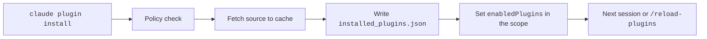

# Plugin Commands


The `claude plugin` command installs, updates, checks, and removes plugins from the shell.
Inside a session, `/plugin` opens a panel and `/reload-plugins` applies changes.
`claude plugins` is an alias of `claude plugin`.
For example, `claude plugin list --json` prints your installs as JSON.

## At a Glance

| Question | Answer |
| --- | --- |
| Can you use it? | ✅ Yes. Shell commands, session commands, and launch flags. |
| Can you change it? | Flags change scope, output, and prompts. |
| Can you turn it on or off? | `claude plugin enable` and `disable`. Managed `disableSideloadFlags` turns off the session flags. |
| Where does it live? | State is in `~/.claude/plugins/` and in `enabledPlugins`. |
| Status | [Documented] |

## Subcommands

`-s` is `--scope`. Scopes are `user`, `project`, and `local`.
Source: [Plugin Commands Reference](https://code.claude.com/docs/en/plugins/cli-reference) and `claude plugin --help`.

| Command | Status | What It Does | Flags and Notes |
| --- | --- | --- | --- |
| `init <name>` (alias `new`) | [Documented] | Scaffolds `~/.claude/skills/<name>/`. It loads next session as `<name>@skills-dir`. | `--description`, `--author`, `--author-email`, `-f/--force`, `--with` (any of `skills`, `agents`, `hooks`, `mcp`, `lsp`, `output-style`, `channel`) |
| `install <plugin>` (alias `i`) | [Documented] | Installs a plugin from a marketplace. | `-s/--scope` (default `user`), `--config key=value`, `-y/--yes`, `--accept-command <sha256>`, `--json`, `--marketplace <source>` |
| `install --registry <url>` | [Documented] | Sets the npm registry for `<package>@npm` installs. | Shown in `--help`, but not in the docs table. |
| `uninstall <plugin>` (aliases `remove`, `rm`) | [Documented] | Removes the plugin from one scope. | `-s`, `--keep-data`, `--prune`, `-y`, `--json`. On the last scope it deletes options, secrets, and data. |
| `enable <plugin>` | [Documented] | Enables a plugin. | `-s` (auto-detects local, project, then user), `--json` |
| `disable [plugin]` | [Documented] | Disables a plugin. | `-a/--all`, `-s`, `--json`. Fails if another plugin depends on it. |
| `update <plugin>` | [Documented] | Updates a plugin. | `-s`, `-y`, `--accept-command`, `--json`. A restart or `/reload-plugins` applies it. |
| `list` | [Documented] | Lists installs. | `--json`, `--available`, `--data-size [plugin]` |
| `details <name>` | [Documented] | Shows the component list and projected token cost. | No flags. |
| `configure <plugin>` | [Documented] | Shows or saves the `userConfig` values. | `--values-stdin`, `--json`. Needs the full plugin id. |
| `prune` (alias `autoremove`) | [Documented] | Removes automatic dependencies that nothing uses. | `-s`, `--dry-run`, `-y` |
| `validate <path>` | [Documented] | Checks a plugin, marketplace, or component folder. | `--strict`, `--json`. Also `/plugin validate`. |
| `tag [path]` | [Documented] | Creates the git tag `<name>--v<version>`. | `--push`, `--dry-run`, `-f`, `-m`, `--remote`. Also `/plugin tag`. |
| `test [dir]` | [Documented] | Runs the tests of a mod. | Runs every `*.test.ts` and `*.test.tsx` file. |
| `eval [target]` | [Documented] | Runs eval cases against a plugin. Needs `2.1.269` or later. | The docs list the main flags. `--help` adds `--allow-real-servers`, `--case`, `--disallow-tools`, `--keep-temp`, `--no-scaffold`, `--output-dir`, `--publish-report`, `--report`, `--tag`, `--verbose`. Also `--trust-plugin` for CI. |
| `eval init [name]` | [Documented] | Creates an eval suite. | `--bare`, `-i/--interactive`, `--eval-dir` |

> **Warning:** `claude plugin eval` loads and runs the plugin on your machine, as you.
> Run it only for plugins you trust. The sandbox limits a bad plugin but is not a guarantee.

## Marketplace Subcommands

| Command | Status | What It Does | Flags and Notes |
| --- | --- | --- | --- |
| `marketplace add <source>` | [Documented] | Adds a marketplace. | `--scope`, `--sparse <paths...>`, `--claudeai`, `--json`. The source is `owner/repo[#ref\|@ref]`, a git URL, an https URL, or a path. |
| `marketplace list` | [Documented] | Lists marketplaces. | `--json` |
| `marketplace remove <name>` (alias `rm`) | [Documented] | Removes the declaration. | `--scope`, `--json`. On the last scope it deletes the cache and uninstalls the plugins from it. |
| `marketplace update [name]` | [Documented] | Refreshes marketplaces. | `--json` needs a name. |

## Session Commands

| Command | Status | What It Does | Notes |
| --- | --- | --- | --- |
| `/plugin` (aliases `/plugins`, `/marketplace`) | [Documented] | Opens the panel with the tabs Discover, Installed, Marketplaces, Stats, and Errors. | Subcommands: `help`, `list [--enabled\|--disabled]`, `install`, `manage`, `stats`, `enable`, `disable`, `uninstall`, `configure`, `validate`, `tag`, `marketplace add\|list\|update\|remove`. Interactive sessions only. |
| `/reload-plugins [--force]` | [Documented] | Applies pending plugin changes without a restart. | Refuses a change to MCP tools that would break the prompt cache, unless you add `--force`. Works in both modes. |

## Session Flags

| Flag | Status | What It Does | Notes |
| --- | --- | --- | --- |
| `--plugin-dir <path>` | [Documented] | Loads a folder or `.zip` for this session only. | The id is `<name>@inline`. A folder of plugins loads each child. Repeatable. The env var `CLAUDE_CODE_PLUGIN_DIRS` does the same. |
| `--plugin-url <url>` | [Documented] | Loads a `.zip` from a URL for this session only. | Repeatable. |
| `--plugin-dir-no-mcp <path>` | [Undocumented] | Loads an inline plugin without its MCP servers. | Hidden flag. The SDK form is `skipMcpDiscovery`. |

Managed `disableSideloadFlags: true` rejects `--plugin-dir`, `--plugin-url`, `--agents`, and `--mcp-config`.

## Example

```bash title="Install, configure, and update a plugin"
claude plugin marketplace add example/team-tools
claude plugin install deploy-tools@team-tools --scope project --config REGION=eu-west-1
claude plugin details deploy-tools@team-tools
claude plugin disable deploy-tools@team-tools
claude plugin update deploy-tools@team-tools --yes
```

## How It Works



## Related Pages

- [Plugins](https://xsyetopz.github.io/claude-code-docs/extend/plugins.md)
- [Marketplaces](https://xsyetopz.github.io/claude-code-docs/extend/plugins/marketplace.md)
- [Plugin Loading](https://xsyetopz.github.io/claude-code-docs/extend/plugins/loading.md)
- [CLI Subcommands](https://xsyetopz.github.io/claude-code-docs/configure/cli/subcommands.md) and [CLI Flags](https://xsyetopz.github.io/claude-code-docs/configure/cli/flags.md) for the other commands
