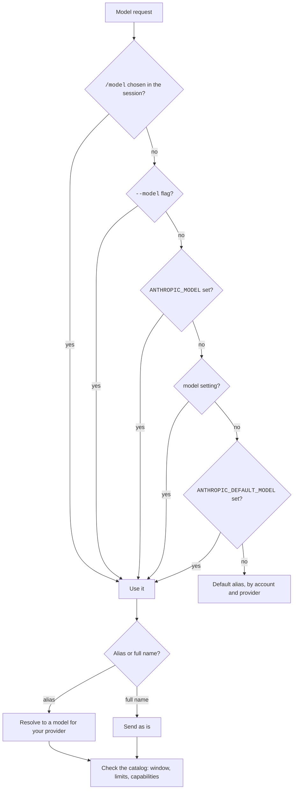
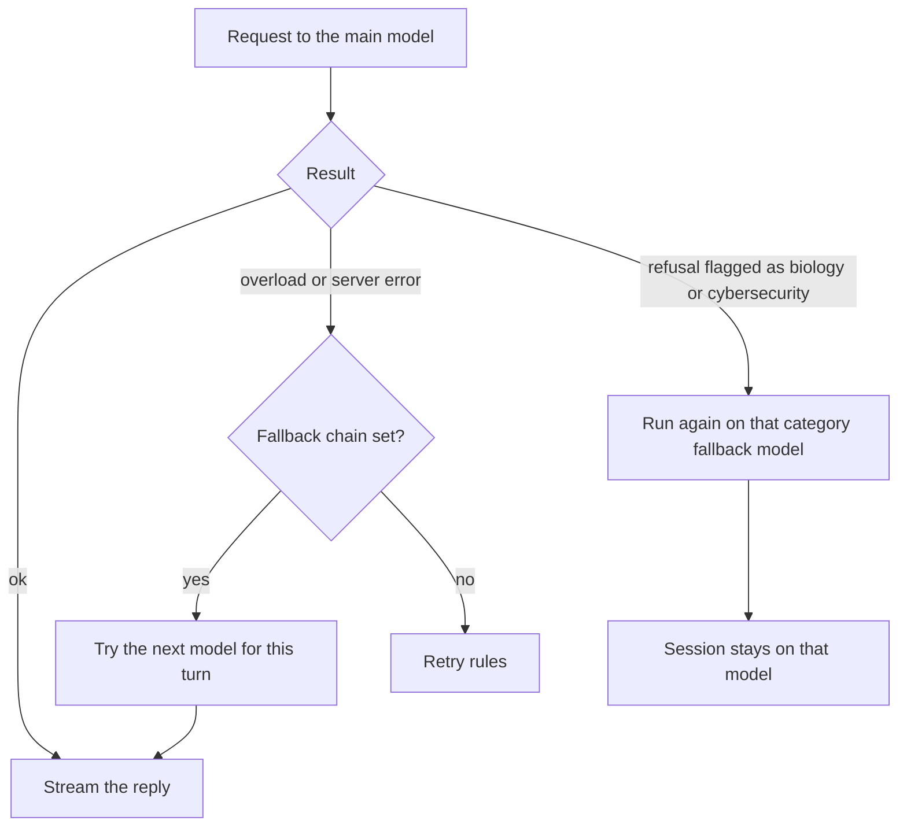

# Models


A model is the Claude version that answers you.
Effort is how hard the model thinks before it answers.
An API call is one request to the model server.
This page explains how Claude Code chooses each of these and what happens when a call fails.
The full list of models, aliases, and providers is on [Models and Providers](https://xsyetopz.github.io/claude-code-docs/configure/models-and-providers.md).

## At a Glance

| Question | Answer |
| --- | --- |
| Can you use it? | ✅ Yes. Every request names a model. |
| Can you change it? | ✅ Yes. Change the model, the effort, the thinking mode, the fallback chain, and the retry rules. |
| Can you turn it on or off? | Thinking can be turned off on older models. Fallback is off until you set a chain. |
| Where does it live? | `--model`, `ANTHROPIC_MODEL`, `/model`, and the settings `model`, `modelSettings`, `availableModels`, `fallbackModel`, `effortLevel`. |
| Status | [Documented] [Undocumented] |

## Choosing the Model

Sources: [Model Configuration](https://code.claude.com/docs/en/model-config) and [Hooks Reference](https://code.claude.com/docs/en/hooks).



| Item | Status | What it does |
| --- | --- | --- |
| `--model <model>` | [Documented] | Sets the model of the session to an alias or a full name. |
| `ANTHROPIC_MODEL` | [Documented] | Sets the model with the same values as `--model`. |
| `ANTHROPIC_DEFAULT_MODEL` | [Documented] | Sets the default for new sessions. It has the lowest priority. |
| `/model` | [Documented] | Switches the model in a session and saves the choice in your user settings. |
| `model`, `modelSettings`, `availableModels`, `fallbackModel` | [Documented] | Settings for the model, options for each model, an allowlist, and a fallback chain. |
| `default` | [Documented] | Clears the override. The model is then Opus 5.5 on the Anthropic API, on the paid plans, and on AWS and Google Cloud. |
| `opusplan` | [Documented] | Uses `opus` in plan mode and `sonnet` when it runs the plan. |
| `best` | [Documented] | Uses the `fable` model where you have it, and `opus` otherwise. |
| `[1m]` suffix | [Documented] | Asks for the 1M window, as in `sonnet[1m]`. It does nothing on a model that has it already. |
| `--include-unsupported-models` | [Undocumented] | Offers models that your account can use and that this version does not know. |
| `PreModelSwitch`, `PostModelSwitch` hooks | [Documented] | Run around a switch. `PreModelSwitch` can block it. |

A switch of the model is a cache miss. See [Request and Cache](https://xsyetopz.github.io/claude-code-docs/how-it-works/request-and-cache.md#what-breaks-the-cache).

## Effort

The effort levels are `low`, `medium`, `high`, `xhigh`, and `max`.
A level that the model does not accept runs as the highest accepted level below it.
Source: [Model Configuration](https://code.claude.com/docs/en/model-config).

| Item | Status | What it does |
| --- | --- | --- |
| `--effort <level>` | [Documented] | Sets the effort of a session. `ultracode` sets `xhigh` and turns on the workflow mode. |
| `CLAUDE_CODE_EFFORT_LEVEL` | [Documented] | Sets the effort. It wins over `--effort`, `/effort`, and the settings. `auto` uses the default of the model. |
| `effortLevel`, `modelSettings`, `maxEffortLevel` | [Documented] | Settings for the default level and for a cap. |
| `output_config.effort` | [Documented] | The request field that carries the level. |
| `per-turn-control-2026-07-01` | [Undocumented] | A beta that lets some models take the effort with each message. |
| `ultrathink` | [Documented] | A word in a prompt that asks for deeper thinking on that turn only. |
| Default effort | [Documented] | `high`, except `medium` for Opus 5.5, Sonnet 5.5, and Haiku 5.5, and `xhigh` for Opus 4.7. |

## Thinking

Sources: [Model Configuration](https://code.claude.com/docs/en/model-config) and [Environment Variables](https://code.claude.com/docs/en/env-vars).

| Item | Status | What it does |
| --- | --- | --- |
| `thinking: {type: "adaptive"}` | [Documented] | Lets the model choose how long it thinks. Newer models always use it. |
| `--thinking <enabled\|adaptive\|disabled>` | [Undocumented] | A hidden flag for print mode. `enabled` means the same as `adaptive`. |
| `--thinking-display <summarized\|omitted\|highlights>` | [Undocumented] | A hidden flag that sets how the thinking text comes back. |
| `--max-thinking-tokens` | [Undocumented] | A hidden flag that is deprecated. Use `--thinking` instead. |
| `MAX_THINKING_TOKENS` | [Documented] | Sets a fixed thinking budget. `0` turns thinking off on the Anthropic API. |
| `CLAUDE_CODE_DISABLE_ADAPTIVE_THINKING` | [Documented] | Goes back to the fixed budget on Opus 4.6 and Sonnet 4.6. |
| `CLAUDE_CODE_DISABLE_THINKING` | [Documented] | Leaves out the `thinking` field, for proxies that reject it. |
| `alwaysThinkingEnabled`, `showThinkingSummaries` | [Documented] | Settings for thinking. `Option+T` or `Alt+T` toggles it in a session. |

`MAX_THINKING_TOKENS` cannot turn thinking off on Opus 5.5, Sonnet 5.5, Haiku 5.5, and the Fable models.
`CLAUDE_CODE_DISABLE_ADAPTIVE_THINKING` has no effect on newer models.

## Capabilities

The model catalog gives each model a list of capability flags.
The code tests a flag to switch a feature on for that model.
The docs do not list these flags, so every row is [Undocumented].
The meaning is given only where the docs or a string in the program make it clear.
The column "Models" counts the models that have the flag.

| Flag | Status | What it does | Models |
| --- | --- | --- | --- |
| `context_management` | [Undocumented] | The model works with the `context-management-2025-06-27` beta. | 18 |
| `effort` | [Undocumented] | The model accepts the `effort` setting. | 12 |
| `max_effort` | [Undocumented] | The model accepts the level `max`. | 12 |
| `xhigh_effort` | [Undocumented] | The model accepts the level `xhigh`. | 10 |
| `adaptive_thinking` | [Undocumented] | The model accepts adaptive thinking. | 12 |
| `mid_conv_tool_change` | [Undocumented] | The tool list can change in the middle of a conversation. | 8 |
| `rejects_disabled_thinking` | [Undocumented] | Thinking cannot be turned off, as the docs say for `MAX_THINKING_TOKENS`. | 6 |
| `per_turn_effort` | [Undocumented] | The model can take the effort with each message. | 4 |
| `per_turn_timing` | [Undocumented] | The model can take the current time with each message. | 4 |
| `lean_prompt` | [Undocumented] | The model-side input for the short system prompt. See [The System Prompt](https://xsyetopz.github.io/claude-code-docs/how-it-works/system-prompt.md#short-or-full-prompt). | 8 |
| `org_locked_thinking` | [Undocumented] | The organization locks the thinking setting. | 2 |
| `haiku_5_5_early_stopping_guidance` | [Undocumented] | Claude Code adds guidance against early stopping. | 1 |
| `refusal_fallback` | [Undocumented] | A refused request can run again on a fallback model. | 5 |
| `silent_turn_reminder` | [Undocumented] | Claude Code adds a reminder after a turn with no text. | 1 |
| `fast_mode` | [Undocumented] | The model supports `/fast`. | 3 |
| `thinking_disabled_effort_cap` | [Undocumented] | The program does not state the purpose. | 1 |
| `opus_5_prompt_bundle` | [Undocumented] | The model gets the prompt sections for Opus 5. | 1 |
| `opus_5_5_prompt_bundle` | [Undocumented] | The model gets the prompt sections for Opus 5.5. | 1 |
| `fable_5_mitigations` | [Undocumented] | The model gets extra safety text for Fable 5. | 3 |
| `fable_5_1_prompt_bundle` | [Undocumented] | The model gets the prompt sections for Fable 5.1. | 2 |

The flags `effort`, `max_effort`, `xhigh_effort`, and `adaptive_thinking` say which effort levels and which thinking mode a model accepts.
The betas `per-turn-control-2026-07-01` and `timing-2026-09-09` match the flags `per_turn_effort` and `per_turn_timing`.

## Fallback



- A fallback chain (`--fallback-model`, `fallbackModel`) holds at most three models.
  It covers overload and server errors, and not auth, billing, rate-limit, request-size, or transport errors.
  The switch lasts for the current turn, and the next turn tries the main model first.
  Source: [Model Configuration: Fallback Model Chains](https://code.claude.com/docs/en/model-config#fallback-model-chains).
- Content-based fallback applies to the Fable models, Opus 5.5, Sonnet 5.5, and Opus 5.
  A request that is flagged as biology or cybersecurity runs again on the fallback model of that category.
  The session then stays on that model.
  Source: [Model Configuration: Automatic Model Fallback](https://code.claude.com/docs/en/model-config#automatic-model-fallback).
- `CLAUDE_CODE_NO_MODEL_FALLBACK` forbids the substitution of a model ([Undocumented], a message in the program names it).

## Retries and Timeouts

Sources: [Error Reference: Automatic Retries](https://code.claude.com/docs/en/errors#automatic-retries) and [Environment Variables](https://code.claude.com/docs/en/env-vars).

| Item | Status | Default | Effect |
| --- | --- | --- | --- |
| `CLAUDE_CODE_MAX_RETRIES` | [Documented] | 10 | Sets how many times a failed request is tried again, up to 15. |
| `CLAUDE_CODE_RETRY_WATCHDOG` | [Documented] | Off | Retries `429` and `529` errors without end and removes the cap. |
| `CLAUDE_CODE_OVERLOADED_RETRY_BASE_DELAY_MS` | [Documented] | 500 | Sets the start of the wait after a `529` error. |
| `CLAUDE_CODE_OVERLOADED_RETRY_MAX_DELAY_MS` | [Documented] | 32000 | Sets the longest wait after a `529` error. |
| `API_TIMEOUT_MS` | [Documented] | 600000 | Sets the timeout of a request. |
| `CLAUDE_STREAM_IDLE_TIMEOUT_MS` | [Documented] | Set by the program | Closes a stream that is silent. A value below 5 minutes counts as 5 minutes. |
| `CLAUDE_STREAM_FIRST_BYTE_TIMEOUT_MS` | [Documented] | Set by the program | Sets the deadline for the first byte of a stream. |
| `CLAUDE_CODE_DISABLE_NONSTREAMING_FALLBACK` | [Documented] | Off | Stops the retry without streaming after a stream fails. |

When a request is too long for the context, Claude Code tries again with a smaller `max_tokens`, and it compacts when that is not enough.
The loop also recovers from a stop at `max_tokens` and from a bad tool call. See [The Agent Loop](https://xsyetopz.github.io/claude-code-docs/how-it-works/agent-loop.md#recovery-inside-the-loop).

## Example

Run one hard task with a stronger model and more thinking.
Make a script fail sooner by lowering the retry count.

```bash
claude --model opus --effort high
CLAUDE_CODE_MAX_RETRIES=3 claude -p "summarize this repo"
```

## Related Pages

- [Models and Providers](https://xsyetopz.github.io/claude-code-docs/configure/models-and-providers.md)
- [Request and Cache](https://xsyetopz.github.io/claude-code-docs/how-it-works/request-and-cache.md)
- [Context and Compaction](https://xsyetopz.github.io/claude-code-docs/how-it-works/context-and-compaction.md)
- [Settings](https://xsyetopz.github.io/claude-code-docs/configure/settings.md) and [Environment Variable](https://xsyetopz.github.io/claude-code-docs/configure/env-vars.md) pages in Configure.
