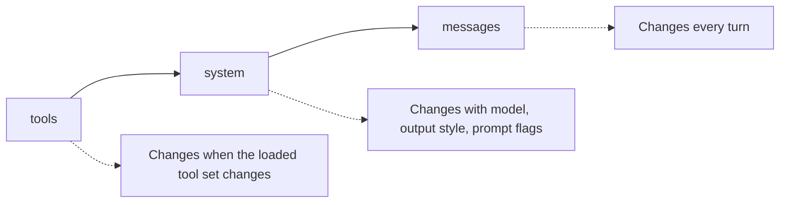
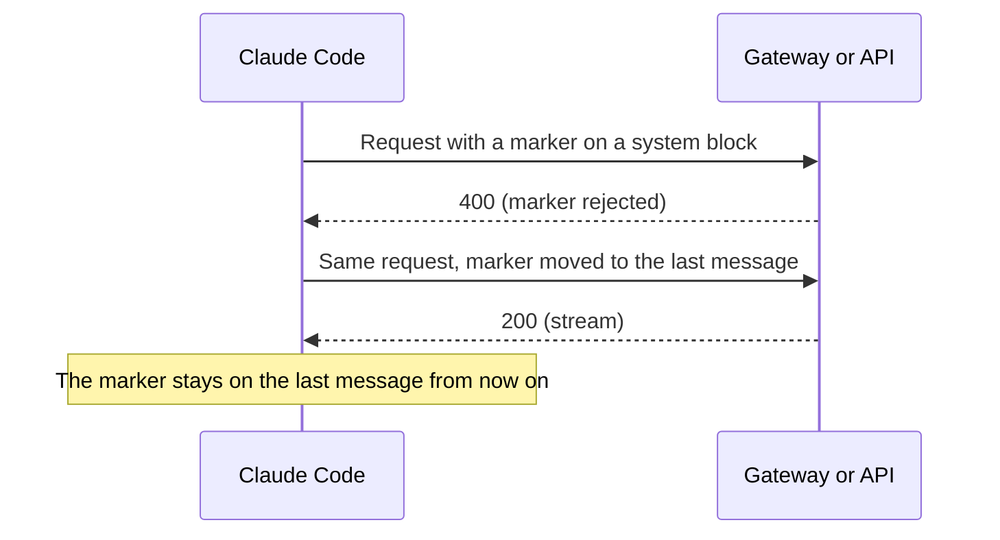

# Request and Cache


Each time the model must answer, Claude Code builds one request to the Messages API.
The request holds the tool list, the system prompt, and the whole conversation so far.
The API can reuse the start of a request it has seen before. That reuse is the prompt cache.
What you change in the request decides what the cache can reuse, so it decides speed and cost.

## Parts of a Request

The API reads the parts in this order: tools, then system, then messages.
A change in an early part makes the later parts miss the cache.
Source: [How Claude Code Uses Prompt Caching](https://code.claude.com/docs/en/prompt-caching).



| Part | Status | Content | Changes when |
| --- | --- | --- | --- |
| `tools` | [Documented] | The tool definitions. MCP tools are deferred by default, so only their names go in. | The set of loaded tools changes. |
| `system` | [Documented] | The attribution line, the identity line, and the system prompt. | The model, the output style, or the prompt flags change. |
| `messages` | [Documented] | The first user message with project context (`CLAUDE.md`, auto memory, unscoped rules), then the conversation. | Every turn. |

Project context changes at session start, at `/clear`, and at `/compact`.

## Body Fields

The field list comes from the official docs and from `api-request` lines that version 2.1.305 wrote to a local transcript. They and a stub run of 2.1.305 wrote `api-request` lines with the keys `model`, `betas`, `max_tokens`, `thinking`, `context_management`, and `output_config`.

| Field | Status | Content |
| --- | --- | --- |
| `model` | [Documented] | The model ID. |
| `max_tokens` | [Documented] | The output limit. `CLAUDE_CODE_MAX_OUTPUT_TOKENS` can change it up to the model cap. |
| `thinking` | [Documented] | The thinking mode, such as `{"type": "adaptive"}`. |
| `output_config` | [Documented] | The `effort` level, the format of structured output, and `task_budget`. See [Gateway Compatibility Guide](https://code.claude.com/docs/en/llm-gateway-protocol) in the official docs. |
| `context_management` | [Documented] | Edits that clear old thinking or old tool results. |
| `betas` | [Documented] | The list of beta values, sent in the `anthropic-beta` header. |
| `safeguards` | [Undocumented] | A list of safety checks, such as `dangerous_tool_use`, with the context that each check needs. |
| `system` | [Documented] | An array of text blocks with `cache_control`. |
| `tools` | [Documented] | An array of tool definitions. |
| `messages` | [Documented] | The conversation. An entry with `role: "system"` can join in the middle. |
| `CLAUDE_CODE_EXTRA_BODY` | [Documented] | An env var that adds fields to the body. |

The transcript line `api-request` records the request.
The lines `api-request-shape` and `api-request-blob` store parts of it once, by hash.
All three are [Undocumented]. See [Transcript Format](https://xsyetopz.github.io/claude-code-docs/reference/transcript-format.md).

## System Blocks and Cache Markers

A cache marker (`cache_control`) tells the API: "everything up to here can be reused."
An observed request had three `system` blocks and three markers.

| Position | Status | Marker |
| --- | --- | --- |
| `system[0]` (attribution line) | [Undocumented] | No marker. |
| `system[1]` (identity line) | [Undocumented] | `ephemeral`, `ttl: 1h`, `scope: global`. |
| `system[2]` (system prompt) | [Undocumented] | `ephemeral`, `ttl: 1h`. |
| Last block of the last message | [Undocumented] | `ephemeral`, `ttl: 1h`. |

Claude Code also marks the block of system context in the middle of a conversation, such as file-change notices, on every provider.
`CLAUDE_CODE_DISABLE_EXPERIMENTAL_BETAS` turns this off.
If a gateway rejects the marker with a `400` error, Claude Code moves it to the last message and keeps it there.



## Cache Lifetime

Sources: [How Claude Code Uses Prompt Caching: Cache Lifetime](https://code.claude.com/docs/en/prompt-caching#cache-lifetime) and [Environment Variables](https://code.claude.com/docs/en/env-vars).

| Item | Status | Effect |
| --- | --- | --- |
| Main conversation | [Documented] | The cache lasts one hour on a Claude subscription within plan usage, and five minutes otherwise. |
| Subagents, workflows, forks, compaction, and titles | [Documented] | The cache lasts five minutes, except for some helper requests that the server sets. |
| `promptCacheTtl`, `CLAUDE_CODE_PROMPT_CACHE_TTL` | [Documented] | Sets `5m` or `1h` for the main conversation. |
| `subagentPromptCacheTtl`, `CLAUDE_CODE_SUBAGENT_PROMPT_CACHE_TTL` | [Documented] | Sets `5m` or `1h` for everything else. |
| `ENABLE_PROMPT_CACHING_1H` | [Documented] | Asks for one hour in both groups. |
| `FORCE_PROMPT_CACHING_5M` | [Documented] | Forces five minutes. It wins over the other items. |
| `DISABLE_PROMPT_CACHING` | [Documented] | Turns caching off. The suffixes `_HAIKU`, `_SONNET`, `_OPUS`, and `_FABLE` turn it off for one model family. |
| `DISABLE_PROMPT_CACHING_MYTHOS` | [Undocumented] | Turns caching off for the Mythos models. |
| `CLAUDE_CODE_MESSAGES_PROMPT_CACHE_TTL` | [Undocumented] | Appears in the env schema. No source states what it does. |

The cache is per machine and per folder, because the prompt holds memory paths and the working directory.

## What Breaks the Cache

Source: [How Claude Code Uses Prompt Caching](https://code.claude.com/docs/en/prompt-caching).

| Action | Status | Effect |
| --- | --- | --- |
| Switch model | [Documented] | Full miss. `/model` asks first while the cache is warm. |
| Change effort | [Documented] | Full miss on most models. Opus 5.5, Sonnet 5.5, Haiku 5.5, and Fable 5.1 keep the cache. |
| Turn on fast mode | [Documented] | One miss, because a header joins the cache key. |
| Add or remove MCP tools that are not deferred | [Documented] | A miss. Deferred tools keep the first tool list for the conversation. |
| Deny a whole tool | [Documented] | A miss, because its definition leaves the list. |
| Run `/compact` | [Documented] | A new prefix starts. |
| Upgrade Claude Code | [Documented] | A miss. |
| Enable a plugin with skills, agents, or hooks | [Documented] | No miss, because the content is appended. |

## Per-Turn Values

Some models can take their effort level and the current time with each message.
Claude Code then sends them in a system entry of the message, with the betas `per-turn-control-2026-07-01` and `timing-2026-09-09`.
These values are [Undocumented]. The capability flags `per_turn_effort` and `per_turn_timing` mark the models that accept them. See [Models](https://xsyetopz.github.io/claude-code-docs/how-it-works/models.md#capabilities).

## Facts From Probes

A local stub of the Messages API showed these facts.
No model call left the machine.

- A model name with the `[1m]` suffix adds the `context-1m-2025-08-07` beta. Without the suffix it is never sent.
- The call to `/v1/messages/cache_touch` needs a subscriber login and the `cache-keepalive-2026-09-03` beta.
  It repeats every 30 seconds (10 to 120), with the body `{"request_id": ...}`.

## What You Can Change

| Goal | How |
| --- | --- |
| Keep the cache alive longer | Set `CLAUDE_CODE_PROMPT_CACHE_TTL=1h` or `ENABLE_PROMPT_CACHING_1H=1`. |
| Make a gateway happy | Set `CLAUDE_CODE_DISABLE_EXPERIMENTAL_BETAS=1`. |
| Add a field to every request | Set `CLAUDE_CODE_EXTRA_BODY` to JSON. |
| Turn caching off | Set `DISABLE_PROMPT_CACHING=1`, or one family variant. |
| Avoid a miss | Pick the model and effort at the start of a session. |
| Keep machine facts out of the system prompt | Use `--exclude-dynamic-system-prompt-sections`. It moves the working folder, environment, memory paths, and git status into the first user message. See [The System Prompt](https://xsyetopz.github.io/claude-code-docs/how-it-works/system-prompt.md). |

## Example

You switch models in the middle of a task with `/model`.
The next request has no cache hits, because each model has its own cache.
Pick the model at the start of a session to avoid this.

```bash
ENABLE_PROMPT_CACHING_1H=1 claude --model sonnet
```

## Related Pages

- [The System Prompt](https://xsyetopz.github.io/claude-code-docs/how-it-works/system-prompt.md)
- [Context and Compaction](https://xsyetopz.github.io/claude-code-docs/how-it-works/context-and-compaction.md)
- [The Agent Loop](https://xsyetopz.github.io/claude-code-docs/how-it-works/agent-loop.md)
- [Models](https://xsyetopz.github.io/claude-code-docs/how-it-works/models.md)
- [API Endpoints](https://xsyetopz.github.io/claude-code-docs/reference/api/endpoints.md) and [API Betas](https://xsyetopz.github.io/claude-code-docs/reference/api/betas.md) pages in Reference.
