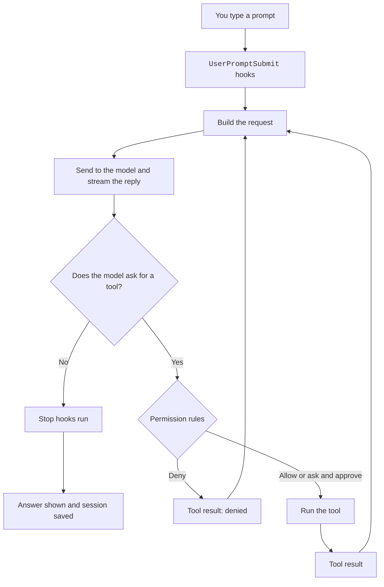

# Every Part of Claude Code You Can Use or Change

Unofficial community docs for version `2.1.304`, built from the official docs and the program itself. Not made by or tied to Anthropic. For supported behavior, check the official docs first.

- [Documented] An official docs page names it.
- [Undocumented] Only the program shows it. It can change without notice.
- [Differs] The docs and the program disagree. The row says how.
- [Gated] It works only behind a flag or a server gate.

Claude Code is a coding assistant that runs in your terminal, your editor, and the cloud.
You tell it a task in plain words. It reads your files, runs commands, and edits code to finish the task.
You can change almost every part of it with settings, hooks, plugins, skills, and MCP servers.

## What This Site Covers

The [official docs](https://code.claude.com/docs/en/overview) explain the features that Anthropic supports.
This site goes further. It lists every surface you can use, change, or switch on and off, whether the [official docs](https://code.claude.com/docs/en/overview) name it or not.
It also explains how the program works inside, so you can predict what a setting will do.

Read [How to Read These Docs](https://xsyetopz.github.io/claude-code-docs/start/how-to-read.md) for the full guide to badges and tables.
The text uses Simple English: short sentences and common words.

## Claude Code in One Minute

Claude Code is one program that runs a loop.
You send a prompt. The program builds a request and sends it to a model. The model either answers or asks for a tool.
If it asks for a tool, Claude Code checks your permission rules, runs the tool, and sends the result back.
The loop stops when the model answers without asking for a tool.

Along the way, Claude Code saves the conversation to a file in `~/.claude/projects/`, so you can resume it later.
When the conversation gets too long, it asks the model for a short summary and goes on from the summary.

| Step | What happens | Learn more |
| --- | --- | --- |
| Start | The program reads your settings, memory files, plugins, and MCP servers. | [Architecture](https://xsyetopz.github.io/claude-code-docs/how-it-works/architecture.md) |
| Turn | Your prompt becomes a request, the model streams a reply, and tools run. | [The Agent Loop](https://xsyetopz.github.io/claude-code-docs/how-it-works/agent-loop.md) |
| Request | The request holds tools, the system prompt, and the conversation, with cache markers. | [Request and Cache](https://xsyetopz.github.io/claude-code-docs/how-it-works/request-and-cache.md) |
| Prompt | The first text the model reads is built from named sections. | [The System Prompt](https://xsyetopz.github.io/claude-code-docs/how-it-works/system-prompt.md) |
| Context | Old messages are summarized when the window fills up. | [Context and Compaction](https://xsyetopz.github.io/claude-code-docs/how-it-works/context-and-compaction.md) |
| Save | Each message is appended to a JSONL file. | [Sessions and Storage](https://xsyetopz.github.io/claude-code-docs/how-it-works/sessions-and-storage.md) |
| Model | The model, effort, thinking, and retries are chosen. | [Models](https://xsyetopz.github.io/claude-code-docs/how-it-works/models.md) |

## Map of the Site

| Section | What you find there | Start with |
| --- | --- | --- |
| Start Here | How to read the badges, a map of what you can change, the files Claude Code keeps, and breaking changes per release. | [How to Read These Docs](https://xsyetopz.github.io/claude-code-docs/start/how-to-read.md) and [What Changed](https://xsyetopz.github.io/claude-code-docs/start/what-changed.md) |
| How It Works | The harness in depth: architecture, the agent loop, requests and cache, the system prompt, compaction, sessions, models, and permissions. | [Architecture](https://xsyetopz.github.io/claude-code-docs/how-it-works/architecture.md) |
| Configure | Settings keys, environment variables, command line flags, permissions, memory, output styles, the status line, and models and providers. | [Models and Providers](https://xsyetopz.github.io/claude-code-docs/configure/models-and-providers.md) |
| Extend | Hooks, skills and commands, subagents, plugins, MCP servers, the Mod API, and headless mode. | Hooks and Plugins |
| Reference | Every tool and parameter, API endpoints and betas, the transcript format, probes, and an index of undocumented items. | [Transcript Format](https://xsyetopz.github.io/claude-code-docs/reference/transcript-format.md) and [Undocumented Items](https://xsyetopz.github.io/claude-code-docs/reference/undocumented.md) |
| System Prompts | The full text of each system prompt variant, captured offline, with sizes and diffs. | [Captured System Prompts](https://xsyetopz.github.io/claude-code-docs/prompts.md) |

## Where to Go Next

- To change how Claude Code behaves, begin with [Models and Providers](https://xsyetopz.github.io/claude-code-docs/configure/models-and-providers.md) and the Settings pages.
- To write a hook or a plugin, read [The Agent Loop](https://xsyetopz.github.io/claude-code-docs/how-it-works/agent-loop.md) first. It shows where each hook event fires.
- To understand cost and speed, read [Request and Cache](https://xsyetopz.github.io/claude-code-docs/how-it-works/request-and-cache.md).
- To see exactly what the model reads, open [Captured System Prompts](https://xsyetopz.github.io/claude-code-docs/prompts.md).
- To help improve this site, read the [Style Guide](https://xsyetopz.github.io/claude-code-docs/contributing/style-guide.md).
