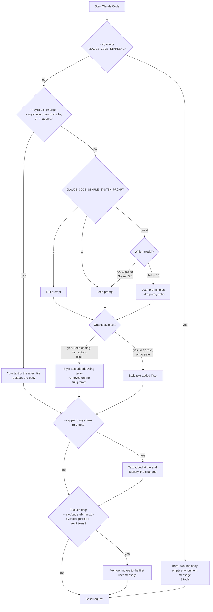

# Captured System Prompts


A system prompt is the text that Claude Code sends to the model before your first message. It tells the model who it is, how to behave, and what the session looks like. The model reads it on every request.

Claude Code has no single system prompt. It builds one from parts. The parts depend on the model, on flags, on env vars, on your output style, and on whether the request comes from the main agent or a subagent. This section shows every variant that you can pick, in full, with a diff against the default.

The text on these pages is Anthropic's. It is shown here only to describe how the program works. See the notice on the home page.

Status badges: [Documented] means an official docs page names the switch. [Undocumented] means only the program shows it. [Differs: example] means the docs and the program disagree. [Gated: example] means a flag or a server gate is needed.

## At a Glance

You can use every prompt here: the answer to "Can you use it?" is ✅ Yes for all of them. Where a page adds a condition, it is in parentheses after the name.

| Prompt | Can You Change It? | Turn On or Off | Where It Lives | Status |
| --- | --- | --- | --- | --- |
| [Default, Lean Prompt](https://xsyetopz.github.io/claude-code-docs/prompts/default-lean.md) (Every session on a lean model gets it) | ✅ Yes. Use the flags and settings on the other pages. | `CLAUDE_CODE_SIMPLE_SYSTEM_PROMPT=0` switches to the full prompt. | Built into the program. Nothing on disk. | [Undocumented] |
| [Default, Sonnet 5.5](https://xsyetopz.github.io/claude-code-docs/prompts/default-sonnet.md) (Every Sonnet 5.5 session gets it) | ✅ Yes. Use the flags and settings on the other pages. | `CLAUDE_CODE_SIMPLE_SYSTEM_PROMPT=0` switches to the full prompt. | Built into the program. Nothing on disk. | [Documented] |
| [Default, Haiku 5.5](https://xsyetopz.github.io/claude-code-docs/prompts/default-haiku.md) (Every Haiku 5.5 session gets it) | ✅ Yes. Use the flags and settings on the other pages. | `CLAUDE_CODE_SIMPLE_SYSTEM_PROMPT=0` switches to the full prompt. | Built into the program. Nothing on disk. | [Undocumented] |
| [Full Prompt](https://xsyetopz.github.io/claude-code-docs/prompts/full-prompt.md) | ✅ Yes. Set or unset the env var. | `CLAUDE_CODE_SIMPLE_SYSTEM_PROMPT=0` (also `false`, `no`, `off`). | Environment variable. Put it under `env` in `settings.json` to keep it. | [Documented] |
| [Simple Prompt Switch on Sonnet](https://xsyetopz.github.io/claude-code-docs/prompts/simple-prompt-sonnet.md) | ✅ Yes. Set or unset the env var. | `CLAUDE_CODE_SIMPLE_SYSTEM_PROMPT=1`. | Environment variable. | [Documented] |
| [Simple Prompt Switch on Haiku](https://xsyetopz.github.io/claude-code-docs/prompts/simple-prompt-haiku.md) | ✅ Yes. Set or unset the env var. | `CLAUDE_CODE_SIMPLE_SYSTEM_PROMPT=1`. | Environment variable. | [Documented] |
| [Simple Prompt Switch on Opus](https://xsyetopz.github.io/claude-code-docs/prompts/simple-prompt-opus.md) | ✅ Yes. Set or unset the env var. | `CLAUDE_CODE_SIMPLE_SYSTEM_PROMPT=1`. | Environment variable. | [Documented] |
| [Bare Mode](https://xsyetopz.github.io/claude-code-docs/prompts/bare.md) | ❌ No. The two lines are fixed. | `--bare` or `CLAUDE_CODE_SIMPLE=1`. | Command-line flag. | [Documented] |
| [Simple Mode Env Var](https://xsyetopz.github.io/claude-code-docs/prompts/simple-env.md) | ❌ No. The two lines are fixed. | `CLAUDE_CODE_SIMPLE=1`. | Environment variable. | [Documented] |
| [Exclude Dynamic Sections](https://xsyetopz.github.io/claude-code-docs/prompts/exclude-dynamic.md) | ❌ No. It only moves text. | `--exclude-dynamic-system-prompt-sections`. | Command-line flag. | [Documented] |
| [Exclude Dynamic Sections, Full Prompt](https://xsyetopz.github.io/claude-code-docs/prompts/exclude-dynamic-full.md) | ❌ No. It only moves text. | `--exclude-dynamic-system-prompt-sections`. | Command-line flag. | [Documented] |
| [Output Style, Explanatory](https://xsyetopz.github.io/claude-code-docs/prompts/style-explanatory.md) | Not the built-in text. You can write a custom style. | `/output-style` or the `outputStyle` setting. | `outputStyle` in any settings scope. | [Documented] |
| [Output Style, Learning](https://xsyetopz.github.io/claude-code-docs/prompts/style-learning.md) | Not the built-in text. You can write a custom style. | `/output-style` or the `outputStyle` setting. | `outputStyle` in any settings scope. | [Documented] |
| [Output Style, Proactive](https://xsyetopz.github.io/claude-code-docs/prompts/style-proactive.md) | Not the built-in text. You can write a custom style. | `/output-style` or the `outputStyle` setting. | `outputStyle` in any settings scope. | [Documented] |
| [Output Style, Concise](https://xsyetopz.github.io/claude-code-docs/prompts/style-concise.md) | Not the built-in text. You can write a custom style. | `/output-style` or the `outputStyle` setting. | `outputStyle` in any settings scope. | [Documented] |
| [Custom Output Style](https://xsyetopz.github.io/claude-code-docs/prompts/style-custom.md) | ✅ Yes. You write the file. | `/output-style` or the `outputStyle` setting. | `~/.claude/output-styles/*.md` or `.claude/output-styles/*.md`. | [Documented] |
| [Custom Output Style on the Full Prompt](https://xsyetopz.github.io/claude-code-docs/prompts/style-custom-full.md) | ✅ Yes. You write the file. | `/output-style` or the `outputStyle` setting. | `~/.claude/output-styles/*.md` or `.claude/output-styles/*.md`. | [Documented] |
| [Custom Output Style with Keep Coding Instructions](https://xsyetopz.github.io/claude-code-docs/prompts/style-custom-keep.md) | ✅ Yes. You write the file. | `keep-coding-instructions` in the style's front matter. | `~/.claude/output-styles/*.md` or `.claude/output-styles/*.md`. | [Documented] |
| [Custom Output Style with Keep Coding Instructions, Lean Prompt](https://xsyetopz.github.io/claude-code-docs/prompts/style-custom-keep-lean.md) | ✅ Yes. You write the file. | `keep-coding-instructions` in the style's front matter. | `~/.claude/output-styles/*.md` or `.claude/output-styles/*.md`. | [Documented] |
| [Append System Prompt](https://xsyetopz.github.io/claude-code-docs/prompts/append-system-prompt.md) | ✅ Yes. You give the text. | `--append-system-prompt` or `--append-system-prompt-file`. | Command-line flags. | [Documented] |
| [Replace System Prompt](https://xsyetopz.github.io/claude-code-docs/prompts/system-prompt.md) | ✅ Yes. You give the text. | `--system-prompt` or `--system-prompt-file`. | Command-line flags. | [Documented] |
| [Replace and Append Together](https://xsyetopz.github.io/claude-code-docs/prompts/system-prompt-append.md) | ✅ Yes. You give the text. | The two flags. | Command-line flags. | [Documented] |
| [With a CLAUDE.md File](https://xsyetopz.github.io/claude-code-docs/prompts/claude-md.md) | ✅ Yes. You write the file. | Add or remove the file. `CLAUDE_CODE_DISABLE_CLAUDE_MDS=1` skips them. | `CLAUDE.md`, `.claude/CLAUDE.md`, `~/.claude/CLAUDE.md`. | [Documented] |
| [Inside a Git Repository](https://xsyetopz.github.io/claude-code-docs/prompts/git-repo.md) (It happens on its own) | ❌ No. | `includeGitInstructions` in settings controls the git rules. The status text always appears in a repo. | Built into the program. | [Undocumented] |
| [Main Thread Custom Agent](https://xsyetopz.github.io/claude-code-docs/prompts/agent-main.md) | ✅ Yes. You write the agent file. | `--agent` or the `agent` setting. | `.claude/agents/*.md` or `~/.claude/agents/*.md`. | [Documented] |
| [Permission Mode, Plan](https://xsyetopz.github.io/claude-code-docs/prompts/mode-plan.md) | ❌ No. | `--permission-mode` or `defaultMode` in settings. | Flag or settings. | [Documented] |
| [Permission Mode, Accept Edits](https://xsyetopz.github.io/claude-code-docs/prompts/mode-acceptEdits.md) | ❌ No. | `--permission-mode` or `defaultMode` in settings. | Flag or settings. | [Documented] |
| [Permission Mode, Don't Ask](https://xsyetopz.github.io/claude-code-docs/prompts/mode-dontAsk.md) | ❌ No. | `--permission-mode` or `defaultMode` in settings. | Flag or settings. | [Documented] |
| [Brief Mode](https://xsyetopz.github.io/claude-code-docs/prompts/brief.md) | ❌ No. | `--brief`. | Command-line flag. | [Undocumented] |
| [Compaction Prompt](https://xsyetopz.github.io/claude-code-docs/prompts/compact.md) | Partly. You can add focus text after `/compact`. | `/compact`, or automatic when the context fills. | Built into the program. | [Undocumented] |
| [Subagent, General Purpose](https://xsyetopz.github.io/claude-code-docs/prompts/subagent-general-purpose.md) (The model starts subagents) | Not the built-in text. You can write custom agents. | `--disallowedTools Agent` stops all subagents. | Built into the program. | [Undocumented] |
| [Subagent, Explore](https://xsyetopz.github.io/claude-code-docs/prompts/subagent-explore.md) (The model starts subagents) | Not the built-in text. You can write custom agents. | `--disallowedTools Agent` stops all subagents. | Built into the program. | [Undocumented] |
| [Subagent, Plan](https://xsyetopz.github.io/claude-code-docs/prompts/subagent-plan.md) (The model starts subagents) | Not the built-in text. You can write custom agents. | `--disallowedTools Agent` stops all subagents. | Built into the program. | [Undocumented] |
| [Subagent, Custom Agent](https://xsyetopz.github.io/claude-code-docs/prompts/subagent-custom.md) | ✅ Yes. You write the agent file. | Add or remove the file. | `.claude/agents/*.md` or `~/.claude/agents/*.md`. | [Documented] |
| [Subagent, Statusline Setup](https://xsyetopz.github.io/claude-code-docs/prompts/subagent-statusline-setup.md) | ✅ Yes. A user agent file with the same name replaces it. | `--disallowedTools Agent` stops all subagents. | Built into the program. Override in `.claude/agents/<name>.md`. | [Undocumented] |
| [Subagent, Claude (FleetView)](https://xsyetopz.github.io/claude-code-docs/prompts/subagent-claude.md) | ✅ Yes. A user agent file with the same name replaces it. | `--disallowedTools Agent` stops all subagents. | Built into the program. Override in `.claude/agents/<name>.md`. | [Undocumented] |
| [Subagent, Web Fetch](https://xsyetopz.github.io/claude-code-docs/prompts/subagent-web-fetch.md) | ✅ Yes. A user agent file with the same name replaces it. | `CLAUDE_CODE_WEB_FETCH_AGENT=1` adds it. `CLAUDE_CODE_DISABLE_WEB_FETCH` removes it. | Built into the program. Override in `.claude/agents/web-fetch.md`. | [Undocumented] |
| [Subagent, Claude Code Guide](https://xsyetopz.github.io/claude-code-docs/prompts/subagent-claude-code-guide.md) | ✅ Yes. A user agent file with the same name replaces it. | Not offered in `-p` or the SDK entry points. `--disallowedTools Agent` stops all subagents. | Built into the program. Override in `.claude/agents/claude-code-guide.md`. | [Undocumented] |
| [Override a Built-in Agent with a File](https://xsyetopz.github.io/claude-code-docs/prompts/override-agent-file.md) | ✅ Yes. You write the agent file. | Add or remove the file. | `.claude/agents/*.md` or `~/.claude/agents/*.md`. | [Undocumented] |
| [Override a Built-in Agent with --agents](https://xsyetopz.github.io/claude-code-docs/prompts/override-agents-flag.md) | ✅ Yes. You give the JSON. | `--agents`. | Command-line flag. | [Documented] |
| [Append to Every Subagent Prompt](https://xsyetopz.github.io/claude-code-docs/prompts/override-append-subagent.md) | ✅ Yes. You give the text. | `--append-subagent-system-prompt` or `--append-subagent-system-prompt-file` (print mode only). | Command-line flags. | [Undocumented] |
| [Turn Off the Explore and Plan Agents](https://xsyetopz.github.io/claude-code-docs/prompts/disable-explore-plan.md) | ✅ Yes. It removes text. | `CLAUDE_CODE_DISABLE_EXPLORE_PLAN_AGENTS=1`. | Environment variable. | [Undocumented] |
| [Turn Off All Built-in Agents](https://xsyetopz.github.io/claude-code-docs/prompts/disable-builtin-agents.md) | ✅ Yes. It removes text. | `CLAUDE_AGENT_SDK_DISABLE_BUILTIN_AGENTS=1`. | Environment variable. | [Undocumented] |
| [Command, /init](https://xsyetopz.github.io/claude-code-docs/prompts/command-init.md) | ✅ Yes. A command or skill file with the same name may replace it. | Type `/init`. | Built into the program. | [Documented] |
| [Command, /security-review](https://xsyetopz.github.io/claude-code-docs/prompts/command-security-review.md) | ✅ Yes. A command or skill file with the same name may replace it. | Type `/security-review`. | Built into the program. | [Documented] |
| [Skill, /simplify](https://xsyetopz.github.io/claude-code-docs/prompts/command-simplify.md) | ✅ Yes. A command or skill file with the same name may replace it. | Type `/simplify`. | Built into the program. | [Undocumented] |
| [Skill, /debug](https://xsyetopz.github.io/claude-code-docs/prompts/command-debug.md) | ✅ Yes. A command or skill file with the same name may replace it. | Type `/debug`. | Built into the program. | [Undocumented] |
| [Override /init with a Command File](https://xsyetopz.github.io/claude-code-docs/prompts/override-command-init.md) | ✅ Yes. A command or skill file with the same name may replace it. | Type `/init`. | Built into the program. | [Undocumented] |
| [Override /simplify with a Skill File](https://xsyetopz.github.io/claude-code-docs/prompts/override-skill-simplify.md) | ✅ Yes. A command or skill file with the same name may replace it. | Type `/simplify`. | Built into the program. | [Undocumented] |
| [Prompt Hook Request](https://xsyetopz.github.io/claude-code-docs/prompts/hook-prompt.md) | Partly. You write the prompt and pick the model. The system text is fixed. | Add or remove the hook. | `hooks` in any settings scope. | [Documented] |
| [Agent Hook Request](https://xsyetopz.github.io/claude-code-docs/prompts/hook-agent.md) | Partly. You write the prompt and pick the model. The system text is fixed. | Add or remove the hook. | `hooks` in any settings scope. | [Documented] |
| [Auto Mode Classifier](https://xsyetopz.github.io/claude-code-docs/prompts/auto-classifier.md) | Partly. The `autoMode` setting edits the rule lists. | `--permission-mode auto` or `defaultMode: "auto"`. | `autoMode` in user, flag, or managed settings. | [Documented] |
| [Auto Mode Classifier, Custom Rules](https://xsyetopz.github.io/claude-code-docs/prompts/auto-classifier-custom.md) | ✅ Yes. You write the rules. | `autoMode` setting. | `autoMode` in user, flag, or managed settings. | [Documented] |
| [Compaction Prompt, Custom Instructions](https://xsyetopz.github.io/claude-code-docs/prompts/compact-custom.md) | ✅ Yes. You add focus text. The base summary rules stay. | `/compact <text>`. | The command line, `CLAUDE.md`, or a `PreCompact` hook. | [Documented] |
| [Plan Mode, Custom Workflow](https://xsyetopz.github.io/claude-code-docs/prompts/plan-mode-instructions.md) | ✅ Yes. You give the workflow text. The read-only rules and the `ExitPlanMode` rule stay. | `--plan-mode-instructions`. | Command-line flag. | [Undocumented] |
| [Git Instructions Turned Off](https://xsyetopz.github.io/claude-code-docs/prompts/git-instructions-off.md) | ✅ Yes. It removes text. | `includeGitInstructions` or `CLAUDE_CODE_DISABLE_GIT_INSTRUCTIONS=1`. | Any settings scope, or an environment variable. | [Documented] |
| [Auto Memory Turned Off](https://xsyetopz.github.io/claude-code-docs/prompts/memory-off.md) | ✅ Yes. It removes text. | `CLAUDE_CODE_DISABLE_AUTO_MEMORY=1` or `autoMemoryEnabled`. | Environment variable or any settings scope. | [Documented] |
| [Custom Output Style with a Built-in Name](https://xsyetopz.github.io/claude-code-docs/prompts/style-override-builtin.md) | ✅ Yes. You write the file. | `/output-style` or the `outputStyle` setting. | `~/.claude/output-styles/*.md` or `.claude/output-styles/*.md`. | [Undocumented] |
| [Subagent with --system-prompt and --append-system-prompt](https://xsyetopz.github.io/claude-code-docs/prompts/subagent-with-prompt-flags.md) | Not for the subagent. Use `--append-subagent-system-prompt`. | The flags. | Command-line flags. | [Undocumented] |
| [Prompt Hook on Stop](https://xsyetopz.github.io/claude-code-docs/prompts/hook-prompt-stop.md) | Partly. You write the prompt and pick the model. The system text is fixed. | Add or remove the hook. | `hooks` in any settings scope. | [Documented] |
| [Override a Prompt](https://xsyetopz.github.io/claude-code-docs/prompts/override.md) | ✅ Yes. The page lists each prompt you can replace, append to, or turn off. | Per prompt. See the page. | Flags, env vars, settings, and files. | [Undocumented] |
| [Tools per Variant](https://xsyetopz.github.io/claude-code-docs/prompts/tools-per-variant.md) (Every request carries the list) | ✅ Yes. Use `--tools`, `--allowedTools`, `--disallowedTools`, or settings. | `--bare` and `CLAUDE_CODE_SIMPLE=1` cut the list to three tools. | Built into the program. | [Undocumented] |

## How the Captures Were Made

Every prompt on these pages was captured offline, with no model call and no cost.

1. A script starts the installed program (version 2.1.305) in print mode (`-p`) once per variant.
2. The program talks to a small fake Messages API on `127.0.0.1`. The fake server writes each request body to a file and sends back a canned reply.
3. The run uses a fake API key, a dead proxy (`HTTPS_PROXY` and `HTTP_PROXY` point to a closed port), `CLAUDE_CODE_DISABLE_NONESSENTIAL_TRAFFIC=1`, `DISABLE_TELEMETRY=1`, and a temporary home, config folder, and project folder. No login token is used. The script checks that every request went to the local server.
4. A second script reads the saved request bodies, replaces machine-specific values with placeholders, and writes these pages. It makes the diffs with `diff -u`, not by hand.

For the subagent pages, the fake server answers the first turn with an `Agent` tool call. The program then starts a real subagent and sends its request to the fake server.

For the compaction page, the script runs twice in the same folders: once with `hi`, then with `--continue` and `/compact`.

## The Three System Blocks

Each request has a `system` field with three blocks, then messages. This is what the captures show.

| Block | What it holds | Cache marker |
| --- | --- | --- |
| `system[0]` | A billing header line with the program version and entry point (`cc_entrypoint=sdk-cli` in `-p` mode). | None |
| `system[1]` | The identity line. | `ephemeral` |
| `system[2]` | The body: the rules, the memory section, and your appended text. | `ephemeral` |

Not everything that the model reads as instructions is in `system`. Claude Code also sends the following in the `messages` list, before your own text:

- A reminder with the git attribution lines (first user message).
- Project memory files, git status, and (with `--exclude-dynamic-system-prompt-sections`) the memory section.
- A message with the role `system`. It holds the environment details, the output style text, the agent types, the skills list, and the date.

Every variant page shows all of these parts, in the order they are sent, with a `===` line before each part.

### Identity Line

In `-p` mode the identity line is the SDK line: `You are a Claude agent, built on Anthropic's Claude Agent SDK.` Every capture here uses `-p`, so every page shows that line, except pages where it changes (see below).

The program has three identity lines. Two more appear in its text:

- `You are Claude Code, Anthropic's official CLI for Claude.` This is the line for the interactive terminal app. It could not be captured offline: the full-screen app did not accept typed input in the test harness, so no request was sent. Setting `CLAUDE_CODE_ENTRYPOINT=cli` in `-p` mode does not change the line.
- `You are Claude Code, Anthropic's official CLI for Claude, running within the Claude Agent SDK.` Print mode sends this one when you use `--append-system-prompt`. See [Append System Prompt](https://xsyetopz.github.io/claude-code-docs/prompts/append-system-prompt.md).

## How Claude Code Picks the Variant

The chart shows what the captures prove. The order of the first three checks was not tested with every combination of flags.



Subagents skip this chart. They get their own body and notes (see [Subagent, general-purpose](https://xsyetopz.github.io/claude-code-docs/prompts/subagent-general-purpose.md)).

Captures disagree with the old wiki in one place: the wiki says models with `sonnet` or `haiku` in the name get the full prompt. In 2.1.305 they get the lean prompt, and only `CLAUDE_CODE_SIMPLE_SYSTEM_PROMPT=0` gives the full one.

## All Variants

Size is the number of characters in everything shown on the variant page, after placeholders are in place. The last column lists the `#` headings found in the system body.

| Variant | How to select it | Characters | Tools | Sections |
| --- | --- | --- | --- | --- |
| [Default, Lean Prompt](https://xsyetopz.github.io/claude-code-docs/prompts/default-lean.md) | Default on Opus 5.5 | 15,501 | 12 | `Harness`, `Session-specific guidance`, `Memory`, `Environment`, `Context management` |
| [Default, Sonnet 5.5](https://xsyetopz.github.io/claude-code-docs/prompts/default-sonnet.md) | Default on Sonnet 5.5 | 15,507 | 12 | `Harness`, `Session-specific guidance`, `Memory`, `Environment`, `Context management` |
| [Default, Haiku 5.5](https://xsyetopz.github.io/claude-code-docs/prompts/default-haiku.md) | Default on Haiku 5.5 | 18,296 | 12 | `Harness`, `Session-specific guidance`, `Memory`, `Environment`, `Context management` |
| [Full Prompt](https://xsyetopz.github.io/claude-code-docs/prompts/full-prompt.md) | `CLAUDE_CODE_SIMPLE_SYSTEM_PROMPT=0` | 36,885 | 12 | `System`, `Doing tasks`, `Executing actions with care`, `Using your tools`, `Tone and style`, `Text output (does not apply to tool calls)`, `Session-specific guidance`, `auto memory`, `Environment`, `Context management` |
| [Simple Prompt Switch on Sonnet](https://xsyetopz.github.io/claude-code-docs/prompts/simple-prompt-sonnet.md) (same text as default-sonnet) | `CLAUDE_CODE_SIMPLE_SYSTEM_PROMPT=1` on Sonnet | 15,507 | 12 | `Harness`, `Session-specific guidance`, `Memory`, `Environment`, `Context management` |
| [Simple Prompt Switch on Haiku](https://xsyetopz.github.io/claude-code-docs/prompts/simple-prompt-haiku.md) (same text as default-haiku) | `CLAUDE_CODE_SIMPLE_SYSTEM_PROMPT=1` on Haiku | 18,296 | 12 | `Harness`, `Session-specific guidance`, `Memory`, `Environment`, `Context management` |
| [Simple Prompt Switch on Opus](https://xsyetopz.github.io/claude-code-docs/prompts/simple-prompt-opus.md) (same text as default-lean) | `CLAUDE_CODE_SIMPLE_SYSTEM_PROMPT=1` on Opus | 15,501 | 12 | `Harness`, `Session-specific guidance`, `Memory`, `Environment`, `Context management` |
| [Bare Mode](https://xsyetopz.github.io/claude-code-docs/prompts/bare.md) | `--bare` | 362 | 3 | none |
| [Simple Mode Env Var](https://xsyetopz.github.io/claude-code-docs/prompts/simple-env.md) (same text as bare) | `CLAUDE_CODE_SIMPLE=1` | 362 | 3 | none |
| [Exclude Dynamic Sections](https://xsyetopz.github.io/claude-code-docs/prompts/exclude-dynamic.md) | `--exclude-dynamic-system-prompt-sections` | 15,396 | 12 | `Harness`, `Environment`, `Context management` |
| [Exclude Dynamic Sections, Full Prompt](https://xsyetopz.github.io/claude-code-docs/prompts/exclude-dynamic-full.md) | `--exclude-dynamic-system-prompt-sections` plus the full prompt | 36,895 | 12 | `System`, `Doing tasks`, `Executing actions with care`, `Using your tools`, `Tone and style`, `auto memory`, `Text output (does not apply to tool calls)`, `Session-specific guidance`, `Environment`, `Context management` |
| [Output Style, Explanatory](https://xsyetopz.github.io/claude-code-docs/prompts/style-explanatory.md) | Output style `Explanatory` | 16,688 | 12 | `Harness`, `Session-specific guidance`, `Memory`, `Environment`, `Context management` |
| [Output Style, Learning](https://xsyetopz.github.io/claude-code-docs/prompts/style-learning.md) | Output style `Learning` | 20,547 | 12 | `Harness`, `Session-specific guidance`, `Memory`, `Environment`, `Context management` |
| [Output Style, Proactive](https://xsyetopz.github.io/claude-code-docs/prompts/style-proactive.md) | Output style `Proactive` | 17,007 | 12 | `Harness`, `Session-specific guidance`, `Memory`, `Environment`, `Context management` |
| [Output Style, Concise](https://xsyetopz.github.io/claude-code-docs/prompts/style-concise.md) | Output style `Concise` | 17,041 | 12 | `Harness`, `Session-specific guidance`, `Memory`, `Environment`, `Context management` |
| [Custom Output Style](https://xsyetopz.github.io/claude-code-docs/prompts/style-custom.md) | Custom style file | 15,719 | 12 | `Harness`, `Session-specific guidance`, `Memory`, `Environment`, `Context management` |
| [Custom Output Style on the Full Prompt](https://xsyetopz.github.io/claude-code-docs/prompts/style-custom-full.md) | Custom style, full prompt | 33,782 | 12 | `System`, `Executing actions with care`, `Using your tools`, `Tone and style`, `Text output (does not apply to tool calls)`, `Session-specific guidance`, `auto memory`, `Environment`, `Context management` |
| [Custom Output Style with Keep Coding Instructions](https://xsyetopz.github.io/claude-code-docs/prompts/style-custom-keep.md) | Custom style with `keep-coding-instructions` | 37,103 | 12 | `System`, `Doing tasks`, `Executing actions with care`, `Using your tools`, `Tone and style`, `Text output (does not apply to tool calls)`, `Session-specific guidance`, `auto memory`, `Environment`, `Context management` |
| [Custom Output Style with Keep Coding Instructions, Lean Prompt](https://xsyetopz.github.io/claude-code-docs/prompts/style-custom-keep-lean.md) (same text as style-custom) | Custom style with `keep-coding-instructions`, lean | 15,719 | 12 | `Harness`, `Session-specific guidance`, `Memory`, `Environment`, `Context management` |
| [Append System Prompt](https://xsyetopz.github.io/claude-code-docs/prompts/append-system-prompt.md) | `--append-system-prompt` | 15,558 | 12 | `Harness`, `Session-specific guidance`, `Memory`, `Environment`, `Context management` |
| [Replace System Prompt](https://xsyetopz.github.io/claude-code-docs/prompts/system-prompt.md) | `--system-prompt` | 9,900 | 12 | none |
| [Replace and Append Together](https://xsyetopz.github.io/claude-code-docs/prompts/system-prompt-append.md) | `--system-prompt` plus `--append-system-prompt` | 9,957 | 12 | none |
| [With a CLAUDE.md File](https://xsyetopz.github.io/claude-code-docs/prompts/claude-md.md) | A `CLAUDE.md` file | 15,890 | 12 | `Harness`, `Session-specific guidance`, `Memory`, `Environment`, `Context management` |
| [Inside a Git Repository](https://xsyetopz.github.io/claude-code-docs/prompts/git-repo.md) | A git repository | 16,117 | 12 | `Harness`, `Session-specific guidance`, `Memory`, `Environment`, `Context management` |
| [Main Thread Custom Agent](https://xsyetopz.github.io/claude-code-docs/prompts/agent-main.md) | `--agent <name>` | 10,002 | 12 | none |
| [Permission Mode, Plan](https://xsyetopz.github.io/claude-code-docs/prompts/mode-plan.md) | `--permission-mode plan` | 20,380 | 12 | `Harness`, `Session-specific guidance`, `Memory`, `Environment`, `Context management` |
| [Permission Mode, Accept Edits](https://xsyetopz.github.io/claude-code-docs/prompts/mode-acceptEdits.md) (same text as default-lean) | `--permission-mode acceptEdits` | 15,501 | 12 | `Harness`, `Session-specific guidance`, `Memory`, `Environment`, `Context management` |
| [Permission Mode, Don't Ask](https://xsyetopz.github.io/claude-code-docs/prompts/mode-dontAsk.md) (same text as default-lean) | `--permission-mode dontAsk` | 15,501 | 12 | `Harness`, `Session-specific guidance`, `Memory`, `Environment`, `Context management` |
| [Brief Mode](https://xsyetopz.github.io/claude-code-docs/prompts/brief.md) (same text as default-lean) | `--brief` | 15,501 | 12 | `Harness`, `Session-specific guidance`, `Memory`, `Environment`, `Context management` |
| [Compaction Prompt](https://xsyetopz.github.io/claude-code-docs/prompts/compact.md) | `/compact` | 21,969 | 12 | `Harness`, `Session-specific guidance`, `Memory`, `Environment`, `Context management` |
| [Subagent, General Purpose](https://xsyetopz.github.io/claude-code-docs/prompts/subagent-general-purpose.md) | `Agent` tool, `general-purpose` | 10,919 | 8 | none |
| [Subagent, Explore](https://xsyetopz.github.io/claude-code-docs/prompts/subagent-explore.md) | `Agent` tool, `Explore` | 11,449 | 5 | none |
| [Subagent, Plan](https://xsyetopz.github.io/claude-code-docs/prompts/subagent-plan.md) | `Agent` tool, `Plan` | 11,756 | 5 | none |
| [Subagent, Custom Agent](https://xsyetopz.github.io/claude-code-docs/prompts/subagent-custom.md) | Custom agent file | 9,543 | 8 | none |
| [Subagent, Statusline Setup](https://xsyetopz.github.io/claude-code-docs/prompts/subagent-statusline-setup.md) | `Agent` tool, `statusline-setup` | 15,541 | 2 | none |
| [Subagent, Claude (FleetView)](https://xsyetopz.github.io/claude-code-docs/prompts/subagent-claude.md) | `Agent` tool, `claude` | 11,318 | 8 | none |
| [Subagent, Web Fetch](https://xsyetopz.github.io/claude-code-docs/prompts/subagent-web-fetch.md) | `CLAUDE_CODE_WEB_FETCH_AGENT=1`, `Agent` tool, `web-fetch` | 5,359 | 1 | none |
| [Subagent, Claude Code Guide](https://xsyetopz.github.io/claude-code-docs/prompts/subagent-claude-code-guide.md) | Interactive session, `Agent` tool, `claude-code-guide` | 29,062 | 4 | none |
| [Override a Built-in Agent with a File](https://xsyetopz.github.io/claude-code-docs/prompts/override-agent-file.md) | Agent file with a built-in name | 9,556 | 8 | none |
| [Override a Built-in Agent with --agents](https://xsyetopz.github.io/claude-code-docs/prompts/override-agents-flag.md) | `--agents` with a built-in name | 9,537 | 8 | none |
| [Append to Every Subagent Prompt](https://xsyetopz.github.io/claude-code-docs/prompts/override-append-subagent.md) | `--append-subagent-system-prompt` | 11,477 | 5 | none |
| [Turn Off the Explore and Plan Agents](https://xsyetopz.github.io/claude-code-docs/prompts/disable-explore-plan.md) | `CLAUDE_CODE_DISABLE_EXPLORE_PLAN_AGENTS=1` | 14,596 | 12 | `Harness`, `Session-specific guidance`, `Memory`, `Environment`, `Context management` |
| [Turn Off All Built-in Agents](https://xsyetopz.github.io/claude-code-docs/prompts/disable-builtin-agents.md) | `CLAUDE_AGENT_SDK_DISABLE_BUILTIN_AGENTS=1` | 13,863 | 12 | `Harness`, `Session-specific guidance`, `Memory`, `Environment`, `Context management` |
| [Command, /init](https://xsyetopz.github.io/claude-code-docs/prompts/command-init.md) | `/init` | 17,160 | 12 | `Harness`, `Session-specific guidance`, `Memory`, `Environment`, `Context management` |
| [Command, /security-review](https://xsyetopz.github.io/claude-code-docs/prompts/command-security-review.md) | `/security-review` | 16,040 | 12 | `Harness`, `Session-specific guidance`, `Memory`, `Environment`, `Context management` |
| [Skill, /simplify](https://xsyetopz.github.io/claude-code-docs/prompts/command-simplify.md) | `/simplify` | 18,392 | 12 | `Harness`, `Session-specific guidance`, `Memory`, `Environment`, `Context management` |
| [Skill, /debug](https://xsyetopz.github.io/claude-code-docs/prompts/command-debug.md) | `/debug` | 17,218 | 12 | `Harness`, `Session-specific guidance`, `Memory`, `Environment`, `Context management` |
| [Override /init with a Command File](https://xsyetopz.github.io/claude-code-docs/prompts/override-command-init.md) | `/init` | 15,624 | 12 | `Harness`, `Session-specific guidance`, `Memory`, `Environment`, `Context management` |
| [Override /simplify with a Skill File](https://xsyetopz.github.io/claude-code-docs/prompts/override-skill-simplify.md) | `/simplify` | 15,577 | 12 | `Harness`, `Session-specific guidance`, `Memory`, `Environment`, `Context management` |
| [Prompt Hook Request](https://xsyetopz.github.io/claude-code-docs/prompts/hook-prompt.md) | Hook `type: prompt` | 1,562 | 0 | none |
| [Agent Hook Request](https://xsyetopz.github.io/claude-code-docs/prompts/hook-agent.md) | Hook `type: agent` | 2,474 | 10 | none |
| [Auto Mode Classifier](https://xsyetopz.github.io/claude-code-docs/prompts/auto-classifier.md) | `--permission-mode auto` | 140,704 | 0 | none |
| [Auto Mode Classifier, Custom Rules](https://xsyetopz.github.io/claude-code-docs/prompts/auto-classifier-custom.md) | `autoMode` setting | 76,014 | 0 | none |
| [Compaction Prompt, Custom Instructions](https://xsyetopz.github.io/claude-code-docs/prompts/compact-custom.md) | `/compact <text>`, CLAUDE.md, or `PreCompact` hook | 22,479 | 12 | `Harness`, `Session-specific guidance`, `Memory`, `Environment`, `Context management` |
| [Plan Mode, Custom Workflow](https://xsyetopz.github.io/claude-code-docs/prompts/plan-mode-instructions.md) | `--plan-mode-instructions` | 16,997 | 12 | `Harness`, `Session-specific guidance`, `Memory`, `Environment`, `Context management` |
| [Git Instructions Turned Off](https://xsyetopz.github.io/claude-code-docs/prompts/git-instructions-off.md) | `includeGitInstructions: false` | 14,863 | 12 | `Harness`, `Session-specific guidance`, `Memory`, `Environment`, `Context management` |
| [Auto Memory Turned Off](https://xsyetopz.github.io/claude-code-docs/prompts/memory-off.md) | `CLAUDE_CODE_DISABLE_AUTO_MEMORY=1` | 13,438 | 12 | `Harness`, `Session-specific guidance`, `Environment`, `Context management` |
| [Custom Output Style with a Built-in Name](https://xsyetopz.github.io/claude-code-docs/prompts/style-override-builtin.md) | Style file with a built-in name | 15,716 | 12 | `Harness`, `Session-specific guidance`, `Memory`, `Environment`, `Context management` |
| [Subagent with --system-prompt and --append-system-prompt](https://xsyetopz.github.io/claude-code-docs/prompts/subagent-with-prompt-flags.md) | Prompt flags plus a subagent | 11,481 | 5 | none |
| [Prompt Hook on Stop](https://xsyetopz.github.io/claude-code-docs/prompts/hook-prompt-stop.md) | Hook `type: prompt` on `Stop` | 12,502 | 0 | none |

See also [Tools per Variant](https://xsyetopz.github.io/claude-code-docs/prompts/tools-per-variant.md).

## Placeholders

| Placeholder | Replaces |
| --- | --- |
| `<cwd>` | The project folder (a temporary folder in each run). |
| `<config-dir>` | The Claude config folder (`CLAUDE_CONFIG_DIR`, a temporary folder). |
| `<home>` | The home folder (a temporary folder). |
| `<project-slug>` | The project folder name as used inside the config folder, with `/` and `.` turned into `-`. |
| `<config-slug>` | The same kind of name for the config folder. |
| `<date>` | Any date such as the day of the run. |
| `<platform>`, `<shell>`, `<os-version>` | Your operating system, shell, and OS version. |
| `<build>` | The build suffix of `cc_version` in the billing header. |
| `<sha>` | A git commit hash. |
| `<robot-emoji>` | A robot emoji in the pull request line of the attribution reminder. The site shows no emojis. |
| `<plan-name>` | The random plan file name in plan mode. |

Strings such as `PROBE-CUSTOM-STYLE-TEXT` and `APPENDED-TEXT-FROM-FLAG` are test text that the script supplies, so you can see where your own text lands.

## How to Regenerate

Run these from the repository root. Both steps use `bun` only.

```bash
bun tools/capture-prompts/capture.ts          # capture every variant, then write the pages
bun tools/capture-prompts/capture.ts --only default-lean,bare   # capture some variants
bun tools/capture-prompts/render.ts           # rebuild the pages from saved captures
```

Raw requests go to `captures/` (not committed). Normalized text goes to `tools/capture-prompts/out/`. The variant list is in `tools/capture-prompts/variants.ts`. For a new release, change the binary path in `capture.ts` and run it again.
