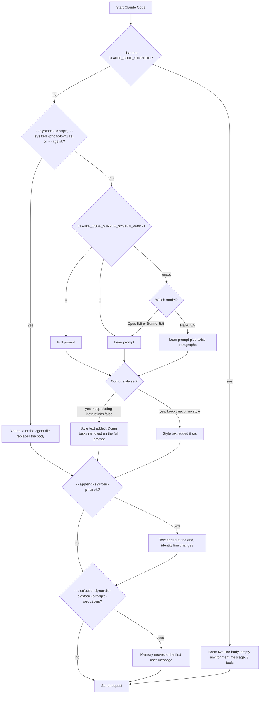

# Captured System Prompts


A system prompt is the text that Claude Code sends to the model before your first message. It tells the model who it is, how to behave, and what the session looks like. The model reads it on every request.

Claude Code has no single system prompt. It builds one from parts. The parts depend on the model, on flags, on env vars, on your output style, and on whether the request comes from the main agent or a subagent. This section shows every variant that you can pick, in full, with a diff against the default.

The text on these pages is Anthropic's. It is shown here only to describe how the program works. See the notice on the home page.

Status badges: [Documented] means an official docs page names the switch. [Undocumented] means only the program shows it. [Differs: example] means the docs and the program disagree. [Gated: example] means a flag or a server gate is needed.

## How the Captures Were Made

Every prompt on these pages was captured offline, with no model call and no cost.

1. A script starts the installed program (version 2.1.303) in print mode (`-p`) once per variant.
2. The program talks to a small fake Messages API on `127.0.0.1`. The fake server writes each request body to a file and sends back a canned reply.
3. The run uses a fake API key, a dead proxy (`HTTPS_PROXY` and `HTTP_PROXY` point to a closed port), `CLAUDE_CODE_DISABLE_NONESSENTIAL_TRAFFIC=1`, `DISABLE_TELEMETRY=1`, and a temporary home, config folder, and project folder. No login token is used. The script checks that every request went to the local server.
4. A second script reads the saved request bodies, replaces machine-specific values with placeholders, and writes these pages. It makes the diffs with `diff -u`, not by hand.

For the subagent pages, the fake server answers the first turn with an `Agent` tool call. The program then starts a real subagent and sends its request to the fake server.

For the compaction page, the script runs twice in the same folders: once with `hi`, then with `--continue` and `/compact`.

## The Three System Blocks

Each request has a `system` field with three blocks, then messages. This is what the captures show.

| Block | What it holds | Cache marker |
| --- | --- | --- |
| `system[0]` | A billing header line with the program version and entry point (`cc_entrypoint=sdk-cli` in `-p` mode). | None |
| `system[1]` | The identity line. | `ephemeral` |
| `system[2]` | The body: the rules, the memory section, and your appended text. | `ephemeral` |

Not everything that the model reads as instructions is in `system`. Claude Code also sends the following in the `messages` list, before your own text:

- A reminder with the git attribution lines (first user message).
- Project memory files, git status, and (with `--exclude-dynamic-system-prompt-sections`) the memory section.
- A message with the role `system`. It holds the environment details, the output style text, the agent types, the skills list, and the date.

Every variant page shows all of these parts, in the order they are sent, with a `===` line before each part.

### Identity Line

In `-p` mode the identity line is the SDK line: `You are a Claude agent, built on Anthropic's Claude Agent SDK.` Every capture here uses `-p`, so every page shows that line, except pages where it changes (see below).

The program has three identity lines. Two more appear in its text:

- `You are Claude Code, Anthropic's official CLI for Claude.` This is the line for the interactive terminal app. It could not be captured offline: the full-screen app did not accept typed input in the test harness, so no request was sent. Setting `CLAUDE_CODE_ENTRYPOINT=cli` in `-p` mode does not change the line.
- `You are Claude Code, Anthropic's official CLI for Claude, running within the Claude Agent SDK.` Print mode sends this one when you use `--append-system-prompt`. See [Append System Prompt](https://xsyetopz.github.io/claude-code-docs/prompts/append-system-prompt.md).

## How Claude Code Picks the Variant

The chart shows what the captures prove. The order of the first three checks was not tested with every combination of flags.



Subagents skip this chart. They get their own body and notes (see [Subagent, general-purpose](https://xsyetopz.github.io/claude-code-docs/prompts/subagent-general-purpose.md)).

Captures disagree with the old wiki in one place: the wiki says models with `sonnet` or `haiku` in the name get the full prompt. In 2.1.303 they get the lean prompt, and only `CLAUDE_CODE_SIMPLE_SYSTEM_PROMPT=0` gives the full one.

## All Variants

Size is the number of characters in everything shown on the variant page, after placeholders are in place. The last column lists the `#` headings found in the system body.

| Variant | How to select it | Characters | Tools | Sections | Status |
| --- | --- | --- | --- | --- | --- |
| [Default, Lean Prompt](https://xsyetopz.github.io/claude-code-docs/prompts/default-lean.md) | Default on Opus 5.5 | 15,142 | 20 | `Harness`, `Session-specific guidance`, `Memory`, `Environment`, `Context management` | [Undocumented] |
| [Default, Sonnet 5.5](https://xsyetopz.github.io/claude-code-docs/prompts/default-sonnet.md) | Default on Sonnet 5.5 | 15,148 | 20 | `Harness`, `Session-specific guidance`, `Memory`, `Environment`, `Context management` | [Documented] |
| [Default, Haiku 5.5](https://xsyetopz.github.io/claude-code-docs/prompts/default-haiku.md) | Default on Haiku 5.5 | 17,937 | 20 | `Harness`, `Session-specific guidance`, `Memory`, `Environment`, `Context management` | [Undocumented] |
| [Full Prompt](https://xsyetopz.github.io/claude-code-docs/prompts/full-prompt.md) | `CLAUDE_CODE_SIMPLE_SYSTEM_PROMPT=0` | 36,526 | 20 | `System`, `Doing tasks`, `Executing actions with care`, `Using your tools`, `Tone and style`, `Text output (does not apply to tool calls)`, `Session-specific guidance`, `auto memory`, `Environment`, `Context management` | [Documented] |
| [Simple Prompt Switch on Sonnet](https://xsyetopz.github.io/claude-code-docs/prompts/simple-prompt-sonnet.md) (same text as default-sonnet) | `CLAUDE_CODE_SIMPLE_SYSTEM_PROMPT=1` on Sonnet | 15,148 | 20 | `Harness`, `Session-specific guidance`, `Memory`, `Environment`, `Context management` | [Documented] |
| [Simple Prompt Switch on Haiku](https://xsyetopz.github.io/claude-code-docs/prompts/simple-prompt-haiku.md) (same text as default-haiku) | `CLAUDE_CODE_SIMPLE_SYSTEM_PROMPT=1` on Haiku | 17,937 | 20 | `Harness`, `Session-specific guidance`, `Memory`, `Environment`, `Context management` | [Documented] |
| [Simple Prompt Switch on Opus](https://xsyetopz.github.io/claude-code-docs/prompts/simple-prompt-opus.md) (same text as default-lean) | `CLAUDE_CODE_SIMPLE_SYSTEM_PROMPT=1` on Opus | 15,142 | 20 | `Harness`, `Session-specific guidance`, `Memory`, `Environment`, `Context management` | [Documented] |
| [Bare Mode](https://xsyetopz.github.io/claude-code-docs/prompts/bare.md) | `--bare` | 362 | 3 | none | [Documented] |
| [Simple Mode Env Var](https://xsyetopz.github.io/claude-code-docs/prompts/simple-env.md) (same text as bare) | `CLAUDE_CODE_SIMPLE=1` | 362 | 3 | none | [Documented] |
| [Exclude Dynamic Sections](https://xsyetopz.github.io/claude-code-docs/prompts/exclude-dynamic.md) | `--exclude-dynamic-system-prompt-sections` | 15,037 | 20 | `Harness`, `Environment`, `Context management` | [Documented] |
| [Exclude Dynamic Sections, Full Prompt](https://xsyetopz.github.io/claude-code-docs/prompts/exclude-dynamic-full.md) | `--exclude-dynamic-system-prompt-sections` plus the full prompt | 36,536 | 20 | `System`, `Doing tasks`, `Executing actions with care`, `Using your tools`, `Tone and style`, `auto memory`, `Text output (does not apply to tool calls)`, `Session-specific guidance`, `Environment`, `Context management` | [Documented] |
| [Output Style, Explanatory](https://xsyetopz.github.io/claude-code-docs/prompts/style-explanatory.md) | Output style `Explanatory` | 16,329 | 20 | `Harness`, `Session-specific guidance`, `Memory`, `Environment`, `Context management` | [Documented] |
| [Output Style, Learning](https://xsyetopz.github.io/claude-code-docs/prompts/style-learning.md) | Output style `Learning` | 20,188 | 20 | `Harness`, `Session-specific guidance`, `Memory`, `Environment`, `Context management` | [Documented] |
| [Output Style, Proactive](https://xsyetopz.github.io/claude-code-docs/prompts/style-proactive.md) | Output style `Proactive` | 16,648 | 20 | `Harness`, `Session-specific guidance`, `Memory`, `Environment`, `Context management` | [Documented] |
| [Output Style, Concise](https://xsyetopz.github.io/claude-code-docs/prompts/style-concise.md) | Output style `Concise` | 16,682 | 20 | `Harness`, `Session-specific guidance`, `Memory`, `Environment`, `Context management` | [Documented] |
| [Custom Output Style](https://xsyetopz.github.io/claude-code-docs/prompts/style-custom.md) | Custom style file | 15,360 | 20 | `Harness`, `Session-specific guidance`, `Memory`, `Environment`, `Context management` | [Documented] |
| [Custom Output Style on the Full Prompt](https://xsyetopz.github.io/claude-code-docs/prompts/style-custom-full.md) | Custom style, full prompt | 33,423 | 20 | `System`, `Executing actions with care`, `Using your tools`, `Tone and style`, `Text output (does not apply to tool calls)`, `Session-specific guidance`, `auto memory`, `Environment`, `Context management` | [Documented] |
| [Custom Output Style with Keep Coding Instructions](https://xsyetopz.github.io/claude-code-docs/prompts/style-custom-keep.md) | Custom style with `keep-coding-instructions` | 36,744 | 20 | `System`, `Doing tasks`, `Executing actions with care`, `Using your tools`, `Tone and style`, `Text output (does not apply to tool calls)`, `Session-specific guidance`, `auto memory`, `Environment`, `Context management` | [Documented] |
| [Custom Output Style with Keep Coding Instructions, Lean Prompt](https://xsyetopz.github.io/claude-code-docs/prompts/style-custom-keep-lean.md) (same text as style-custom) | Custom style with `keep-coding-instructions`, lean | 15,360 | 20 | `Harness`, `Session-specific guidance`, `Memory`, `Environment`, `Context management` | [Documented] |
| [Append System Prompt](https://xsyetopz.github.io/claude-code-docs/prompts/append-system-prompt.md) | `--append-system-prompt` | 15,199 | 20 | `Harness`, `Session-specific guidance`, `Memory`, `Environment`, `Context management` | [Documented] |
| [Replace System Prompt](https://xsyetopz.github.io/claude-code-docs/prompts/system-prompt.md) | `--system-prompt` | 9,541 | 20 | none | [Documented] |
| [Replace and Append Together](https://xsyetopz.github.io/claude-code-docs/prompts/system-prompt-append.md) | `--system-prompt` plus `--append-system-prompt` | 9,598 | 20 | none | [Documented] |
| [With a CLAUDE.md File](https://xsyetopz.github.io/claude-code-docs/prompts/claude-md.md) | A `CLAUDE.md` file | 15,531 | 20 | `Harness`, `Session-specific guidance`, `Memory`, `Environment`, `Context management` | [Documented] |
| [Inside a Git Repository](https://xsyetopz.github.io/claude-code-docs/prompts/git-repo.md) | A git repository | 15,758 | 20 | `Harness`, `Session-specific guidance`, `Memory`, `Environment`, `Context management` | [Undocumented] |
| [Main Thread Custom Agent](https://xsyetopz.github.io/claude-code-docs/prompts/agent-main.md) | `--agent <name>` | 9,643 | 20 | none | [Documented] |
| [Permission Mode, Plan](https://xsyetopz.github.io/claude-code-docs/prompts/mode-plan.md) | `--permission-mode plan` | 20,021 | 20 | `Harness`, `Session-specific guidance`, `Memory`, `Environment`, `Context management` | [Documented] |
| [Permission Mode, Accept Edits](https://xsyetopz.github.io/claude-code-docs/prompts/mode-acceptEdits.md) (same text as default-lean) | `--permission-mode acceptEdits` | 15,142 | 20 | `Harness`, `Session-specific guidance`, `Memory`, `Environment`, `Context management` | [Documented] |
| [Permission Mode, Don't Ask](https://xsyetopz.github.io/claude-code-docs/prompts/mode-dontAsk.md) (same text as default-lean) | `--permission-mode dontAsk` | 15,142 | 20 | `Harness`, `Session-specific guidance`, `Memory`, `Environment`, `Context management` | [Documented] |
| [Brief Mode](https://xsyetopz.github.io/claude-code-docs/prompts/brief.md) (same text as default-lean) | `--brief` | 15,142 | 20 | `Harness`, `Session-specific guidance`, `Memory`, `Environment`, `Context management` | [Undocumented] |
| [Compaction Prompt](https://xsyetopz.github.io/claude-code-docs/prompts/compact.md) | `/compact` | 21,610 | 20 | `Harness`, `Session-specific guidance`, `Memory`, `Environment`, `Context management` | [Undocumented] |
| [Subagent, General Purpose](https://xsyetopz.github.io/claude-code-docs/prompts/subagent-general-purpose.md) | `Agent` tool, `general-purpose` | 10,591 | 13 | none | [Undocumented] |
| [Subagent, Explore](https://xsyetopz.github.io/claude-code-docs/prompts/subagent-explore.md) | `Agent` tool, `Explore` | 11,134 | 9 | none | [Undocumented] |
| [Subagent, Plan](https://xsyetopz.github.io/claude-code-docs/prompts/subagent-plan.md) | `Agent` tool, `Plan` | 11,441 | 9 | none | [Undocumented] |
| [Subagent, Custom Agent](https://xsyetopz.github.io/claude-code-docs/prompts/subagent-custom.md) | Custom agent file | 9,215 | 13 | none | [Documented] |

See also [Tools per Variant](https://xsyetopz.github.io/claude-code-docs/prompts/tools-per-variant.md).

## Placeholders

| Placeholder | Replaces |
| --- | --- |
| `<cwd>` | The project folder (a temporary folder in each run). |
| `<config-dir>` | The Claude config folder (`CLAUDE_CONFIG_DIR`, a temporary folder). |
| `<home>` | The home folder (a temporary folder). |
| `<project-slug>` | The project folder name as used inside the config folder, with `/` and `.` turned into `-`. |
| `<config-slug>` | The same kind of name for the config folder. |
| `<date>` | Any date such as the day of the run. |
| `<platform>`, `<shell>`, `<os-version>` | Your operating system, shell, and OS version. |
| `<build>` | The build suffix of `cc_version` in the billing header. |
| `<sha>` | A git commit hash. |
| `<robot-emoji>` | A robot emoji in the pull request line of the attribution reminder. The site shows no emojis. |
| `<plan-name>` | The random plan file name in plan mode. |

Strings such as `PROBE-CUSTOM-STYLE-TEXT` and `APPENDED-TEXT-FROM-FLAG` are test text that the script supplies, so you can see where your own text lands.

## How to Regenerate

Run these from the repository root. Both steps use `bun` only.

```bash
bun tools/capture-prompts/capture.ts          # capture every variant, then write the pages
bun tools/capture-prompts/capture.ts --only default-lean,bare   # capture some variants
bun tools/capture-prompts/render.ts           # rebuild the pages from saved captures
```

Raw requests go to `captures/` (not committed). Normalized text goes to `tools/capture-prompts/out/`. The variant list is in `tools/capture-prompts/variants.ts`. For a new release, change the binary path in `capture.ts` and run it again.
