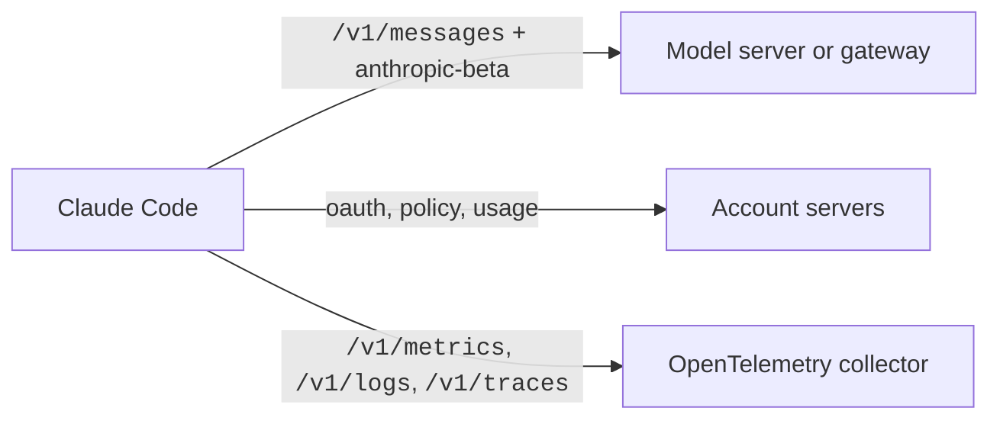

# API


Claude Code is a client of the Messages API. It sends model requests, counts tokens, and calls a few account and service servers.
Each request carries headers and a list of beta values. This section lists them all.
If you run Claude Code behind a gateway or proxy, read these pages first, because the gateway must pass some headers on without a change.

## At a Glance

| Question | Answer |
| --- | --- |
| Can you use it? | Not directly. Claude Code makes these calls for you. You can watch them with a proxy or a local stub. |
| Can you change it? | ✅ Yes. `ANTHROPIC_BASE_URL`, `ANTHROPIC_CUSTOM_HEADERS`, `ANTHROPIC_BETAS`, `--betas`, and provider variables change the calls. |
| Can you turn it on or off? | `CLAUDE_CODE_DISABLE_EXPERIMENTAL_BETAS`, `CLAUDE_CODE_GATEWAY_HINT_HEADERS`, `CLAUDE_CODE_ATTRIBUTION_HEADER=0`. |
| Where does it live? | In the program. The gateway guide is the only official source. |
| Status | [Documented] [Undocumented] |

## Pages

| Page | What It Covers |
| --- | --- |
| [Endpoints and Headers](https://xsyetopz.github.io/claude-code-docs/reference/api/endpoints.md) | Model and service paths, request and response headers, the attribution block |
| [Betas](https://xsyetopz.github.io/claude-code-docs/reference/api/betas.md) | Every `anthropic-beta` value, when it is sent, and how the list is built |

## Example

Send Claude Code through a gateway and pass an extra header.

```bash title="Use a gateway"
export ANTHROPIC_BASE_URL=https://gateway.example.com
export ANTHROPIC_CUSTOM_HEADERS=$'X-Team: docs\nX-Env: staging'
claude
```

## How It Works



## Related Pages

- [Gateway Compatibility Guide](https://code.claude.com/docs/en/llm-gateway-protocol) is the official page for the model server contract.
- [Request and Cache](https://xsyetopz.github.io/claude-code-docs/how-it-works/request-and-cache.md)
- [Models and Providers](https://xsyetopz.github.io/claude-code-docs/configure/models-and-providers.md)
- [Network and Proxy Variables](https://xsyetopz.github.io/claude-code-docs/configure/env-vars/network-and-proxy.md)
