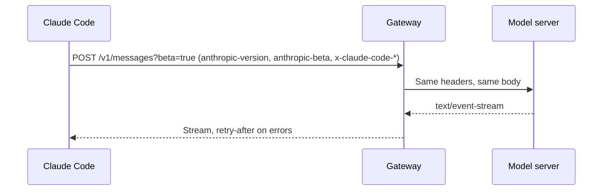

# Endpoints and Headers


An endpoint is a URL path on a server, and a header is a named value that a request carries.
Claude Code calls the model server and a few account servers, and it adds headers to each request.
If you run Claude Code behind a proxy, the proxy must pass `anthropic-version` and `anthropic-beta` on without a change.

Base URL variables pick the server, and `ANTHROPIC_CUSTOM_HEADERS` adds headers. The switches are `CLAUDE_CODE_GATEWAY_HINT_HEADERS`, `CLAUDE_CODE_ATTRIBUTION_HEADER=0`, and `CLAUDE_CODE_ENABLE_GATEWAY_MODEL_DISCOVERY=1`. The model list is cached in `~/.claude/cache/gateway-models.json`.

## Model Endpoints

Source: [Gateway Compatibility Guide](https://code.claude.com/docs/en/llm-gateway-protocol), and [Probes](https://xsyetopz.github.io/claude-code-docs/reference/probes.md) for `cache_touch`.

| Path | Status | What It Does |
| --- | --- | --- |
| `/v1/messages?beta=true` | [Documented] | Sends the model request. |
| `/v1/messages/count_tokens` | [Documented] | Counts tokens. Without it, Claude Code estimates from the number of characters. |
| `/v1/messages/cache_touch` | [Undocumented] | Claude Code calls it every 30 seconds (10 to 120) to keep the prompt cache warm. It needs a subscriber login and the `cache-keepalive-2026-09-03` beta. |
| `/v1/models` | [Documented] | Lists the models for the `/model` picker, only with `CLAUDE_CODE_ENABLE_GATEWAY_MODEL_DISCOVERY=1`. |
| `HEAD /api/hello` | [Documented] | Warms up the connection. Claude Code skips it when an HTTP proxy or a client certificate is set. |
| `/model/{model}/invoke` and `/model/{model}/invoke-with-response-stream` | [Documented] | The Amazon Bedrock format, chosen with `ANTHROPIC_BEDROCK_BASE_URL`. |
| `:rawPredict` and `:streamRawPredict` | [Documented] | The Google Cloud Agent Platform format, chosen with `ANTHROPIC_VERTEX_BASE_URL`. |

## Account and Service Endpoints

These paths are strings in the program. The docs do not describe them, except the OpenTelemetry row.
The use of a path is a guess from its name.

| Path | Status | Likely Use |
| --- | --- | --- |
| `/v1/oauth/token`, `/api/oauth/profile`, `/api/oauth/usage`, `/api/oauth/account/settings` | [Undocumented] | Sign-in tokens, the profile, plan usage, and account settings. |
| `/api/claude_code/policy_limits` | [Undocumented] | The limits of your organization, cached in `policy-limits.json`. |
| `/api/claude_code/organizations/metrics_enabled`, `/api/claude_code/notification/preferences`, `/api/claude_code/skills` | [Undocumented] | The metrics switch of the organization, notification settings, and synced skills. |
| `/api/event_logging/v2/batch` | [Undocumented] | Event logging by Anthropic. |
| `/v1/metrics`, `/v1/logs`, `/v1/traces` | [Documented] | OpenTelemetry export. See [Monitoring](https://code.claude.com/docs/en/monitoring-usage). |
| `/api/claude_cli_feedback`, `/api/claude_code_shared_session_transcripts` | [Undocumented] | Feedback and shared transcripts. |
| `/v1/code/sessions`, `/v1/code/triggers`, `/v1/code/github/*`, `/v1/code/agent-proxy` | [Undocumented] | Cloud sessions, routines, and GitHub helpers. |
| `/v1/ultrareview/quota`, `/v1/ultrareview/preflight` | [Undocumented] | The command `claude ultrareview`. |
| `/api/model_selector/{id}`, `/api/organization/claude_code_first_token_date` | [Undocumented] | Data for the model picker and the date of first use. |
| `/api/ws/speech_to_text/voice_stream` | [Undocumented] | Voice dictation. |
| `/api/frame/*`, `/v1/design/*` | [Undocumented] | Artifacts and Claude Design. |

The program also holds an Anthropic SDK client with paths such as `/v1/agents`, `/v1/skills`, `/v1/vaults`, and `/v1/organizations/*`.
They belong to the SDK code, and the Claude Code loop does not call them.
The program names these hosts: `code.claude.com`, `claude.ai`, `claude.com`, `api.anthropic.com`, `platform.claude.com`, `www.anthropic.com`, `support.claude.com`, `downloads.claude.ai`, and `mcp-proxy.anthropic.com`.

## Request Headers

Source: [Gateway Compatibility Guide](https://code.claude.com/docs/en/llm-gateway-protocol#request-headers). Header names are not case-sensitive.

| Header | Status | Meaning |
| --- | --- | --- |
| `Authorization`, `x-api-key` | [Documented] | The credential. |
| `anthropic-version` | [Documented] | The API version, `2023-06-01`. |
| `anthropic-beta` | [Documented] | The list of beta values. See [Betas](https://xsyetopz.github.io/claude-code-docs/reference/api/betas.md). |
| `x-claude-code-session-id` | [Documented] | One value for each session. |
| `x-claude-code-agent-id`, `x-claude-code-parent-agent-id` | [Documented] | The subagent that sent the request, and its parent. |
| `x-claude-code-request-class` | [Documented] | The kind of request: `main`, `subagent`, `workflow`, `compaction`, or `auxiliary`. |
| `x-claude-code-agent-type` | [Documented] | The kind of agent: `Explore`, `Plan`, `general-purpose`, `custom`, `teammate`, or `fork`. |
| `x-claude-code-compaction`, `x-claude-code-context-compacted` | [Documented] | Marks a compaction request, and the first request after one. |
| `x-claude-code-prev-tool-durations` | [Documented] | The run time of the last tool batch, such as `Bash=742;Read=9`, with at most 32 entries and 4 KB. |
| `x-claude-code-prompt-id` | [Documented] | A random UUID for the user prompt, from `2.1.283`. |
| `anthropic-workspace-id` | [Documented] | Needed on Claude Platform on AWS. |
| `ANTHROPIC_CUSTOM_HEADERS` | [Documented] | An env var for extra headers, one `Name: value` on each line. It is not a header itself. |
| `x-app`, `anthropic-client-platform`, `X-Stainless-*`, `X-Trusted-Device-Token`, `x-organization-uuid` | [Undocumented] | Names in the program. No source states their rules. |

The hint headers (`x-claude-code-request-class` and the next four rows) go out on a direct connection to the Anthropic API.
On a custom base URL they need `CLAUDE_CODE_GATEWAY_HINT_HEADERS=1`. Setting it to `0` stops them everywhere.

## Response Headers Claude Code Reads

| Header | Status | Use |
| --- | --- | --- |
| `retry-after` | [Documented] | A number of seconds. A value above 60 stops the retries unless `CLAUDE_CODE_RETRY_WATCHDOG` is set. |
| `x-should-retry` | [Documented] | `true` or `false`. It is one input to the retry decision. |
| `anthropic-ratelimit-unified-*` | [Documented] | Plan usage and limits for `claude.ai` sign-ins. |
| `content-type` | [Documented] | `text/event-stream`, or `application/vnd.amazon.eventstream` on Bedrock. |

## Attribution Block

The first block of `system` is a text line that starts with `x-anthropic-billing-header:`.
The docs say the block holds the client version and a fingerprint of the conversation ([Gateway Compatibility Guide](https://code.claude.com/docs/en/llm-gateway-protocol#system-prompt-attribution-block)).
The field names below come from the program.

| Field | Status | Meaning |
| --- | --- | --- |
| `cc_version` | [Undocumented] | The client version. |
| `cc_entrypoint` | [Undocumented] | Where Claude Code runs, such as `cli`, `sdk-cli`, or `claude-vscode`. |
| `cc_workload`, `cc_is_subagent` | [Undocumented] | The workload tag (`--workload`), and a flag for subagents. |
| `cc_prev_req`, `cc_prompt_id`, `cc_turn_origin`, `cc_prompt_index`, `cc_turn_index` | [Undocumented] | Request and turn tracking, only on the Anthropic API. |
| `cc_gateway`, `cc_project`, `cc_project_src` | [Undocumented] | Tags for the gateway and the project. |

`CLAUDE_CODE_ATTRIBUTION_HEADER=0` removes the block.
The `api.anthropic.com` server strips it when it is the first and only block of its entry.

## Example

Keep the hint headers on a custom gateway and read them there.

```bash title="Send hint headers to a gateway"
export ANTHROPIC_BASE_URL=https://gateway.example.com
export CLAUDE_CODE_GATEWAY_HINT_HEADERS=1
claude -p "hi"
```

The gateway then sees `x-claude-code-request-class: main` and the other hint headers on each request.

## How It Works



## Related Pages

- [Betas](https://xsyetopz.github.io/claude-code-docs/reference/api/betas.md)
- [Request and Cache](https://xsyetopz.github.io/claude-code-docs/how-it-works/request-and-cache.md)
- [Environment Variables](https://xsyetopz.github.io/claude-code-docs/configure/env-vars.md)
- [Gateway Compatibility Guide](https://code.claude.com/docs/en/llm-gateway-protocol)
