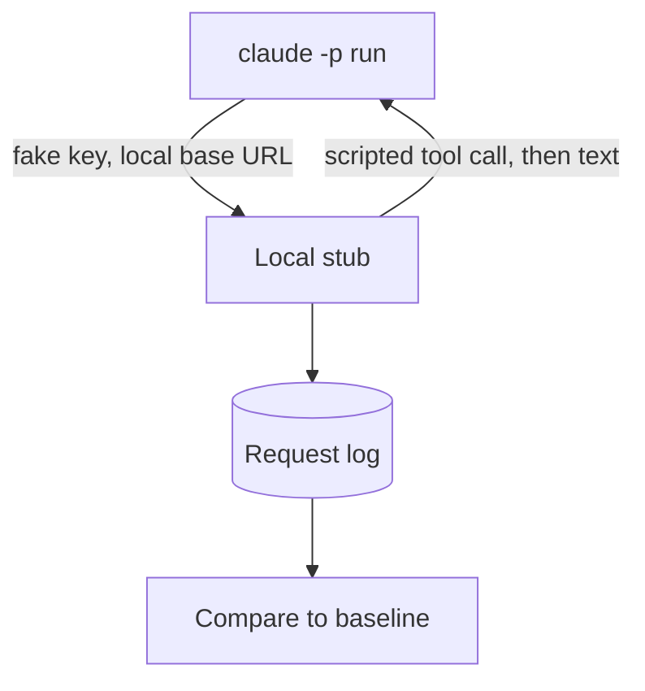

# Probes


A probe is a small test that runs Claude Code `2.1.304` and checks what one setting changes.
The probes ran against a local stub of the Messages API, so they cost nothing and sent no data to Anthropic.
They show which environment variables and settings have an effect that you can see.

## How We Probed

1. We ran the unmodified `2.1.304` program with `claude -p "hi" --output-format stream-json --verbose`.
2. We gave each run a fresh config folder, a fresh home folder, a fake API key, and a base URL that points to the local stub.
3. We turned off telemetry and other optional traffic. We pointed the proxy settings to a closed port, so a stray request to `api.anthropic.com` fails.
4. The stub answered `POST /v1/messages` as a stream or as JSON. It sent one scripted tool call and then plain text. It wrote the method, path, headers, and body of each request to a log.
5. We made two baselines. The first was a plain run. The second ran a `Bash` tool call with command hooks on five events and a local plugin with a skill, a hook, and an MCP server. Two repeat runs of each baseline were identical after we removed ids, paths, and times.
6. We set each of 166 variables to `1` in both baselines, which gave 332 runs. We compared headers, betas, the system prompt, tools, body fields, output events, files in the config folder, the hook log, and the environment names that hooks saw.
7. Some names got extra runs: auto mode with a `Bash` call, `--brief`, `--resume`, and the plugin variables with a plugin.

Every request carried the fake key, and the only path called was `/v1/messages?beta=true`.



## Results

Of the 166 variables, 11 had an effect that we could see. The rest had none.
No visible effect in print mode does not prove that a variable does nothing.
Many variables work only in other modes, in remote sessions, or with a login.
This page lists only the rows with an effect or a difference. The rows with no visible effect are left out.

### Effects and Differences

An item is [Differs] when the result differs from the docs.
The status of an environment variable is the one on its row in the [Environment Variables](https://xsyetopz.github.io/claude-code-docs/configure/env-vars.md) pages. This table records only what the probe saw.

| Name | What We Set | Status | What We Saw |
| --- | --- | --- | --- |
| `--model X[1m]` | model flag | [Undocumented] | `context-1m-2025-08-07` is added for `sonnet[1m]`, `opus[1m]`, and every `claude-*[1m]` tried, also for models with a native 1M window. Without `[1m]` it is never sent. |
| hook `type: "script"` | settings | [Differs] | Rejected at load with `Unknown hook type "script"; entry ignored`. No script ran. A `PreToolUse` entry also disables the whole settings file it sits in. |
| `CLAUDE_CODE_AMBER_ASTROLABE` | `1` | [Undocumented] | Adds an "operating autonomously" block to the system prompt (do not ask "Shall I...?", finish the work before ending the turn). |
| `CLAUDE_CODE_BASALT_COVE` | `1` | [Undocumented] | Adds a "Communicating with the user" section and a code-comment rule to the system prompt. |
| `CLAUDE_CODE_HUMBLE_HAMMOCK` | `1` | [Undocumented] [Gated: A feature flag or server gate decides by default. This variable overrides it] | Adds `wire_tool_inputs` (raw `tool_use.input`) to the assistant event when a tool runs. |
| `CLAUDE_CODE_INLINE_TOOLS` | `1` | [Undocumented] [Gated: Works only behind a feature flag or server gate] | Adds the beta `inline-tools-2026-09-15` to `anthropic-beta`. |
| `CLAUDE_CODE_LANTERN_PRISM` | `1` | [Undocumented] [Gated: Works only behind a feature flag or server gate] | Adds the `skill-doctor` skill to the `init` event. |
| `CLAUDE_CODE_LARCH_CISTERN` | `1` | [Undocumented] [Gated: A feature flag or server gate decides by default. This variable overrides it] | Adds a "Corrections" section to the system prompt (avoid excessive self-correction). |
| `CLAUDE_CODE_PLUGIN_DIRS` | `1` | [Documented] | Loads the plugin dir like `--plugin-dir` (same `plugins` list in `init`). |
| `CLAUDE_CODE_SIMULATE_PROXY_USAGE` | `1` | [Undocumented] | Removes the whole `anthropic-beta` header and the `thinking.display` field. |
| `CLAUDE_CODE_SKIP_PLUGIN_MCP_SERVERS` | `1` | [Undocumented] | Plugin MCP servers are not started. `mcp_servers` is empty and the tool list shrinks. |
| `CLAUDE_CODE_SYNC_PLUGIN_INSTALL` | `1` | [Documented] | Emits `plugin_install` events (`started`, `completed`) in stream-json. |
| `CLAUDE_CODE_USE_COWORK_PLUGINS` | `1` | [Undocumented] | User settings come from `cowork_settings.json`, so its hooks and `env` apply and those of `settings.json` do not. Plugins and marketplaces use `cowork_plugins`. `claude plugin install` writes there. |

## Request Details

- `cc_version=2.1.304.914`: the suffix `914` stayed the same in all runs.
- `/v1/messages/cache_touch`: never called. The program sends it only when the response has `anthropic-cache-keepalive: active` for a request with the `cache-keepalive-2026-09-03` beta.
  That beta needs a 1-hour cache TTL for a subscriber login, `allow_cache_keepalive`, and a server-side flag.
  The body is `{"request_id": ...}`. Touches repeat every 30 s by default (10 to 120).
  The stub with the response header and a flag override did not start it, because the probe had no subscriber login.
- `context-1m-2025-08-07`: added by a `[1m]` suffix, also on models with a native 1M window. Not sent without the suffix.
  The default model in this setup was `claude-opus-5-5` and it did not send the beta.
- Base betas in the plain run: `claude-code-20250219`, `interleaved-thinking-2025-05-14`, `thinking-token-count-2026-05-13`, `context-management-2025-06-27`, `prompt-caching-scope-2026-01-05`, `per-turn-control-2026-07-01`, `mid-conversation-tool-changes-2026-07-01`, `effort-2025-11-24`, `thinking-display-updates-2026-08-18`.
  A first-party connection adds `advanced-tool-use-2025-11-20`, `thinking-binding-controls-2026-08-01`, and `cache-diagnosis-2026-04-07`.

## Auto Mode

With `--permission-mode auto` and a `Bash` call, the stub got classifier requests with `xml_s1` and `xml_s2` stages.
The debug log says `server_no_result` and falls back to billed local classifier requests.
Neither classifier variable changed that.

### `autoMode.classifyAllShell`

We ran `claude -p --permission-mode auto` against the stub with the command `curl -s http://127.0.0.1:9/x` and a user allow rule `Bash(curl -s http://127.0.0.1:9/x)`. The count is the stub requests that carried the classifier system prompt. A managed folder needed `sudo`, so the user ran the managed cases.

| Settings | Classifier Requests |
| --- | --- |
| No allow rule | 1 |
| Allow rule, flag unset | 0 |
| Allow rule, user `true` or `--settings` `true` | 1 |
| Allow rule, user `false` or `--settings` `false` | 0 |
| User `false` and `--settings` `true`, or the reverse | 1 |
| Managed `false`, with user or `--settings` `true` | 1 |
| Managed `false`, with user or `--settings` `false`, or neither | 0 |
| Managed `true`, with user `false`, `--settings` `false`, or neither | 1 |

Any `true` in user, `--settings`, or managed settings turns the flag on. `false` is the same as unset. The program reads no project or local source. Not seen: the setting in project or local settings (the program ignores them; not run).

## Subagents and Hooks

Follow-up probes used the same stub, a fake key, a temp home folder, and `-p --output-format stream-json --verbose`. The stub scripted `Agent`, `Workflow`, `Bash`, and `Skill` calls, so each subagent request could be logged. No login was used, so cloud paths were not run. The interactive screen has its own section below.

| What We Ran | Status | What We Saw |
| --- | --- | --- |
| `Workflow` script with `agent()`, and the model variables | [Undocumented] | The subagent model comes from `CLAUDE_CODE_WORKFLOW_SUBAGENT_MODEL` (not `inherit`), then `CLAUDE_CODE_SUBAGENT_MODEL`, then the main model. A `model` option in `agent()` is overridden. With `CLAUDE_CODE_SUBAGENT_MODEL_FORCE`, the workflow variable is dropped. |
| `CLAUDE_CODE_WEB_FETCH_AGENT=1` | [Undocumented] | The roster gains `web-fetch`, and `WebFetch` leaves the main session's tools. The agent has only `WebFetch`. |
| `Agent` with each built-in type | [Undocumented] | `claude`, `Explore`, `general-purpose`, `Plan`, `statusline-setup`, and `fork` started. `claude-code-guide`, `comment-thread-analyst`, `observer`, and `workflow-subagent` gave `Agent type '...' not found` in `-p`. The interactive screen started `claude-code-guide` (see [Interactive Probes](#interactive-probes)). |
| `--append-subagent-system-prompt` | [Undocumented] | The text is the last lines of the subagent system prompt. The env var alone changed nothing. |
| `observer` frontmatter | [Undocumented] | Without `CLAUDE_CODE_EXPERIMENTAL_OBSERVER_AGENTS=1` no observer ran. With it, a fifth request ran as the observer, with an `ObserverReport` tool, and `observerMessage` was the last line of the digest. |
| Subscription (OAuth) login, main and `Explore` requests | [Undocumented] | Same main prompt, same 12 default tools, and same `Explore` prompt as an API key. The `Explore` request had the same 7 tools: `Bash`, `ListAgents`, `Read`, `ReportFindings`, `Skill`, `DeferredToolPlaceholder`, and `ToolSearch`. See [Override a Prompt](https://xsyetopz.github.io/claude-code-docs/prompts/override.md). |
| Agent frontmatter spelling | [Undocumented] | `Tools` and `disallowed-tools` were ignored. `tools` and `disallowedTools` worked. |
| `isolation: remote` in a file | [Undocumented] | No error. The agent ran in a local worktree, like `worktree`. |
| Command hooks with `continue:false` and `systemMessage` | [Documented] | See [Hook Input and Output](https://xsyetopz.github.io/claude-code-docs/extend/hooks/input-and-output.md#what-continue-and-systemmessage-do-per-event). |
| Setup hook `additionalContext` | [Differs: Not in the model request.] | It never reached the model request. |

## Configure and Memory

These checks used the same stub, plus static reading of the program. Nothing was run with a login.

| What We Ran | Status | What We Saw |
| --- | --- | --- |
| User `outputStyle` plus a plugin style with `force-for-plugin: true` | [Undocumented] | The system prompt used the forced plugin style. The `init` event still named the configured style. |
| `CLAUDE_CODE_REMOTE=1`, with and without `CLAUDE_CODE_REMOTE_MEMORY_DIR` | [Undocumented] | Without the dir, the auto-memory section is missing. With it, the section returns and names the dir. |
| `CLAUDE_MEMORY_STORES` set to a JSON list | [Undocumented] | The auto-memory section was gone. No `memory_*` tool was added. |
| `claude auto-mode config` with `autoMode.allow` in each source | [Documented] | User settings and `--settings` applied. `.claude/settings.json` and `.claude/settings.local.json` were ignored. Managed settings applied too, see [Managed Folder Probe](#managed-folder-probe). |

## Context Budget

These runs used a live subscription login on `2.1.304`, not the stub, with a fresh config folder and an empty project.

| What We Ran | Status | What We Saw |
| --- | --- | --- |
| `claude -p "/context" --output-format stream-json`, empty and after `claude -p hi` | [Undocumented] | An empty session held 12,114 tokens and 15,768 after "hi". The first request matched `/context` exactly. See [Context Budget](https://xsyetopz.github.io/claude-code-docs/how-it-works/context-budget.md). |

## Static and Print Probes

These runs used the same stub, a fake key, a temp home folder, and a dead proxy, plus static reading of the program. Nothing was run with a login or with `sudo`. The [Managed Folder Probe](#managed-folder-probe) is the one section that used `sudo`.

| What We Ran | Status | What We Saw |
| --- | --- | --- |
| Control requests on stdin with `--input-format stream-json` | [Undocumented] | `set_model`, `get_binary_version`, `set_permission_mode`, `mcp_status`, and `interrupt` got replies that match [Control Protocol](https://xsyetopz.github.io/claude-code-docs/extend/headless/control-protocol.md). An unknown model ID still got `success`. A bad mode got `error` with `error_code` `invalid_mode`. |
| A user agent with `mcpServers` frontmatter | [Undocumented] | The server started with the agent and stopped when it ended. The same agent in `.claude/agents/` was skipped in an untrusted folder. |
| `claude plugin validate` with odd `version` values | [Documented] | A string of any text passed. A number failed. An empty string counted as missing. See [Plugin Manifest](https://xsyetopz.github.io/claude-code-docs/extend/plugins/manifest.md). |
| `CLAUDE_CODE_SUBPROCESS_ENV_SCRUB` with test variables | [Undocumented] | Credential and config names were removed. The four GitHub token variables stayed. The permission mode was forced to `default`. See [Tools and Bash Variables](https://xsyetopz.github.io/claude-code-docs/configure/env-vars/tools-and-bash.md#what-the-scrub-removes). |
| Default `-p hi` for every model in the catalog | [Undocumented] | Short, extended short, or full prompt by model. See [System Prompt](https://xsyetopz.github.io/claude-code-docs/how-it-works/system-prompt.md#prompt-by-model). |
| `CLAUDE_COWORK_MEMORY_*` and `CLAUDE_CODE_POST_TURN_MEMORY` | [Undocumented] | The four Cowork variables changed the memory section as described in [Memory and Rules](https://xsyetopz.github.io/claude-code-docs/configure/memory-and-rules.md). The post-turn pass did not run locally: the log said the memory server was not mounted. |
| `PostToolUse` hook logging per tool | [Undocumented] | The `tool_response` shapes in [Hook Events](https://xsyetopz.github.io/claude-code-docs/extend/hooks/events.md#posttooluse-tool_response-shapes). |
| `claude -p "/context"` | [Undocumented] | 24 `count_tokens` requests and no `/v1/messages` request. |
| Skill variables in the `init` skill list | [Documented] | `CLAUDE_CODE_DISABLE_CLAUDE_API_SKILL` removed `claude-api`. The other four had no visible effect. |
| `CLAUDE_CODE_MANAGED_SETTINGS_PATH` | [Undocumented] | Ignored. The log still read the machine default managed folder. |
| `/status` size warning with a 45,000-character `CLAUDE.md` in `-p`, `claude doctor`, and `get_status` | [Undocumented] | No warning in these three. It shows in the interactive screen (see [Interactive Probes](#interactive-probes)). |

## Managed Folder Probe

These runs used the real `2.1.304` binary on macOS with the stub, a fake key, and a temp home and config folder. The managed folder `/Library/Application Support/ClaudeCode` was made with `sudo` (owner `root:wheel`). It held `CLAUDE.md`, a rule, a skill, an output style, `managed-settings.json`, a `managed-settings.d/` drop-in, and `managed-mcp.json` with one stdio server. Each run also had a user server and a project `.mcp.json` server. A baseline ran without the folder. Runs used `-p --output-format stream-json`, plus `claude mcp list` and `claude mcp get`.

| What We Ran | Status | What We Saw |
| --- | --- | --- |
| `managed-mcp.json` with a user server and a project server | [Documented] | Only the managed server started. The user and project servers were not started and not in `init` (the baseline started both). `claude mcp list` showed only the managed server. `claude mcp get` on a user server exited 1 with `No MCP server named "user_srv". Configured servers: managed_srv`. |
| `claude mcp get` on the managed server | [Undocumented] | `Scope: Enterprise config (managed by your organization)`, and the removal hint names the `managed-mcp.json` path. |
| `--mcp-config <file>` with `managed-mcp.json` present | [Documented] | Exit 1 with `You cannot dynamically configure MCP servers when an enterprise MCP config is present`. No `init` event. See [Servers passed with `--mcp-config`](https://code.claude.com/docs/en/managed-mcp#servers-passed-with---mcp-config-or---strict-mcp-config). |
| Managed `outputStyle` with a style file in the managed `.claude/output-styles/` | [Documented] | The `init` event named the style and its text was in the request. It won over `outputStyle` in user settings, `.claude/settings.json`, `.claude/settings.local.json`, and `--settings`. |
| A skill in the managed `.claude/skills/`, with and without `CLAUDE_CODE_DISABLE_POLICY_SKILLS=1` | [Documented] | The skill was listed and its description was in the request. The variable removed it. Nothing else changed. |
| Managed `CLAUDE.md` with user and project `CLAUDE.md` | [Documented] | Order in the request: managed, then `~/.claude/CLAUDE.md`, then project `CLAUDE.md`. |
| `claudeMdExcludes` of `**/CLAUDE.md`, the managed absolute path, and `<managed>/**`, in user or project settings | [Documented] | User and project `CLAUDE.md` were removed. The managed `CLAUDE.md` still loaded. |
| Managed `.claude/rules/*.md` | [Undocumented] | It loaded, and `claudeMdExcludes` with `<managed>/**` did not remove it. |
| A `managed-settings.d/` drop-in that denies `NotebookEdit` | [Documented] | `NotebookEdit` was gone from the tool list (present in the baseline). |
| The prompt note "not verified as your organization's policy" | [Undocumented] | It did not appear with a root-owned folder. The program text says it is added for managed files that the session's own account could write (not run). |
| User agent with `mcpServers` frontmatter, no `--mcp-config` | [Undocumented] | The agent ran, but its server did not start (without the managed folder it did). A notice said `probe-agent agent MCP server blocked by enterprise MCP config: agent_srv`. |
| `autoMode` in `managed-settings.json` and a `managed-settings.d/` drop-in, with `claude auto-mode config` | [Documented] | Both files applied. Lists from all sources join, with user or `--settings` rules first and managed rules after. `$defaults` expands where it sits. A list with no `$defaults` in any source has no defaults. See [Auto Mode](https://xsyetopz.github.io/claude-code-docs/configure/permissions/auto-mode.md). |

## Interactive Probes

These runs used the real `2.1.304` binary in a pseudo-terminal (a Python `pty` driver with `pyte` to render the 200x50 screen, because tmux was not installed). The method is the same as `tmux send-keys` and `capture-pane`. The stub, the fake key, the temp home and config folders, the dead proxy, and `CLAUDE_CODE_DISABLE_NONESSENTIAL_TRAFFIC=1` were as in the other probes, with `env -i` so the parent session marker did not leak in. Onboarding and trust were skipped by seeding the config file. The stub answered a `DO:{...}` line in the prompt with one scripted tool call. No login and no real credentials were used.

| What We Ran | Status | What We Saw |
| --- | --- | --- |
| `Agent` with `claude-code-guide` | [Documented] | It started on `claude-haiku-5-5` with the tools `Bash`, `Read`, `WebFetch`, and `WebSearch`. The program leaves it out when `CLAUDE_CODE_ENTRYPOINT` is `sdk-ts`, `sdk-py`, or `sdk-cli`, which includes `-p`. See [Subagent, Claude Code Guide](https://xsyetopz.github.io/claude-code-docs/prompts/subagent-claude-code-guide.md). |
| `Agent` with other types | [Undocumented] | Unknown types return `Agent type '<x>' not found. Available agents: claude, claude-code-guide, Explore, general-purpose, Plan, statusline-setup`. `comment-thread-analyst`, `workflow-subagent`, and `web-fetch` (default settings) gave that error. `fork` returned `Fork started`. See [Subagent Runtime](https://xsyetopz.github.io/claude-code-docs/extend/subagents/runtime.md). |
| `PermissionRequest`, `PermissionDenied`, `Notification`, and `PreCompact` hooks | [Undocumented] | All four fired. See [Hook Input and Output](https://xsyetopz.github.io/claude-code-docs/extend/hooks/input-and-output.md#what-fires-and-what-is-honored-in-the-interactive-screen). |
| `Notification` types | [Documented] | Seven values seen live: `permission_prompt`, `idle_prompt`, `elicitation_dialog`, `elicitation_response`, `elicitation_url_dialog`, `elicitation_complete`, and `agent_needs_input`. See [Hook Events](https://xsyetopz.github.io/claude-code-docs/extend/hooks/events.md#notification). |
| `Elicitation` and `ElicitationResult` hooks with an MCP server | [Undocumented] | Both fired. Inputs had `mcp_server_name`, `message`, `mode`, and `requested_schema`, and for the result `action` and `content`. |
| `statusLine` and `subagentStatusLine` commands that log their input | [Undocumented] | `subagentStatusLine` ran on a fixed 5-second tick and got no `COLUMNS` or `LINES`. `statusLine` got `transcript_path` from the first run and `prompt_id` after the first prompt. Runs paused under dialogs. See [Status Line](https://xsyetopz.github.io/claude-code-docs/configure/status-line.md). |
| Instruction file size warning with 45.6k, 156.0k, and four 34.4k files | [Undocumented] | A banner under the header at start and a line in `/status`. The 40k, 120k total, and 150k (Opus 5.5) limits held. See [Memory and Rules](https://xsyetopz.github.io/claude-code-docs/configure/memory-and-rules.md). |
| `PostToolUse` hook logging for `Read`, `Write`, `Edit`, `Bash`, and an MCP tool | [Undocumented] | Same shapes as the `-p` probe (no `contentNotInModelContext` on `Edit`). See [Hook Events](https://xsyetopz.github.io/claude-code-docs/extend/hooks/events.md#posttooluse-tool_response-shapes). |
| `/usage` when the usage endpoint answers `429`, with fake subscriber credentials and a local TLS stub behind a proxy (without `CLAUDE_CODE_DISABLE_NONESSENTIAL_TRAFFIC`) | [Undocumented] | Six texts, such as `Error: Usage endpoint is rate limited until 10:44am.` and `Showing last-known usage as of 10m ago (rate limited until 10:45am)`. See [Slash Commands](https://xsyetopz.github.io/claude-code-docs/extend/skills-and-commands/slash-commands.md). With `CLAUDE_CODE_DISABLE_NONESSENTIAL_TRAFFIC` set, the panel showed `Failed to load usage data` and sent no request. Not seen: the `(could not refresh)` variants, the form without `as of`, and the `403` path. |
| A mod that calls `$.ui.notify` | [Undocumented] | The hook got `message`, `title`, and `notification_type` (type `plugin_notification`), even with no notification channel. See [Hook Events](https://xsyetopz.github.io/claude-code-docs/extend/hooks/events.md#notification). |

### Notification Types

Follow-up probes ran the interactive screen with a hook that logs each `Notification` input. The same stub and fake key were used, with a temp home and config folder.

| What We Ran | Status | What We Saw |
| --- | --- | --- |
| `PushNotification` tool call `{message, status: "proactive"}` | [Undocumented] [Gated: The tool is behind a server-side flag that is off by default] | The hook got `session_id`, `transcript_path`, `cwd`, `prompt_id`, `hook_event_name`, `message` (`probe push`), and `notification_type` `push_notification`. No `title`. The tool result was `Terminal notification sent.` The flag is `tengu_kairos_push_notifications`. The probe forced it through cached feature flags in the temp config, with `CLAUDE_CODE_GB_DISK_CACHE_WHEN_TELEMETRY_OFF=1`, `ENABLE_TOOL_SEARCH=false` (the tool is deferred), and `CLAUDE_CODE_DISABLE_NOTIFICATION_PRESENCE_CHECK=1`. A run without the presence-check variable was not done. |
| Agent teams (`CLAUDE_CODE_EXPERIMENTAL_AGENT_TEAMS=1`), one named background teammate, and a hand-written `permission_request` in `<config>/teams/<team>/inboxes/team-lead.json` | [Undocumented] [Gated: Set CLAUDE_CODE_EXPERIMENTAL_AGENT_TEAMS=1 or use --agent-teams] | The hook got `worker_permission_prompt` with the message `A subagent needs permission for Bash` (the name part was `A subagent`, not the teammate name) and no `title`. A normal `permission_prompt` (`Claude needs your permission`) followed when the dialog showed `Bash command · from a subagent`. The lead's poller starts only when a teammate exists, and it sends the notification only when the lead is idle with no dialog shown. The network form, `<name> needs network access to <host>`, was not run. |
| Built-in computer-use MCP server, enabled in `/mcp` | [Undocumented] [Gated: Needs a Pro or Max plan, a server flag, and not HIPAA] | It connected with its tools. `list_granted_applications` and `wait` calls did not fire the hook. The program sends `computer_use_enter` when it takes the computer-use lock, so the probe stopped before any action that controls the screen. Not seen. |
| Search of the program for `model_refusal_fallback` | [Undocumented] | The name is in the `notification_type` list, but no code sends a Notification with it. The only other use is a system message subtype. This is a reading of the program, not a live run. |
| `auth_storage_failure` | [Undocumented] | Not run. The token URL cannot point at localhost (`CLAUDE_CODE_CUSTOM_OAUTH_URL` allows only three Anthropic hosts), and on macOS the save goes to the real keychain. |

Not run, because they need a login, a cloud or remote session, or another host:

- `callback` hook forwarding for cloud sessions.
- The `Notification` types `auth_success`, `agent_completed`, `quota_auto_resume_fired`, `quota_auto_resume_stale`, and `quota_auto_resume_disabled`. The other types are in [Notification Types](#notification-types).
- Cloud and Cowork memory variables.
- `Glob`, `Grep`, `NotebookEdit`, `WebFetch`, and `WebSearch` in the `PostToolUse` shape probe.

## What We Did Not Probe

- Cloud hook forwarding (`callback`) and the post-turn memory pass need a cloud session.
- Chrome variables need the extension.
- Remote, CCR, and cloud variables need a remote session.
- Subscriber-only paths such as `cache_touch` need a login.

## Example

Repeat the `[1m]` probe by hand against any stub or proxy that logs request headers.

```bash title="Check the 1M beta"
ANTHROPIC_BASE_URL=http://127.0.0.1:8787 \
ANTHROPIC_API_KEY=sk-ant-fake-probe \
claude -p "hi" --model "sonnet[1m]" --output-format stream-json --verbose
```

Look for `context-1m-2025-08-07` in the `anthropic-beta` header. Run it again without `[1m]` and the value is gone.

## How It Works

The harness reads an env var at start or at the point of use. A probe sets one variable, runs the same short session, and compares every output to the baseline.
A change in a header, the system prompt, the tool list, or an event is an effect. A run with no change shows nothing in print mode, but the variable can still matter in another mode.

## Related Pages

- [API Betas](https://xsyetopz.github.io/claude-code-docs/reference/api/betas.md)
- [API Endpoints and Headers](https://xsyetopz.github.io/claude-code-docs/reference/api/endpoints.md)
- [Environment Variables](https://xsyetopz.github.io/claude-code-docs/configure/env-vars.md)
- [Hooks](https://xsyetopz.github.io/claude-code-docs/extend/hooks.md)
- [Request and Cache](https://xsyetopz.github.io/claude-code-docs/how-it-works/request-and-cache.md)
