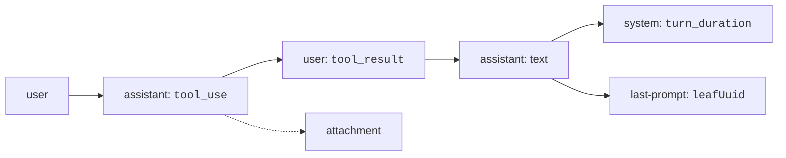

# Transcript Format


A transcript is a text file with one JSON object on each line.
Each object is a message, or a note about the session.
Claude Code appends a line as things happen, so a crash loses little.
The [official docs](https://code.claude.com/docs/en/claude-directory) say the format is internal and changes between versions, so a script that reads it can break.

## At a Glance

| Question | Answer |
| --- | --- |
| Can you use it? | ✅ Yes, read-only. Open the file with `jq` or any JSON Lines reader. |
| Can you change it? | Not safely. Claude Code owns the file. Use `/export` or print mode output for scripts. |
| Can you turn it on or off? | `--no-session-persistence` (print mode) or `CLAUDE_CODE_SKIP_PROMPT_HISTORY` (any mode). |
| Where does it live? | `~/.claude/projects/<project>/<session>.jsonl` |
| Status | [Documented] for the location. [Undocumented] for every line type and field. |

## Where Files Live

Source: [Explore the .claude Directory: Application Data](https://code.claude.com/docs/en/claude-directory#application-data).

- `~/.claude/`
  - `history.jsonl` every prompt you typed
  - `projects/`
    - `<project>/`
      - `<session>.jsonl` the transcript
      - `<session>.orphaned-<time>-<id>.jsonl` set aside, not in the picker
      - `<session>.jsonl.superseded-<time>` set aside, not in the picker
      - `<session>/`
        - `subagents/` one transcript per subagent
        - `tool-results/` large tool outputs and MCP images

The `<project>` name is the folder path with every character other than a letter or a digit changed to `-`.
`CLAUDE_CONFIG_DIR` moves `~/.claude`. See [Sessions and Storage](https://xsyetopz.github.io/claude-code-docs/how-it-works/sessions-and-storage.md) for cleanup and resume rules.

## How the Lines Link

Most lines carry `uuid` and `parentUuid`. The `parentUuid` field points to the line before, so the lines form a chain.
A branch or a rewind makes a second child for one parent. The `last-prompt` line holds a `leafUuid` that marks the tip the picker uses.



## Common Fields

These keys appear on `user`, `assistant`, `attachment`, and `system` lines.

| Field | Status | Meaning |
| --- | --- | --- |
| `type` | [Undocumented] | The line type (see the next section). |
| `uuid` | [Undocumented] | ID of the line. The same in the file and in every later read. |
| `parentUuid` | [Undocumented] | `uuid` of the line before. `null` for the first line. |
| `sessionId` | [Undocumented] | The session ID. Also written as `session_id` on some lines. |
| `timestamp` | [Undocumented] | When Claude Code wrote the line, in ISO form. |
| `cwd` | [Undocumented] | The working folder. |
| `gitBranch` | [Undocumented] | The git branch at the time, if any. |
| `version` | [Undocumented] | The Claude Code version that wrote the line. |
| `entrypoint` | [Undocumented] | The host that started the session, such as `cli` or `sdk-cli`. See [Architecture](https://xsyetopz.github.io/claude-code-docs/how-it-works/architecture.md#where-it-runs). |
| `userType` | [Undocumented] | The kind of user account. |
| `isSidechain` | [Undocumented] | `true` on lines that belong to a subagent branch. |
| `isMeta` | [Undocumented] | `true` on a user-side row the person did not type, such as a reminder. |

## Line Types

All rows are [Undocumented], because no docs page lists the line types.
The key lists come from a transcript that 2.1.304 wrote, and the meanings from the program and its type file where they are clear.

| `type` | Main keys | Meaning |
| --- | --- | --- |
| `user` | `message`, `promptId`, `permissionMode`, `permissionDecision`, `toolUseResult`, `sourceToolAssistantUUID`, `origin`, `promptSource`, `turnOrigin`, `turnPosition` | A user turn or a tool result. |
| `assistant` | `message`, `requestId`, `requestRef`, `requestedModel`, `effort`, `perTurnEffort`, `advisorModel`, `apiBlockIndex` | A reply of the model. |
| `system` | `subtype`, `content`, `level`, `durationMs`, `messageCount` | A note that the model never reads. |
| `attachment` | `attachment`, `rendered`, `renderedRole` | Context that Claude Code adds beside the conversation. |
| `queue-operation` | `operation`, `content`, `commandUuid`, `deliveryId`, `reason` | A prompt or command that waits in the queue. |
| `api-request` | `params`, `shapeHash`, `cacheControl`, `requestDigest`, `querySource`, `base`, `keep`, `tail`, `id` | The shape of one request. |
| `api-request-shape` | `shape`, `shapeHash` | The `system` and `tools` of a request, stored once. |
| `api-request-blob` | `hash`, `message` | A message stored by its hash. |
| `file-history-snapshot` | `messageId`, `snapshot`, `isSnapshotUpdate` | A file checkpoint for rewind. |
| `file-history-delta` | `messageId`, `snapshotMessageId`, `backup`, `trackingPath` | A change to a checkpoint. |
| `last-prompt` | `lastPrompt`, `leafUuid` | The last prompt, for the picker. |
| `ai-title` | `aiTitle` | The title that the model made for the session. |
| `mode` | `mode` | The mode of the session. Seen value: `normal`. |
| `permission-mode` | `permissionMode` | The permission mode. Seen value: `auto`. |
| `cost-state` | `totalCostUSD`, `totalAPIDuration`, `totalAPIDurationWithoutRetries`, `totalToolDuration`, `totalDuration`, `totalLinesAdded`, `totalLinesRemoved`, `modelUsage`, `hasUnknownModelCost`, `startTime` | Totals for cost and time. |
| `atis-latch` | `atis` | A latch value. No source states its purpose. |

Lines of types `file-history-snapshot`, `file-history-delta`, `last-prompt`, `ai-title`, `mode`, `permission-mode`, `cost-state`, `atis-latch`, and `queue-operation` carry `sessionId` but not the chain fields.

### Other Types in the Writer

These names are in the program next to the writer.
No example line was read, so there is no verified meaning.

`custom-title`, `agent-name`, `agent-color`, `agent-setting`, `tag`, `worktree-state`, `pr-link`, `bridge-session`, `content-replacement`, `attribution-snapshot`, `fork-context-ref`, `observer-ref`, `isolation-latch`, `memory-mode`, `proactivity`, `dev-mods`, `language`, `frame-link`, `ended-by-model`, `line-withheld`, and `artifact-autoreact-ledger`.

> **Not Verified:** The meaning of the types in the list above, and of `atis-latch`, is not verified.

## The `message` Object

On `user` and `assistant` lines, `message` holds an API message.

| Field | Where | Meaning |
| --- | --- | --- |
| `role` | both | `user` or `assistant`. |
| `content` | both | A string (a typed prompt), or an array of blocks. |
| `id`, `model`, `type` | assistant | The API message ID, the model that answered, and `message`. |
| `stop_reason`, `stop_sequence`, `stop_details` | assistant | Why the model stopped. Seen values: `tool_use`, `end_turn`. |
| `usage` | assistant | Token counts (next table). |
| `container`, `context_management`, `diagnostics`, `input_transformations` | assistant | Extra fields of the API reply. |

Content block types seen: `text`, `thinking`, `tool_use` (in `assistant` lines), and `text`, `tool_result` (in `user` lines).

### The `usage` Object

| Field | Meaning |
| --- | --- |
| `input_tokens`, `output_tokens` | Tokens read and written. |
| `cache_creation_input_tokens`, `cache_read_input_tokens` | Tokens written to and read from the prompt cache. |
| `cache_creation` | A break-down of cache writes by lifetime. |
| `output_tokens_details`, `iterations` | More detail about output and about repeated passes. |
| `server_tool_use` | Counts of server-side tool calls. |
| `service_tier`, `speed`, `inference_geo` | The tier, the speed mode, and the region of the call. |
| `fallback_credit` | Present when a fallback model answered. |

## `user` Line Fields

| Field | Meaning |
| --- | --- |
| `promptId` | Groups the lines of one prompt. |
| `permissionMode` | The permission mode when the prompt was sent. |
| `permissionDecision` | On a tool result: an object with `decision` (seen: `accept`), `source` (seen: `config`), and `reasonType` (seen: `classifier`, `mode`). |
| `toolUseResult` | The structured result of a tool. Its keys depend on the tool. Seen: `stdout`, `stderr`, `interrupted`, `isImage` for `Bash`; `filePath`, `structuredPatch`, `originalFile`, `userModified` for edits; `agentId`, `status`, `outputFile`, `isAsync` for `Agent`. |
| `sourceToolAssistantUUID` | `uuid` of the assistant line whose `tool_use` this answers. |
| `origin` | Who caused the line. Seen kinds: `human`, `peer` (a subagent hand-back). |
| `promptSource` | How the prompt came in. Seen: `typed`. |
| `turnOrigin`, `turnPosition` | Where the turn came from and its place in the chain. |
| `queueSkipAttachments`, `queueSkipSlashCommands` | Set on queued prompts that skip those steps. |

## `assistant` Line Fields

| Field | Meaning |
| --- | --- |
| `requestId` | The request ID from the API. |
| `requestRef` | A reference to the matching `api-request` line. |
| `requestedModel` | The model Claude Code asked for. The `message.model` field shows the model that answered. |
| `effort`, `perTurnEffort` | The effort level of the call. |
| `advisorModel` | The advisor model, if the advisor tool was on. |
| `apiBlockIndex` | The index of this block in the API reply. One reply can produce several lines. |
| `thinkingDisplay`, `thinkingDurationMs` | How the thinking text was shown, and how long it took. |
| `serverClassifierRequest`, `wireToolInputs`, `wireIngestContext` | Internal fields about classifier calls and tool input on the wire. |

## `system` Subtypes

| `subtype` | Extra keys | Meaning |
| --- | --- | --- |
| `turn_duration` | `durationMs`, `messageCount`, `pendingBackgroundAgentCount` | How long a turn took. |
| `local_command` | `content`, `level`, `commandRun` | The output of a local slash command. |
| `informational` | `content`, `level` | A notice for the user. |
| `compact_boundary` | (see [Context and Compaction](https://xsyetopz.github.io/claude-code-docs/how-it-works/context-and-compaction.md)) | Marks where a compaction replaced the history. |

## `attachment` Types

An `attachment` line holds an object in `attachment` with a `type` key.
Types seen in a 2.1.304 transcript:

| `attachment.type` | Meaning |
| --- | --- |
| `total_tokens_reminder` | A reminder of the token budget. |
| `output_style`, `output_style_instructions` | The active output style. |
| `queued_command` | A prompt that was queued while a turn ran. |
| `nested_memory` | A nested `CLAUDE.md` that was picked up. |
| `skill_listing` | The list of skills. |
| `agent_listing_delta`, `deferred_tools_delta`, `mcp_instructions_delta` | Changes to agents, deferred tools, or MCP instructions. |
| `deferred_tools_record` | A record of deferred tools. |
| `edited_text_file` | A note that a file changed outside the model. |
| `environment`, `date`, `model`, `session_context`, `instructions` | Environment and session facts. |
| `goal_status`, `auto_mode`, `credential_org`, `prompt_snapshot`, `silent_turn_reminder` | State of a goal, auto mode, the account, the prompt snapshot, and a reminder after a silent turn. |

The Mod API type `SessionAppendMessage` lists the `name` of an attachment as `queued_command`, `nested_memory`, and similar, and notice names such as `compact_boundary` and `local_command`.

## `queue-operation` Values

The `operation` key was seen as `enqueue`, `dequeue`, and `remove`. A `remove` line carries `reason`.

## File History Lines

A `file-history-snapshot` line holds `snapshot` with `messageId`, `timestamp`, and `trackedFileBackups`.
`/rewind` and `--rewind-files` use these to restore files. The newest 100 checkpoints are kept.

## `api-request` Lines

The `params` object of an `api-request` line has these keys: `model`, `max_tokens`, `thinking`, `output_config`, `context_management`, `safeguards`, and `betas`.
The `system` and `tools` parts are in a separate `api-request-shape` line with the same `shapeHash`.
Large messages are stored once in `api-request-blob` lines and referred to by hash. See [Request and Cache](https://xsyetopz.github.io/claude-code-docs/how-it-works/request-and-cache.md#body-fields).

## Example

Count the lines by `type` to see what a session holds:

```bash
jq -r .type ~/.claude/projects/<project>/<session>.jsonl | sort | uniq -c
```

List the tools the model called, in order:

```bash
jq -r 'select(.type=="assistant") | .message.content[]? | select(.type=="tool_use") | .name' \
  ~/.claude/projects/<project>/<session>.jsonl
```

> **Warning:** The file is plain text. A secret that a tool prints goes into it.
> Set `cleanupPeriodDays` low, or `CLAUDE_CODE_SKIP_PROMPT_HISTORY`, if that matters to you.

## Related Pages

- [Sessions and Storage](https://xsyetopz.github.io/claude-code-docs/how-it-works/sessions-and-storage.md)
- [Request and Cache](https://xsyetopz.github.io/claude-code-docs/how-it-works/request-and-cache.md)
- [Context and Compaction](https://xsyetopz.github.io/claude-code-docs/how-it-works/context-and-compaction.md)
- [Undocumented Items](https://xsyetopz.github.io/claude-code-docs/reference/undocumented.md)
