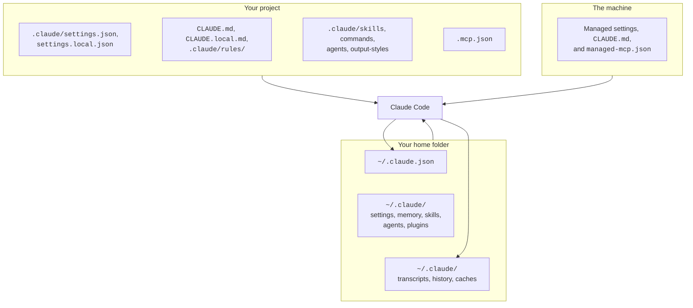

# Files on Disk


Claude Code keeps its state in plain files.
Some you write, such as settings and `CLAUDE.md`. Others Claude Code writes, such as transcripts and caches.
This page lists them by place, says what each one is, and links to the page with the details.

## At a Glance

| Question | Answer |
| --- | --- |
| Can you use it? | ✅ Yes. Open any file listed here in an editor. Most are plain JSON, Markdown, or JSONL. |
| Can you change it? | You edit the files marked "You write". Do not edit the files that Claude Code writes. |
| Can you turn it on or off? | `CLAUDE_CONFIG_DIR` moves `~/.claude`. `cleanupPeriodDays` sets the cleanup age. |
| Where does it live? | `~/.claude/`, `~/.claude.json`, `.claude/` in a project, and managed folders. |
| Status | [Documented] [Undocumented] |

Source: [Explore the .claude Directory](https://code.claude.com/docs/en/claude-directory) and the program.

> **Warning:** The files are not encrypted.
> A secret that a tool prints goes into the transcript, and every prompt you type goes into `history.jsonl`.

## The Big Picture



## Files in a Project

You usually commit these files, except the ones marked local.

| Path | Status | You write? | What it is | Page |
| --- | --- | --- | --- | --- |
| `.claude/settings.json` | [Documented] | ✅ | Shared project settings. | [Settings Files and Scopes](https://xsyetopz.github.io/claude-code-docs/configure/settings.md) |
| `.claude/settings.local.json` | [Documented] | ✅ | Your private project settings. Claude Code adds it to your global git excludes. | [Settings Files and Scopes](https://xsyetopz.github.io/claude-code-docs/configure/settings.md) |
| `CLAUDE.md` or `.claude/CLAUDE.md` | [Documented] | ✅ | Project instructions. Files in the working folder and each folder above it load at launch. | [Memory and Rules](https://xsyetopz.github.io/claude-code-docs/configure/memory-and-rules.md) |
| `CLAUDE.local.md` | [Documented] | ✅ | Private project notes. Add it to `.gitignore`. | [Memory and Rules](https://xsyetopz.github.io/claude-code-docs/configure/memory-and-rules.md) |
| `AGENTS.md` or `.claude/AGENTS.md` | [Documented] | ✅ | Read when no `CLAUDE.md` or `CLAUDE.local.md` is in or above the working folder. | [Memory and Rules](https://xsyetopz.github.io/claude-code-docs/configure/memory-and-rules.md) |
| `.claude/rules/**/*.md` | [Documented] | ✅ | Rules. A `paths` key limits a rule to matching files. | [Memory and Rules](https://xsyetopz.github.io/claude-code-docs/configure/memory-and-rules.md) |
| `<subfolder>/CLAUDE.md` | [Documented] | ✅ | Loads after Claude reads or edits a file in that subfolder. | [Memory and Rules](https://xsyetopz.github.io/claude-code-docs/configure/memory-and-rules.md) |
| `.claude/skills/<name>/SKILL.md` | [Documented] | ✅ | A project skill. | [Skills and Commands](https://xsyetopz.github.io/claude-code-docs/extend/skills-and-commands.md) |
| `.claude/commands/<name>.md` | [Documented] | ✅ | A project slash command. Skills replace this form, but it still loads. | [Slash Commands](https://xsyetopz.github.io/claude-code-docs/extend/skills-and-commands/slash-commands.md) |
| `.claude/agents/*.md` | [Documented] | ✅ | A project subagent. The closest definition wins. | [Subagents](https://xsyetopz.github.io/claude-code-docs/extend/subagents.md) |
| `.claude/agent-memory/` | [Documented] | ❌ | Memory of subagents that set `memory: project`. `memory: local` uses `.claude/agent-memory-local/`. | [Subagent Frontmatter](https://xsyetopz.github.io/claude-code-docs/extend/subagents/frontmatter.md) |
| `.claude/output-styles/*.md` | [Documented] | ✅ | A project output style. | [Output Styles](https://xsyetopz.github.io/claude-code-docs/configure/output-styles.md) |
| `.mcp.json` | [Documented] | ✅ | Project MCP servers. Claude Code asks you to approve them first. | [MCP Config](https://xsyetopz.github.io/claude-code-docs/extend/mcp/config.md) |

## Files in Your Home Folder

`CLAUDE_CONFIG_DIR` moves `~/.claude`. It does not move `~/.claude.json` unless you set the variable.

| Path | Status | You write? | What it is | Page |
| --- | --- | --- | --- | --- |
| `~/.claude.json` | [Documented] | Mostly no | App state, sign-in data, personal and local MCP servers, and per-project state. Claude Code writes it. | [Extra Keys and Global Config](https://xsyetopz.github.io/claude-code-docs/configure/settings/extra-keys.md) |
| `~/.claude/settings.json` | [Documented] | ✅ | Your user settings. | [Settings Files and Scopes](https://xsyetopz.github.io/claude-code-docs/configure/settings.md) |
| `~/.claude/CLAUDE.md` | [Documented] | ✅ | Your personal instructions for every project. | [Memory and Rules](https://xsyetopz.github.io/claude-code-docs/configure/memory-and-rules.md) |
| `~/.claude/rules/*.md` | [Documented] | ✅ | Your personal rules. They load before project rules. | [Memory and Rules](https://xsyetopz.github.io/claude-code-docs/configure/memory-and-rules.md) |
| `~/.claude/skills/<name>/SKILL.md` | [Documented] | ✅ | Your personal skills. | [Skills and Commands](https://xsyetopz.github.io/claude-code-docs/extend/skills-and-commands.md) |
| `~/.claude/skills/synced/` | [Documented] | ❌ | Skills from your claude.ai account. | [Skills and Commands](https://xsyetopz.github.io/claude-code-docs/extend/skills-and-commands.md) |
| `~/.claude/skills/.trash/`, `~/.claude/plugins/.trash/` | [Documented] | ❌ | Synced items that were removed. Kept so you can recover them until the retention sweep deletes them. The sweep uses `cleanupPeriodDays`, which is 30 days by default. | [Skills and Commands](https://xsyetopz.github.io/claude-code-docs/extend/skills-and-commands.md) |
| `~/.claude/commands/` | [Documented] | ✅ | Your personal slash commands. | [Slash Commands](https://xsyetopz.github.io/claude-code-docs/extend/skills-and-commands/slash-commands.md) |
| `~/.claude/agents/*.md` | [Documented] | ✅ | Your personal subagents. | [Subagents](https://xsyetopz.github.io/claude-code-docs/extend/subagents.md) |
| `~/.claude/output-styles/*.md` | [Documented] | ✅ | Your personal output styles. | [Output Styles](https://xsyetopz.github.io/claude-code-docs/configure/output-styles.md) |
| `~/.claude/keybindings.json` | [Documented] | ✅ | Your keyboard shortcuts. Run `/keybindings` to open it. | [Slash Commands](https://xsyetopz.github.io/claude-code-docs/extend/skills-and-commands/slash-commands.md) |
| `~/.claude/agent-memory/` | [Documented] | ❌ | Memory of subagents that set `memory: user`. | [Subagent Frontmatter](https://xsyetopz.github.io/claude-code-docs/extend/subagents/frontmatter.md) |

## Plugins and Marketplaces

Source: [Plugin Loading Reference](https://code.claude.com/docs/en/plugins/loading).

| Path | Status | What it is | Page |
| --- | --- | --- | --- |
| `~/.claude/plugins/` | [Documented] | The plugin root. `CLAUDE_CODE_PLUGIN_CACHE_DIR` sets this parent folder. | [Plugin Loading](https://xsyetopz.github.io/claude-code-docs/extend/plugins/loading.md) |
| `plugins/cache/<marketplace>/<plugin>/<version>/` | [Undocumented] | One copy of each installed version. | [Plugin Loading](https://xsyetopz.github.io/claude-code-docs/extend/plugins/loading.md) |
| `plugins/data/<id>/` | [Documented] | The folder behind `${CLAUDE_PLUGIN_DATA}`. It survives updates. | [Plugin Loading](https://xsyetopz.github.io/claude-code-docs/extend/plugins/loading.md) |
| `plugins/installed_plugins.json` | [Undocumented] | The install records. Claude Code may keep dated `set-aside` or `unreadable` copies. | [Plugin Loading](https://xsyetopz.github.io/claude-code-docs/extend/plugins/loading.md) |
| `plugins/known_marketplaces.json` | [Documented] | The marketplace records. | [Plugin Loading](https://xsyetopz.github.io/claude-code-docs/extend/plugins/loading.md) |
| `plugins/marketplaces/<name>` | [Documented] | A clone of each marketplace. | [Marketplaces](https://xsyetopz.github.io/claude-code-docs/extend/plugins/marketplace.md) |
| `plugins/synced` | [Documented] | Plugins synced from claude.ai. The id is `<name>@synced`. | [Plugin Loading](https://xsyetopz.github.io/claude-code-docs/extend/plugins/loading.md) |
| `<plugin>/.claude-plugin/plugin.json` | [Documented] | The manifest inside a plugin. | [Plugin Manifest](https://xsyetopz.github.io/claude-code-docs/extend/plugins/manifest.md) |
| `.claude-plugin/marketplace.json` | [Documented] | The catalog inside a marketplace repository. | [Marketplaces](https://xsyetopz.github.io/claude-code-docs/extend/plugins/marketplace.md) |
| `<plugin>/hooks/hooks.json` | [Documented] | Hooks and mod modules that a plugin ships. | [Hooks Configuration](https://xsyetopz.github.io/claude-code-docs/extend/hooks/configuration.md) |
| `.claude-plugin/types/` | [Documented] | Type files that Claude Code writes for a mod that you load from a folder. | [Files, Nouns, and Gates](https://xsyetopz.github.io/claude-code-docs/extend/mod-api/nouns-and-gates.md) |

## Sessions and Transcripts

All paths here are under `~/.claude/`.
`<project>` is the project folder path with every character other than a letter or digit turned into `-`.
Source: [Explore the .claude Directory](https://code.claude.com/docs/en/claude-directory).

| Path | Status | What it is | Cleaned by age? |
| --- | --- | --- | --- |
| `projects/<project>/<session>.jsonl` | [Documented] | The transcript of one session. | ✅ |
| `projects/<project>/<session>/subagents/` | [Documented] | Subagent transcripts. | ✅ |
| `projects/<project>/<session>/tool-results/` | [Documented] | Large tool outputs and MCP images. | ✅ |
| `projects/<project>/memory/` | [Documented] | Auto memory. `MEMORY.md` is the index. | ❌ |
| `file-history/<session>/` | [Documented] | Snapshots from before edits, for rewind. | ✅ |
| `plans/` | [Documented] | Plan files from plan mode. | ✅ |
| `tasks/` | [Documented] | Task lists. | ✅ |
| `dev-mods/<session>/` | [Documented] | Mods that Claude wrote during a session. | ✅ |
| `uploads/<session>/` | [Documented] | Files attached from the web or mobile app. | ✅ |
| `debug/` | [Documented] | Debug logs, written while debug logging is on. | ✅ |
| `paste-cache/` | [Documented] | Large pastes. | ✅ |
| `shell-snapshots/`, `session-env/` | [Documented] | Shell setup and per-session metadata. | ✅ |
| `backups/` | [Documented] | Copies of `~/.claude.json`. The five newest stay. | ✅ |
| `sessions/` | [Documented] | One small file for each running session. | ❌ |
| `history.jsonl` | [Documented] | Every prompt you typed, for up-arrow and `Ctrl+R`. | Entries age out |
| `feedback-bundles/`, `feedback/drafts/` | [Documented] | Feedback archives and drafts that you have not sent. | Drafts age out |
| `usage-data/` | [Documented] | Reports from `/insights` and their cached data. | ❌ |

The full list, the retention rules, and the controls are on [Sessions and Storage](https://xsyetopz.github.io/claude-code-docs/how-it-works/sessions-and-storage.md).
The line format of a transcript is on [Transcript Format](https://xsyetopz.github.io/claude-code-docs/reference/transcript-format.md).

## Caches and Account Files

| Path | Status | What it is | Page |
| --- | --- | --- | --- |
| `~/.claude/.credentials.json` | [Documented] | Your login credentials. On macOS, the Keychain holds them, and Claude Code falls back to this file when the Keychain rejects the write. On Linux and Windows, Claude Code uses this file (mode `0600` on Linux). Keep it private and do not delete it. | [Sessions and Storage](https://xsyetopz.github.io/claude-code-docs/how-it-works/sessions-and-storage.md) |
| `~/.claude/stats-cache.json` | [Documented] | Totals shown by `/usage`. | [Sessions and Storage](https://xsyetopz.github.io/claude-code-docs/how-it-works/sessions-and-storage.md) |
| `~/.claude/remote-settings.json` | [Documented] | Cached server-managed settings, or `{}`. | [Enterprise Settings](https://xsyetopz.github.io/claude-code-docs/configure/settings/enterprise.md) |
| `~/.claude/policy-limits.json` | [Documented] | Cached organization limits. Some account types only. | [Enterprise Settings](https://xsyetopz.github.io/claude-code-docs/configure/settings/enterprise.md) |
| `~/.claude/cache/changelog.md` | [Documented] | A cached copy of the [changelog](https://code.claude.com/docs/en/changelog) for `/release-notes`. | [What Changed](https://xsyetopz.github.io/claude-code-docs/start/what-changed.md) |
| `~/.claude/daemon/roster.json`, `~/.claude/jobs/<id>/state.json`, `~/.claude/jobs/<id>/tmp/` | [Documented] | The list of running background sessions, the state of each session, and its scratch folder. Keep them. The official "Agent View" page describes them. | [Sessions and Storage](https://xsyetopz.github.io/claude-code-docs/how-it-works/sessions-and-storage.md) |
| `state/`, `mods/`, `bridge-spawn/`, `seed-admin/`, `downloads/`, `cache/model-catalog/` | [Undocumented] | Seen on a `2.1.304` machine or named in the program. No docs page describes them. The program describes `state/`, `seed-admin/`, `bridge-spawn/`, and `cache/model-catalog/`; see the link. | [Sessions and Storage](https://xsyetopz.github.io/claude-code-docs/how-it-works/sessions-and-storage.md) |

## Managed Files

An administrator puts these on the machine. A user cannot override them.

| Path | Status | What it is | Page |
| --- | --- | --- | --- |
| `managed-settings.json` and `managed-settings.d/*.json` | [Documented] | Organization settings. The folder is next to the file and merges in alphabetical order. | [Settings Files and Scopes](https://xsyetopz.github.io/claude-code-docs/configure/settings.md) |
| Managed `CLAUDE.md` | [Documented] | Organization instructions. A user cannot exclude it. | [Memory and Rules](https://xsyetopz.github.io/claude-code-docs/configure/memory-and-rules.md) |
| `managed-mcp.json` | [Documented] | A fixed set of MCP servers. It gives the organization exclusive control. | [MCP Settings and Policy](https://xsyetopz.github.io/claude-code-docs/extend/mcp/settings.md) |
| Managed skills `<managed dir>/.claude/skills/` | [Documented] | Skills for all users on a machine. They win over personal and project skills. | [Skills and Commands](https://xsyetopz.github.io/claude-code-docs/extend/skills-and-commands.md) |

The folder is `/Library/Application Support/ClaudeCode/` on macOS, `/etc/claude-code/` on Linux and WSL, and `C:\Program Files\ClaudeCode\` on Windows.

## Settings Precedence

When two settings files set the same key, the higher one wins.

```text
1. Managed settings
2. --settings (command line)
3. .claude/settings.local.json
4. .claude/settings.json
5. ~/.claude/settings.json
```

List keys such as `permissions.allow` merge across files.
The exceptions and the merge rules are on [Settings Files and Scopes](https://xsyetopz.github.io/claude-code-docs/configure/settings.md).

## Example

You want to find where Claude Code kept the last session in `/work/app`, and then remove old ones.

```bash
ls ~/.claude/projects/-work-app/
claude purge --dry-run
```

The first command lists the transcripts of that project.
The second shows what `claude purge` would delete, without deleting it.

## Related Pages

- [What Can I Change](https://xsyetopz.github.io/claude-code-docs/start/what-can-i-change.md)
- [Sessions and Storage](https://xsyetopz.github.io/claude-code-docs/how-it-works/sessions-and-storage.md)
- [Settings Files and Scopes](https://xsyetopz.github.io/claude-code-docs/configure/settings.md)
- [Environment Variables for Sessions and Storage](https://xsyetopz.github.io/claude-code-docs/configure/env-vars/sessions-and-storage.md)
