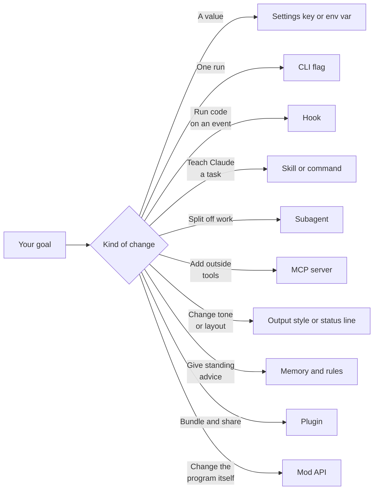

# What Can I Change


Claude Code has many places where you can change how it works.
This page starts from what you want to do, and it points to the right place.
Each row links to the page that lists every key, flag, or field.

## At a Glance

| Question | Answer |
| --- | --- |
| Can you use it? | ✅ Yes. Find your goal in a table below and follow the link. |
| Can you change it? | Every row names the surface that changes the goal. |
| Can you turn it on or off? | The "How" column names the switch. |
| Where does it live? | The pages in Configure, Extend, and How It Works. |
| Status | [Documented] [Undocumented] |

## The Surfaces



| Surface | Use it when | Page |
| --- | --- | --- |
| Settings keys | You want a stored value that stays between sessions. | [Settings Files and Scopes](https://xsyetopz.github.io/claude-code-docs/configure/settings.md) |
| Environment variables | You want a value for a shell, a script, or a CI job. | [Environment Variables](https://xsyetopz.github.io/claude-code-docs/configure/env-vars.md) |
| CLI flags | You want a change for one run only. | [CLI Flags](https://xsyetopz.github.io/claude-code-docs/configure/cli/flags.md) |
| Hooks | You want your own code to run on an event, and maybe block it. | [Hooks](https://xsyetopz.github.io/claude-code-docs/extend/hooks.md) |
| Skills and commands | You want a reusable prompt or a `/name` shortcut. | [Skills and Commands](https://xsyetopz.github.io/claude-code-docs/extend/skills-and-commands.md) |
| Subagents | You want a helper with its own prompt, tools, and model. | [Subagents](https://xsyetopz.github.io/claude-code-docs/extend/subagents.md) |
| Plugins | You want to bundle and share several of these. | [Plugins](https://xsyetopz.github.io/claude-code-docs/extend/plugins.md) |
| MCP servers | You want Claude to use tools from another program or service. | [MCP](https://xsyetopz.github.io/claude-code-docs/extend/mcp.md) |
| Mod API | You want code that changes Claude Code itself, such as new UI or event handlers. | [Mod API Overview](https://xsyetopz.github.io/claude-code-docs/extend/mod-api.md) |

## Behavior and Safety

| I want to ... | Status | How | Page |
| --- | --- | --- | --- |
| Allow or block a tool call without a prompt | [Documented] | `permissions.allow`, `permissions.deny`, and `permissions.ask` rules | [Permission Rules](https://xsyetopz.github.io/claude-code-docs/configure/permissions/rules.md) |
| Start in a different permission mode | [Documented] | `--permission-mode` flag or the `permissions.defaultMode` setting | [Permission Modes](https://xsyetopz.github.io/claude-code-docs/configure/permissions/modes.md) |
| Let a classifier approve safe actions | [Documented] | Auto mode and its rules | [Auto Mode](https://xsyetopz.github.io/claude-code-docs/configure/permissions/auto-mode.md) |
| Limit what shell commands can touch | [Documented] | The `sandbox` settings | [Sandbox](https://xsyetopz.github.io/claude-code-docs/configure/permissions/sandbox.md) |
| Block a command with my own logic | [Documented] | A `PreToolUse` hook | [Hook Events](https://xsyetopz.github.io/claude-code-docs/extend/hooks/events.md) |
| Understand why a call was allowed or asked | [Documented] | Read the flow | [Permission Flow](https://xsyetopz.github.io/claude-code-docs/how-it-works/permission-flow.md) |
| Let managed policy lock a value | [Documented] | Managed settings | [Enterprise Settings](https://xsyetopz.github.io/claude-code-docs/configure/settings/enterprise.md) |

## Models and Cost

| I want to ... | Status | How | Page |
| --- | --- | --- | --- |
| Pick the model | [Documented] | `/model`, `--model`, the `model` setting, or `ANTHROPIC_MODEL` | [Model Settings](https://xsyetopz.github.io/claude-code-docs/configure/settings/model.md) |
| Change how hard the model thinks | [Documented] | The effort and thinking settings | [Models and Effort Variables](https://xsyetopz.github.io/claude-code-docs/configure/env-vars/models-and-effort.md) |
| Use Bedrock, Vertex, or Foundry | [Documented] | Provider variables | [Models and Providers](https://xsyetopz.github.io/claude-code-docs/configure/models-and-providers.md) |
| Change when old messages are summarized | [Documented] | Compaction settings and variables | [Context and Compaction Variables](https://xsyetopz.github.io/claude-code-docs/configure/env-vars/context-and-compaction.md) |
| Understand how a model is chosen | [Documented] | Read the flow | [Models](https://xsyetopz.github.io/claude-code-docs/how-it-works/models.md) |
| Route requests through a proxy or custom CA | [Documented] | Network variables | [Network and Proxy Variables](https://xsyetopz.github.io/claude-code-docs/configure/env-vars/network-and-proxy.md) |

## Instructions and Memory

| I want to ... | Status | How | Page |
| --- | --- | --- | --- |
| Give Claude standing project advice | [Documented] | `CLAUDE.md` | [Memory and Rules](https://xsyetopz.github.io/claude-code-docs/configure/memory-and-rules.md) |
| Apply advice only to some files | [Documented] | A rule file with `paths` in `.claude/rules/` | [Memory and Rules](https://xsyetopz.github.io/claude-code-docs/configure/memory-and-rules.md) |
| Turn off auto memory | [Documented] | `autoMemoryEnabled: false` or `CLAUDE_CODE_DISABLE_AUTO_MEMORY=1` | [Memory and Rules](https://xsyetopz.github.io/claude-code-docs/configure/memory-and-rules.md) |
| Change the tone or style of replies | [Documented] | An output style | [Output Styles](https://xsyetopz.github.io/claude-code-docs/configure/output-styles.md) |
| See the real system prompt | [Undocumented] | Captured prompts on this site | [Prompt Captures](https://xsyetopz.github.io/claude-code-docs/prompts.md) |
| Understand how the prompt is built | [Documented] | Read the build steps | [System Prompt](https://xsyetopz.github.io/claude-code-docs/how-it-works/system-prompt.md) |
| Add text to the system prompt | [Documented] | `--append-system-prompt` | [CLI Flags](https://xsyetopz.github.io/claude-code-docs/configure/cli/flags.md) |

## Tools and Automation

| I want to ... | Status | How | Page |
| --- | --- | --- | --- |
| Run something after every file edit | [Documented] | A `PostToolUse` hook | [Hooks](https://xsyetopz.github.io/claude-code-docs/extend/hooks.md) |
| Add my own `/command` | [Documented] | A skill or a file in `.claude/commands/` | [Skills and Commands](https://xsyetopz.github.io/claude-code-docs/extend/skills-and-commands.md) |
| Start a helper for one kind of task | [Documented] | A file in `.claude/agents/` | [Subagent Frontmatter](https://xsyetopz.github.io/claude-code-docs/extend/subagents/frontmatter.md) |
| Connect a database or an API | [Documented] | `claude mcp add` or `.mcp.json` | [MCP Config](https://xsyetopz.github.io/claude-code-docs/extend/mcp/config.md) |
| Limit which MCP servers may run | [Documented] | MCP allow and deny settings | [MCP Settings and Policy](https://xsyetopz.github.io/claude-code-docs/extend/mcp/settings.md) |
| Run Claude Code from a script | [Documented] | Print mode with `-p` | [Headless Mode](https://xsyetopz.github.io/claude-code-docs/extend/headless.md) |
| Drive it from my own program | [Documented] | Stream JSON and the control protocol | [Control Protocol](https://xsyetopz.github.io/claude-code-docs/extend/headless/control-protocol.md) |
| Share my setup with a team | [Documented] | A plugin and a marketplace | [Plugin Marketplaces](https://xsyetopz.github.io/claude-code-docs/extend/plugins/marketplace.md) |

## Screen and Terminal

| I want to ... | Status | How | Page |
| --- | --- | --- | --- |
| Show my own status line | [Documented] | The `statusLine` setting | [Status Line](https://xsyetopz.github.io/claude-code-docs/configure/status-line.md) |
| Change theme, spinner, or notices | [Documented] | Interface settings | [Interface Settings](https://xsyetopz.github.io/claude-code-docs/configure/settings/ui.md) |
| Change terminal behavior with variables | [Documented] | UI and terminal variables | [UI and Terminal Variables](https://xsyetopz.github.io/claude-code-docs/configure/env-vars/ui-and-terminal.md) |
| Change keyboard shortcuts | [Documented] | `/keybindings` opens `~/.claude/keybindings.json` | [Slash Commands](https://xsyetopz.github.io/claude-code-docs/extend/skills-and-commands/slash-commands.md) |
| Add a screen element or dialog | [Documented] | A mod that uses `$.ui` | [Mod API UI](https://xsyetopz.github.io/claude-code-docs/extend/mod-api/ui.md) |

## Sessions, Files, and Privacy

| I want to ... | Status | How | Page |
| --- | --- | --- | --- |
| Continue or branch an old session | [Documented] | `--continue`, `--resume`, `/branch` | [Sessions and Storage](https://xsyetopz.github.io/claude-code-docs/how-it-works/sessions-and-storage.md) |
| Keep sessions for a shorter time | [Documented] | `cleanupPeriodDays` | [Core Settings](https://xsyetopz.github.io/claude-code-docs/configure/settings/core.md) |
| Stop Claude Code from saving anything | [Documented] | `CLAUDE_CODE_SKIP_PROMPT_HISTORY` or `--no-session-persistence` | [Sessions and Storage](https://xsyetopz.github.io/claude-code-docs/how-it-works/sessions-and-storage.md) |
| Move the whole `~/.claude` folder | [Documented] | `CLAUDE_CONFIG_DIR` | [Files on Disk](https://xsyetopz.github.io/claude-code-docs/start/files-on-disk.md) |
| Turn off telemetry or debug output | [Documented] | Telemetry variables | [Telemetry and Debug Variables](https://xsyetopz.github.io/claude-code-docs/configure/env-vars/telemetry-and-debug.md) |
| Know where a file lives | [Documented] | The file map | [Files on Disk](https://xsyetopz.github.io/claude-code-docs/start/files-on-disk.md) |

## What You Cannot Change

Some parts are fixed in the program.
You cannot edit the built-in tools, the permission engine, or the request format from a setting.
You can still watch or shape them with a hook or a mod.
The [Architecture](https://xsyetopz.github.io/claude-code-docs/how-it-works/architecture.md) and [Agent Loop](https://xsyetopz.github.io/claude-code-docs/how-it-works/agent-loop.md) pages show where each part sits.

> **Warning:** Do not use [Undocumented] items in shared setups without a plan.
> They can change in any release without notice.

## Example

You want Claude to run your formatter after each edit and to ask before it runs `git push`.
Two small settings do both.

```json title=".claude/settings.json"
{
  "permissions": {
    "ask": ["Bash(git push:*)"]
  },
  "hooks": {
    "PostToolUse": [
      {
        "matcher": "Edit|Write",
        "hooks": [{ "type": "command", "command": "bunx prettier --write ." }]
      }
    ]
  }
}
```

The first part is a permission rule. The second part is a hook. Both live in the shared project settings file.

## Related Pages

- [How to Read These Docs](https://xsyetopz.github.io/claude-code-docs/start/how-to-read.md)
- [Files on Disk](https://xsyetopz.github.io/claude-code-docs/start/files-on-disk.md)
- [Environment Variable Groups](https://xsyetopz.github.io/claude-code-docs/configure/env-vars/features-and-toggles.md)
- [Undocumented Items](https://xsyetopz.github.io/claude-code-docs/reference/undocumented.md)
